# Icon catalog — every icon and small illustration in Pantheon Realms

Generated by `npm run icons:catalog` from the game itself (content `content-0.8.0`, 2026-10-03). Do not edit by hand: change the content or `tools/assets/icon-catalog/briefs.ts` and run it again. **786 entries** in 12 sections; **246** have no art of their own yet (only a glyph, a stand-in or a generated placeholder) and are marked *now*. The same list, with thumbnails of what the game shows today and a Status column for production, is in [`assets-source/icons/ICON_CATALOG.xlsx`](assets-source/icons/ICON_CATALOG.xlsx) (and [`icon_catalog.csv`](assets-source/icons/icon_catalog.csv)).

## How to deliver an icon

1. Draw it to the size in its section (larger masters are welcome; keep a copy in `assets-source/icons/masters/`).
2. Name the PNG exactly as its **asset ID** plus `.png` (for example `icon.spell.rune_of_tyr.png`).
3. Put it in `assets-source/icons/final/` and run `npm run icons:import`: it is checked against this catalog, sized for the game, copied to `assets-runtime/ui/icons/final/` and registered in `assets-runtime/ui/final-manifest.json`. The game shows it in place of the stand-in by asset ID — no screen changes (ASSET_PIPELINE.md §11).
4. Run `npm run icons:catalog` again: the entry shows the new art and leaves the *now* list.

Interface icons that have only a glyph today (asset IDs `icon.ui.<name>`) and spells, artifacts, skills, portraits and emblems are picked up the same way. So are artifact-set emblems (`icon.set.*`, the set badges on the hero screen) and creature-ability badges (`icon.ability.*`, on army slots, creature details and the Encyclopedia): until they are delivered the game shows a clearly temporary stand-in (a coloured gem; the nearest interface glyph).

## Style guide

* **Look:** Painted metal-and-enamel icons in the style of the delivered interface art (assets-source/ui/sheets/resource-status-icon-pack.png): warm gold rims, deep blue and bronze, soft top-left light, a subtle dark outline so the icon reads on dark panels.
* **Background:** Transparent PNG, no baked-in frame or square backdrop (the game draws sockets, frames and rarity borders).
* **Readability:** Must read at 24 px (resource bar, cost lists) and look good at 96–128 px (hero screen, encyclopedia). One clear silhouette, no text or letters.
* **Palette:** Shared icons stay neutral (gold, bronze, ivory, deep blue). Pantheon icons use the pantheon accent: Greek #3b73d9, Norse #7fb3d9, Egyptian #2aa3a8, Japanese #d0453f, Celtic #4f9f5c, Mesoamerican #d9772f (each pantheon’s theme accent).
* **Naming:** Name each file exactly as its asset ID plus .png (for example icon.spell.rune_of_tyr.png). Delivered files replace the stand-ins by asset ID only — no screen changes (ASSET_PIPELINE.md §11).
* **Originality:** Original designs only: no logos, no characters or symbols from other games, films or brands.

## Contents

| Section | Entries | Without art yet (*now*) | Size |
|---|---:|---:|---|
| [Interface icons](#interface) | 60 | 0 | 96 × 96 px PNG, transparent (menu icons 192 px) |
| [Map markers](#markers) | 30 | 0 | 96 × 96 px PNG, transparent |
| [Spells](#spells) | 54 | 0 | 128 × 128 px PNG, transparent, round-socket safe (keep the subject inside a 110 px circle) |
| [Artifacts](#artifacts) | 79 | 0 | 128 × 128 px PNG, transparent, object fills ~80 % |
| [Artifact sets](#sets) | 10 | 0 | 96 × 96 px PNG, transparent |
| [Hero skills](#skills) | 17 | 0 | 96 × 96 px PNG, transparent |
| [Divine interventions](#interventions) | 14 | 0 | 96 × 96 px PNG, transparent |
| [Creature abilities](#abilities) | 14 | 0 | 64 × 64 px PNG, transparent |
| [Effect and status icons](#effects) | 20 | 0 | 96 × 96 px PNG, transparent |
| [Portraits (heroes, story characters, gods)](#portraits) | 138 | 138 | 256 × 256 px PNG (shown at 48–160 px) |
| [Creature portraits](#creatures) | 102 | 102 | 256 × 256 px PNG |
| [Emblems, buildings and thumbnails](#illustrations) | 248 | 6 | emblems 256 px; thumbnails 640 × 360 px |

## Interface icons

Every icon name the interface draws through `Icon` (`packages/ui/src/assets/icons.tsx`). Names with art today show the owner-supplied art; the rest show a simple SVG glyph and are the first to replace. Asset IDs starting `icon.ui.` are the IDs for icons that have no art yet: art delivered under that ID replaces the glyph automatically (`iconArt`). **Size:** 96 × 96 px PNG, transparent (menu icons 192 px).

| Now | Asset ID (deliver as) | Name | Shown on | Today | What to draw |
|---|---|---|---|---|---|
| 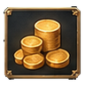 | `icon.res.gold` | gold Interface | Costs and rewards (every screen); Kingdom overview; Resource bar (adventure, town); Town | Placeholder art — assets-runtime/ui/icons/res.gold.png | Gold — a small stack of thick gold coins. |
| 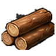 | `icon.res.wood` | wood Interface | Costs and rewards (every screen); Resource bar (adventure, town) | Placeholder art — assets-runtime/ui/icons/res.wood.png | Wood — a bundle of three cut logs tied with rope. |
| 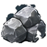 | `icon.res.stone` | stone Interface | Costs and rewards (every screen); Resource bar (adventure, town) | Placeholder art — assets-runtime/ui/icons/res.stone.png | Stone — two squared, quarried stone blocks. |
| 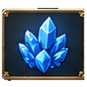 | `icon.res.crystal` | crystal Interface | Costs and rewards (every screen); Resource bar (adventure, town) | Placeholder art — assets-runtime/ui/icons/res.crystal.png | Crystal — a cluster of glowing violet-blue crystals. |
|  | `icon.res.favor` | favor Interface | Adventure map; Battle; Costs and rewards (every screen); Map dialogs (camps, events, sites); Pantheon; Resource bar (adventure, town); Town | Placeholder art — assets-runtime/ui/icons/res.favor.png | Favor — a radiant laurel around a small sacred flame (divine favor). |
| 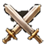 | `icon.stat.attack` | attack Interface | Adventure map; Artifact fallback glyph (hero screen, merchant, encyclopedia); Battle; Dialogs (briefing, debrief, pause, save/load, encounters); Encyclopedia; Hero screen | Placeholder art — assets-runtime/ui/icons/stat.attack.png | Attack — a sword blade pointing up-right. |
| 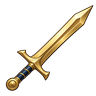 | `icon.ui.sword2` | sword2 Interface | Ability badge stand-in (army slots, creature details, encyclopedia) until the ability icon exists; Battle | Final art — assets-runtime/ui/icons/final/icon.ui.sword2.png | Melee — a single straight sword. |
| 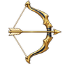 | `icon.ui.bow` | bow Interface | Ability badge stand-in (army slots, creature details, encyclopedia) until the ability icon exists | Final art — assets-runtime/ui/icons/final/icon.ui.bow.png | Ranged — a drawn bow. |
|  | `icon.stat.defense` | defense Interface | Ability badge stand-in (army slots, creature details, encyclopedia) until the ability icon exists; Adventure map; Artifact fallback glyph (hero screen, merchant, encyclopedia); Battle; Encyclopedia; Hero screen | Placeholder art — assets-runtime/ui/icons/stat.defense.png | Defense — a round shield with a boss. |
|  | `icon.stat.hp` | hp Interface | Encyclopedia | Placeholder art — assets-runtime/ui/icons/stat.hp.png | Health — a heart with a small cross. |
|  | `icon.stat.damage` | damage Interface | Ability badge stand-in (army slots, creature details, encyclopedia) until the ability icon exists; Battle; Encyclopedia | Placeholder art — assets-runtime/ui/icons/stat.damage.png | Damage — a jagged impact burst on a blade edge. |
| 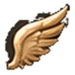 | `icon.stat.speed` | speed Interface | Ability badge stand-in (army slots, creature details, encyclopedia) until the ability icon exists; Artifact fallback glyph (hero screen, merchant, encyclopedia); Battle; Encyclopedia | Placeholder art — assets-runtime/ui/icons/stat.speed.png | Speed — a winged boot. |
| 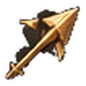 | `icon.stat.shots` | shots Interface | Battle | Placeholder art — assets-runtime/ui/icons/stat.shots.png | Shots — a quiver with arrows. |
| 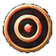 | `icon.stat.range` | range Interface | Battle | Placeholder art — assets-runtime/ui/icons/stat.range.png | Shooting range — a drawn bow with a dotted arc ending in a small target. |
|  | `icon.ui.growth` | growth Interface | Map dialogs (camps, events, sites) | Final art — assets-runtime/ui/icons/final/icon.ui.growth.png | Weekly growth — a sprouting seedling with an upward arrow. |
| 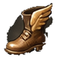 | `icon.stat.movement` | movement Interface | Adventure map; Artifact fallback glyph (hero screen, merchant, encyclopedia); Hero screen | Placeholder art — assets-runtime/ui/icons/stat.movement.png | Movement — a boot print on a path. |
|  | `icon.stat.mana` | mana Interface | Adventure map; Hero screen | Placeholder art — assets-runtime/ui/icons/stat.mana.png | Mana — a blue droplet of light. |
| 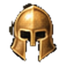 | `icon.stat.morale` | morale Interface | Ability badge stand-in (army slots, creature details, encyclopedia) until the ability icon exists; Hero screen | Placeholder art — assets-runtime/ui/icons/stat.morale.png | Morale — a raised banner with a laurel. |
| 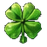 | `icon.stat.luck` | luck Interface | Artifact fallback glyph (hero screen, merchant, encyclopedia); Hero screen | Placeholder art — assets-runtime/ui/icons/stat.luck.png | Luck — a four-leaf clover on a coin. |
|  | `icon.stat.power` | power Interface | Adventure map; Artifact fallback glyph (hero screen, merchant, encyclopedia); Hero screen | Placeholder art — assets-runtime/ui/icons/stat.power.png | Spell power — an open hand with a star of light. |
|  | `icon.stat.knowledge` | knowledge Interface | Adventure map; Artifact fallback glyph (hero screen, merchant, encyclopedia); Hero screen | Placeholder art — assets-runtime/ui/icons/stat.knowledge.png | Knowledge — an open scroll with a quill. |
|  | `icon.stat.xp` | xp Interface | Hero screen | Placeholder art — assets-runtime/ui/icons/stat.xp.png | Experience — a star with a small plus sign. |
| 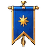 | `icon.world.hero` | hero Interface | Adventure map; Kingdom overview; Town | Placeholder art — assets-runtime/ui/icons/world.hero.png | Hero — a helmeted bust in profile. |
| 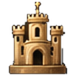 | `icon.world.town` | town Interface | Adventure map; Dialogs (briefing, debrief, pause, save/load, encounters); Kingdom overview | Placeholder art — assets-runtime/ui/icons/world.town.png | Town — a walled town with a gate and two towers. |
|  | `icon.ui.journal` | journal Interface | Adventure map; Battle; Dialogs (briefing, debrief, pause, save/load, encounters); Hero screen | Final art — assets-runtime/ui/icons/final/icon.ui.journal.png | Journal — a bound quest book with a ribbon marker. |
| 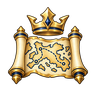 | `icon.ui.overview` | overview Interface | Adventure map | Final art — assets-runtime/ui/icons/final/icon.ui.overview.png | Kingdom overview — an unrolled map with a small crown. |
|  | `icon.menu.encyclopedia` | bestiary Interface | Adventure map; Dialogs (briefing, debrief, pause, save/load, encounters); Encyclopedia; Main menu; Recruitment | Placeholder art — assets-runtime/icons/menu-encyclopedia.png | Encyclopedia — an open book with a creature silhouette. |
| 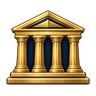 | `icon.ui.pantheon` | pantheon Interface | Adventure map; Kingdom overview; Pantheon; Town | Final art — assets-runtime/ui/icons/final/icon.ui.pantheon.png | Pantheon — a temple front with four columns. |
| 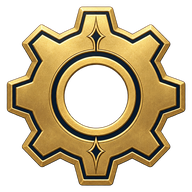 | `icon.menu.settings` | settings Interface | Dialogs (briefing, debrief, pause, save/load, encounters); Main menu | Placeholder art — assets-runtime/icons/menu-settings.png | Settings — a gear wheel. |
| 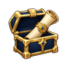 | `icon.ui.save` | save Interface | Dialogs (briefing, debrief, pause, save/load, encounters) | Final art — assets-runtime/ui/icons/final/icon.ui.save.png | Save — a sealed scroll going into a chest. |
| 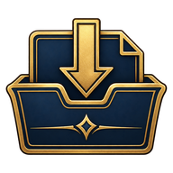 | `icon.menu.load-game` | load Interface | Dialogs (briefing, debrief, pause, save/load, encounters); Main menu | Placeholder art — assets-runtime/icons/menu-load-game.png | Load — a tray with an arrow lifting out. |
| 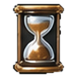 | `icon.time.day` | hourglass Interface | Adventure map; Shared game widgets (resource bar, costs, stat blocks); Town | Placeholder art — assets-runtime/ui/icons/time.day.png | Day / end of turn — an hourglass. |
|  | `icon.ui.back` | back Interface | Dialogs (briefing, debrief, pause, save/load, encounters); Hero screen; New game / setup; Results / high scores; Shared game widgets (resource bar, costs, stat blocks) | Final art — assets-runtime/ui/icons/final/icon.ui.back.png | Back — a curved arrow pointing left. |
|  | `icon.ui.close` | close Interface | Adventure map; Battle; Journal; Shared controls (every screen) | Final art — assets-runtime/ui/icons/final/icon.ui.close.png | Close — an X of two strokes. |
| 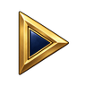 | `icon.ui.play` | play Interface | Battle; Creature detail; Dialogs (briefing, debrief, pause, save/load, encounters); Random map setup | Final art — assets-runtime/ui/icons/final/icon.ui.play.png | Play — a right-pointing triangle. |
| 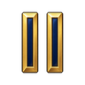 | `icon.ui.pause` | pause Interface | Adventure map; Battle; Creature detail | Final art — assets-runtime/ui/icons/final/icon.ui.pause.png | Pause — two vertical bars. |
| 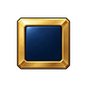 | `icon.ui.stop` | stop Interface | Creature detail | Final art — assets-runtime/ui/icons/final/icon.ui.stop.png | Stop — a square. |
| 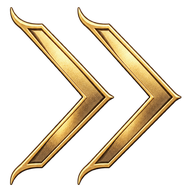 | `icon.menu.continue` | continue Interface | Ability badge stand-in (army slots, creature details, encyclopedia) until the ability icon exists; Hero screen; Main menu | Placeholder art — assets-runtime/icons/menu-continue.png | Continue — a double chevron pointing right. |
| 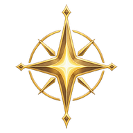 | `icon.menu.new-game` | newgame Interface | Dialogs (briefing, debrief, pause, save/load, encounters); Main menu; Random map setup | Placeholder art — assets-runtime/icons/menu-new-game.png | New game — a four-point star. |
| 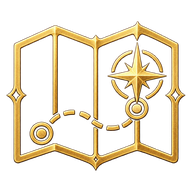 | `icon.menu.campaign` | campaign Interface | Main menu; New game / setup | Placeholder art — assets-runtime/icons/menu-campaign.png | Campaign — a map with a dotted route. |
| 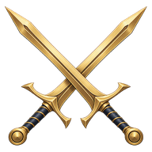 | `icon.menu.skirmish` | skirmish Interface | Main menu; New game / setup | Placeholder art — assets-runtime/icons/menu-skirmish.png | Skirmish — two crossed swords. |
| 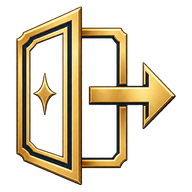 | `icon.menu.quit` | quit Interface | Dialogs (briefing, debrief, pause, save/load, encounters); Main menu | Placeholder art — assets-runtime/icons/menu-quit.png | Quit — a door with an arrow leaving it. |
|  | `icon.menu.credits` | credits Interface | Main menu | Placeholder art — assets-runtime/icons/menu-credits.png | Credits — a laurel wreath around a small “i” mark (no letters if possible: a quill instead). |
| 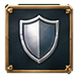 | `icon.action.defend` | defend Interface | Ability badge stand-in (army slots, creature details, encyclopedia) until the ability icon exists; Battle | Placeholder art — assets-runtime/ui/icons/action.defend.png | Defend (battle action) — a shield raised in front of a figure. |
| 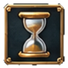 | `icon.action.wait` | wait Interface | Battle | Placeholder art — assets-runtime/ui/icons/action.wait.png | Wait (battle action) — a small hourglass beside a raised hand. |
| 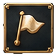 | `icon.action.retreat` | retreat Interface | Battle; Dialogs (briefing, debrief, pause, save/load, encounters) | Placeholder art — assets-runtime/ui/icons/action.retreat.png | Retreat — a banner turned backwards with an arrow. |
| 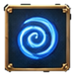 | `icon.action.spell` | spell Interface | Battle; Hero screen | Placeholder art — assets-runtime/ui/icons/action.spell.png | Cast a spell — an open spellbook with a spark above it. |
| 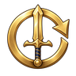 | `icon.ui.auto` | auto Interface | Battle | Final art — assets-runtime/ui/icons/final/icon.ui.auto.png | Auto-combat — a sword inside a circular arrow. |
|  | `icon.ui.upgrade` | upgrade Interface | Ability badge stand-in (army slots, creature details, encyclopedia) until the ability icon exists | Final art — assets-runtime/ui/icons/final/icon.ui.upgrade.png | Upgrade — a double up-chevron. |
|  | `icon.ui.lock` | lock Interface | Hero screen; Journal; Town | Final art — assets-runtime/ui/icons/final/icon.ui.lock.png | Locked — a padlock. |
|  | `icon.ui.check` | check Interface | Adventure map; Dialogs (briefing, debrief, pause, save/load, encounters); Journal | Final art — assets-runtime/ui/icons/final/icon.ui.check.png | Done — a check mark. |
|  | `icon.ui.info` | info Interface | Hero screen | Final art — assets-runtime/ui/icons/final/icon.ui.info.png | Information — a small circle with an inner dot and stroke. |
|  | `icon.ui.swap` | swap Interface | Ability badge stand-in (army slots, creature details, encyclopedia) until the ability icon exists; Hero screen | Final art — assets-runtime/ui/icons/final/icon.ui.swap.png | Swap / exchange — two curved arrows chasing each other. |
|  | `icon.ui.flag` | flag Interface | Adventure map; Journal; Kingdom overview | Final art — assets-runtime/ui/icons/final/icon.ui.flag.png | Flag / owner — a pennant on a pole. |
|  | `icon.stat.vision` | eye Interface | Adventure map; Hero screen; Journal; Kingdom overview | Placeholder art — assets-runtime/ui/icons/stat.vision.png | Vision — an open eye. |
| 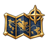 | `icon.ui.map` | map Interface | New game / setup | Final art — assets-runtime/ui/icons/final/icon.ui.map.png | Random map — a folded map with a compass star. |
| 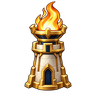 | `icon.ui.beacon` | beacon Interface | Dialogs (briefing, debrief, pause, save/load, encounters) | Final art — assets-runtime/ui/icons/final/icon.ui.beacon.png | Beacon / goal — a stone beacon with a fire. |
|  | `icon.ui.star` | star Interface | Artifact fallback glyph (hero screen, merchant, encyclopedia); Hero screen; Results / high scores; Shared art widgets | Final art — assets-runtime/ui/icons/final/icon.ui.star.png | Star (score, favourite, generic) — a five-point star. |
| 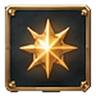 | `icon.action.ability` | ability Interface | Battle | Placeholder art — assets-runtime/ui/icons/action.ability.png | Ability — a burst of light around a hand. |
| 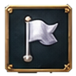 | `icon.action.surrender` | surrender Interface | Battle | Placeholder art — assets-runtime/ui/icons/action.surrender.png | Surrender — a white flag. |

## Map markers

Marker art beside site names (adventure tile panel, Journal). Chosen by the site kind and ownership in `siteMarkerAsset` (`components/art.tsx`). **Size:** 96 × 96 px PNG, transparent.

| Now | Asset ID (deliver as) | Name | Shown on | Today | What to draw |
|---|---|---|---|---|---|
| 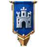 | `icon.marker.town` | Own town Map marker | Adventure map tile panel; Journal objectives | Placeholder art — assets-runtime/ui/icons/marker.town.png | A small walled town with your banner. A town you own |
| 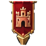 | `icon.marker.hostile-town` | Hostile town Map marker | Adventure map tile panel; Journal objectives | Placeholder art — assets-runtime/ui/icons/marker.hostile-town.png | A walled town under a red banner. A town owned by another empire |
| 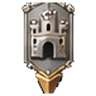 | `icon.marker.neutral-town` | Neutral town Map marker | Adventure map tile panel; Journal objectives | Placeholder art — assets-runtime/ui/icons/marker.neutral-town.png | A walled town with a grey banner. An unowned town |
| 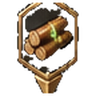 | `icon.marker.sawmill` | Sawmill Map marker | Adventure map tile panel; Journal objectives | Placeholder art — assets-runtime/ui/icons/marker.sawmill.png | A saw blade over a log. Sawmill (wood mine) |
| 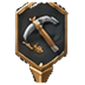 | `icon.marker.quarry` | Quarry Map marker | Adventure map tile panel; Journal objectives | Placeholder art — assets-runtime/ui/icons/marker.quarry.png | A pick against a stone block. Quarry (stone mine) |
| 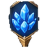 | `icon.marker.crystal` | Crystal Map marker | Adventure map tile panel; Journal objectives | Placeholder art — assets-runtime/ui/icons/marker.crystal.png | A single crystal shard. Crystal deposit, or a pickup of crystal only |
| 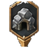 | `icon.marker.mine` | Gold mine Map marker | Adventure map tile panel; Journal objectives | Placeholder art — assets-runtime/ui/icons/marker.mine.png | A mine entrance with a cart of gold. Gold mine |
| 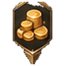 | `icon.marker.gold` | Gold pickup Map marker | Adventure map tile panel; Journal objectives | Placeholder art — assets-runtime/ui/icons/marker.gold.png | A small heap of coins. A pickup of gold only |
| 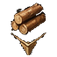 | `icon.marker.wood` | Wood pickup Map marker | Adventure map tile panel; Journal objectives | Placeholder art — assets-runtime/ui/icons/marker.wood.png | A pile of logs. A pickup of wood only |
| 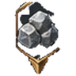 | `icon.marker.stone` | Stone pickup Map marker | Adventure map tile panel; Journal objectives | Placeholder art — assets-runtime/ui/icons/marker.stone.png | A pile of stones. A pickup of stone only |
| 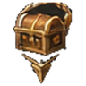 | `icon.marker.chest` | Treasure Map marker | Adventure map tile panel; Journal objectives | Placeholder art — assets-runtime/ui/icons/marker.chest.png | A treasure chest. A pickup with mixed rewards |
|  | `icon.marker.artifact` | Artifact Map marker | Adventure map tile panel; Journal objectives | Placeholder art — assets-runtime/ui/icons/marker.artifact.png | A glowing relic on a plinth. A pickup that holds an artifact |
| 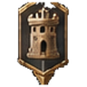 | `icon.marker.watchtower` | Watchtower Map marker | Adventure map tile panel; Journal objectives | Placeholder art — assets-runtime/ui/icons/marker.watchtower.png | A tall wooden lookout tower. Watchtower / lookout |
|  | `icon.marker.locked` | Guarded crossing / gate Map marker | Adventure map tile panel; Journal objectives | Placeholder art — assets-runtime/ui/icons/marker.locked.png | A closed gate with a padlock. A crossing or gate not yet opened |
|  | `icon.marker.quest` | Landmark Map marker | Adventure map tile panel; Journal objectives | Placeholder art — assets-runtime/ui/icons/marker.quest.png | A scroll with a seal. A story landmark (nest, refuge, ruin) |
|  | `icon.marker.story` | Goal Map marker | Adventure map tile panel; Journal objectives | Placeholder art — assets-runtime/ui/icons/marker.story.png | A stone beacon with a flame. A beacon, rune-stone or relay to activate |
|  | `icon.marker.creature` | Creature camp Map marker | Adventure map tile panel; Journal objectives | Placeholder art — assets-runtime/ui/icons/marker.creature.png | A tent with a creature’s paw print. A camp that sells creatures |
|  | `icon.marker.question` | Map event Map marker | Adventure map tile panel; Journal objectives | Placeholder art — assets-runtime/ui/icons/marker.question.png | A question mark made of light over a road. A one-time choice not yet taken |
|  | `icon.marker.shrine` | Relic shrine Map marker | Adventure map tile panel; Journal objectives | Placeholder art — assets-runtime/ui/icons/marker.shrine.png | A small shrine with a flame. The hold-the-relic shrine |
|  | `icon.marker.portal` | Two-way portal Map marker | Adventure map tile panel; Journal objectives | Placeholder art — assets-runtime/ui/icons/marker.portal.png | An arch of standing stones around a violet veil. A two-way portal (random maps; a hero who stops on it steps out of its twin) |
| — | `icon.marker.learning-stone` | Learning stone Map marker | Adventure map tile panel; Journal objectives | Generated placeholder / text — no art | A carved standing stone with a glowing rune. A standing stone that grants experience once per hero (random maps) |
| — | `icon.marker.spell-shrine` | Spell shrine Map marker | Adventure map tile panel; Journal objectives | Generated placeholder / text — no art | A small open shrine with a floating spell scroll. A shrine that teaches one spell to heroes with a spellbook (random maps) |
| — | `icon.marker.skill-trainer` | Skill trainer Map marker | Adventure map tile panel; Journal objectives | Generated placeholder / text — no art | A training post with crossed practice staves. A mentor who teaches or improves one skill (random maps) |
| — | `icon.marker.quest-hut` | Quest hut Map marker | Adventure map tile panel; Journal objectives | Generated placeholder / text — no art | A thatched hut with a hanging notice scroll. A hut that rewards bringing resources or defeating a guard (random maps) |
| — | `icon.marker.key-tent` | Key tent Map marker | Adventure map tile panel; Journal objectives | Generated placeholder / text — no art | A small pointed tent with a key on its flap; light neutral colours so it can be tinted. A coloured tent that gives its colour’s key (the marker is tinted by key colour) |
| — | `icon.marker.key-gate` | Key gate Map marker | Adventure map tile panel; Journal objectives | Generated placeholder / text — no art | A barred gate with a keyhole seal; light neutral colours so it can be tinted. A coloured gate that opens for players holding the matching key (tinted by key colour) |
| — | `icon.marker.windmill` | Windmill Map marker | Adventure map tile panel; Journal objectives | Generated placeholder / text — no art | A small windmill with a sack at its door. A windmill whose stores refill each week (random maps) |
| — | `icon.marker.prison` | Prison Map marker | Adventure map tile panel; Journal objectives | Generated placeholder / text — no art | A stone cell door with iron bars. A prison holding a captive hero (random maps) |
|  | `icon.marker.check` | Done Map marker | Adventure map tile panel; Journal objectives | Placeholder art — assets-runtime/ui/icons/marker.check.png | A check mark in a ring. A site already cleared, visited or activated |
|  | `icon.marker.unknown` | Unknown Map marker | Adventure map tile panel; Journal objectives | Placeholder art — assets-runtime/ui/icons/marker.unknown.png | A question mark. Anything else |

## Spells

54 spells. Each spell has its own icon ID; until it exists the game shows the icon of its effect family (`SPELL_EFFECT_ART`). Pantheon spells should carry their pantheon's palette; shared spells stay neutral. **Size:** 128 × 128 px PNG, transparent, round-socket safe (keep the subject inside a 110 px circle).

| Now | Asset ID (deliver as) | Name | Pantheon | Shown on | Today | What to draw |
|---|---|---|---|---|---|---|
|  | `icon.spell.blessing` | Blessing Spell · tier 1 | Shared | Spellbook; Battle spell choice (when several can be cast); Encyclopedia | Final art — assets-runtime/ui/icons/final/icon.spell.blessing.png | Blessing: a weapon edge glowing white-hot. A priest touches a spear-point and names a god. Battle · 4 mana · target ally stack · Ally rolls its maximum damage through the current and next round. |
|  | `icon.spell.far_sight` | Far Sight Spell · tier 1 | Shared | Spellbook; Adventure map cast buttons; Encyclopedia | Final art — assets-runtime/ui/icons/final/icon.spell.far_sight.png | Far Sight: an eye opening over a map. Shepherds’ magic: look at a hill long enough and you can see what grazes on its far side. Adventure · 5 mana · target known tile · Adventure only: reveal radius 2 around a known tile until next dawn. · expanded content |
|  | `icon.spell.hearthlight` | Hearthlight Spell · tier 1 | Shared | Spellbook; Battle spell choice (when several can be cast); Encyclopedia | Final art — assets-runtime/ui/icons/final/icon.spell.hearthlight.png | Hearthlight: a warm light closing a wound. A glow like the fire of home, carried into the field. Battle · 4 mana · target ally stack · Heal up to 12 + 4 × Power of the front creature’s missing HP; no resurrection. · expanded content |
|  | `icon.spell.ill_omen` | Ill Omen Spell · tier 1 | Shared | Spellbook; Battle spell choice (when several can be cast); Encyclopedia | Final art — assets-runtime/ui/icons/final/icon.spell.ill_omen.png | Ill Omen: a thread being cut short, a weapon dulled. Every army has a soldier who sees a crow on the left and loses heart. Battle · 5 mana · target enemy stack · Enemy stack rolls its minimum damage through the current and next round (a Blessing on it cancels out). · expanded content |
|  | `icon.spell.shield_of_faith` | Shield of Faith Spell · tier 1 | Shared | Spellbook; Battle spell choice (when several can be cast); Encyclopedia | Final art — assets-runtime/ui/icons/final/icon.spell.shield_of_faith.png | Shield of Faith: a shield wall turning a blade. Priests of every road-shrine teach the same prayer: not for victory, only that the next blow land a little lighter. Battle · 5 mana · target ally stack · Ally takes ×0.8 damage from melee strikes through the current and next round. · expanded content |
|  | `icon.spell.spark` | Spark Spell · tier 1 | Shared | Spellbook; Battle spell choice (when several can be cast); Encyclopedia | Final art — assets-runtime/ui/icons/final/icon.spell.spark.png | Spark: a bolt or burst striking one target. The first thing every apprentice learns: a crack of light between two fingers, thrown hard. Battle · 4 mana · target enemy stack · Enemy stack takes 10 + 5 × Power direct damage. |
|  | `icon.spell.swiftness` | Swiftness Spell · tier 1 | Shared | Spellbook; Battle spell choice (when several can be cast); Encyclopedia | Final art — assets-runtime/ui/icons/final/icon.spell.swiftness.png | Swiftness: winged light at a runner’s heels. Spoken over a soldier’s feet, it makes the ground feel like a downhill road. Battle · 4 mana · target ally stack · Ally +2 Speed through the current and next round. · expanded content |
|  | `icon.spell.warcry` | War Cry Spell · tier 1 | Shared | Spellbook; Battle spell choice (when several can be cast); Encyclopedia | Final art — assets-runtime/ui/icons/final/icon.spell.warcry.png | War Cry: a weapon wreathed in a golden aura. A shout that is half prayer, half threat. Battle · 4 mana · target ally stack · Ally +3 Attack through the current and next round. |
|  | `icon.spell.ward` | Ward Spell · tier 1 | Shared | Spellbook; Battle spell choice (when several can be cast); Encyclopedia | Final art — assets-runtime/ui/icons/final/icon.spell.ward.png | Ward: a shield of light in front of a warrior. A circle drawn in the air around a company. Battle · 4 mana · target ally stack · Ally +3 Defense through the current and next round. |
|  | `icon.spell.clear_skies` | Clear Skies Spell · tier 2 | Shared | Spellbook; Adventure map cast buttons; Encyclopedia | Final art — assets-runtime/ui/icons/final/icon.spell.clear_skies.png | Clear Skies: an eye opening over a map. Sailors pay well for it: one day without fog, and a whole valley laid out like a map. Adventure · 8 mana · target known tile · Adventure only: reveal radius 4 around a known tile until next dawn. · expanded content |
|  | `icon.spell.ember_burst` | Ember Burst Spell · tier 2 | Shared | Spellbook; Battle spell choice (when several can be cast); Encyclopedia | Final art — assets-runtime/ui/icons/final/icon.spell.ember_burst.png | Ember Burst: an explosion spreading over a small area. A handful of coals from the forge, thrown with a word. Battle · 8 mana · target enemy stack · Enemy stack and every enemy stack beside it take 12 + 5 × Power damage. · expanded content |
|  | `icon.spell.fleet_foot` | Fleet Foot Spell · tier 2 | Shared | Spellbook; Adventure map cast buttons; Encyclopedia | Final art — assets-runtime/ui/icons/final/icon.spell.fleet_foot.png | Fleet Foot: a road unrolling under winged feet. Couriers’ magic: the day stretches a little longer for whoever carries urgent news. Adventure · 6 mana · target self · Adventure only: the caster gains 200 movement points today. · expanded content |
|  | `icon.spell.lightning` | Lightning Spell · tier 2 | Shared | Spellbook; Battle spell choice (when several can be cast); Encyclopedia | Final art — assets-runtime/ui/icons/final/icon.spell.lightning.png | Lightning: a bolt or burst striking one target. The sky-father’s weapon, borrowed for one stroke. Battle · 6 mana · target enemy stack · Enemy stack takes 25 + 10 × Power direct damage. |
|  | `icon.spell.mend` | Mend Spell · tier 2 | Shared | Spellbook; Battle spell choice (when several can be cast); Encyclopedia | Final art — assets-runtime/ui/icons/final/icon.spell.mend.png | Mend: a warm light closing a wound. Field-surgeons’ magic, plain and practical: flesh remembers being whole and is persuaded to be so again. Battle · 5 mana · target ally stack · Heal up to 20 + 5 × Power of the front creature’s missing HP; no resurrection. |
|  | `icon.spell.sapping_touch` | Sapping Touch Spell · tier 2 | Shared | Spellbook; Battle spell choice (when several can be cast); Encyclopedia | Final art — assets-runtime/ui/icons/final/icon.spell.sapping_touch.png | Sapping Touch: a weapon wreathed in a golden aura. The fever-healer’s art turned backwards: instead of drawing sickness out, it pours weariness in. Battle · 6 mana · target enemy stack · Enemy −3 Attack through the current and next round. · expanded content |
|  | `icon.spell.steadfast` | Steadfast Spell · tier 2 | Shared | Spellbook; Battle spell choice (when several can be cast); Encyclopedia | Final art — assets-runtime/ui/icons/final/icon.spell.steadfast.png | Steadfast: a shield of light in front of a warrior. Old sergeants call it the stubborn spell. Battle · 6 mana · target ally stack · Ally +4 Defense through the current and next round. · expanded content |
|  | `icon.spell.veil` | Veil Spell · tier 2 | Shared | Spellbook; Battle spell choice (when several can be cast); Encyclopedia | Final art — assets-runtime/ui/icons/final/icon.spell.veil.png | Veil: arrows deflected by a dome of light. A shimmer in the air like heat over stones. Battle · 6 mana · target ally stack · Ally takes ×0.75 damage from ranged strikes through the current and next round. |
|  | `icon.spell.weariness` | Weariness Spell · tier 2 | Shared | Spellbook; Battle spell choice (when several can be cast); Encyclopedia | Final art — assets-runtime/ui/icons/final/icon.spell.weariness.png | Weariness: winged light at a runner’s heels. Every soldier knows the hour before dawn when the shield gets heavy. Battle · 5 mana · target enemy stack · Enemy −2 Speed through the current and next round (never below 1). · expanded content |
|  | `icon.spell.divine_sight` | Divine Sight Spell · tier 3 | Shared | Spellbook; Adventure map cast buttons; Encyclopedia | Final art — assets-runtime/ui/icons/final/icon.spell.divine_sight.png | Divine Sight: an eye opening over a map. Gods see the whole world at once. Adventure · 10 mana · target known tile · Adventure only: reveal radius 3 around a known tile until next dawn. |
|  | `icon.spell.homecoming` | Homecoming Spell · tier 3 | Shared | Spellbook; Adventure map cast buttons; Encyclopedia | Final art — assets-runtime/ui/icons/final/icon.spell.homecoming.png | Homecoming: a portal back to a town gate. Every hearth remembers the one who left it. Adventure · 14 mana · target self · Adventure only: the caster returns to the nearest town you own; its movement ends for the day. · expanded content |
|  | `icon.spell.leaden_air` | Leaden Air Spell · tier 3 | Shared | Spellbook; Battle spell choice (when several can be cast); Encyclopedia | Final art — assets-runtime/ui/icons/final/icon.spell.leaden_air.png | Leaden Air: a banner of light over a whole army. The air over the enemy turns thick as summer before a storm. Battle · 11 mana · target enemy army · Every enemy stack −1 Speed through the current and next round (never below 1). · expanded content |
|  | `icon.spell.rallying_hymn` | Rallying Hymn Spell · tier 3 | Shared | Spellbook; Battle spell choice (when several can be cast); Encyclopedia | Final art — assets-runtime/ui/icons/final/icon.spell.rallying_hymn.png | Rallying Hymn: a banner of light over a whole army. Every people has a song it sings when the line is about to break. Battle · 10 mana · target friendly army · Every friendly stack +3 Defense through the current round. · expanded content |
|  | `icon.spell.renewal` | Renewal Spell · tier 3 | Shared | Spellbook; Battle spell choice (when several can be cast); Encyclopedia | Final art — assets-runtime/ui/icons/final/icon.spell.renewal.png | Renewal: healing light falling like rain over an army. Springtime, called down for a moment over a battlefield. Battle · 12 mana · target friendly army · The front creature of every friendly stack heals up to 10 + 5 × Power HP (no resurrection). · expanded content |
|  | `icon.spell.starfall` | Starfall Spell · tier 3 | Shared | Spellbook; Battle spell choice (when several can be cast); Encyclopedia | Final art — assets-runtime/ui/icons/final/icon.spell.starfall.png | Starfall: fire or stars falling over an enemy army. On the night the old gods quarrelled, stars fell on both their armies. Battle · 14 mana · target enemy army · Every enemy stack takes 10 + 4 × Power damage. · expanded content |
|  | `icon.spell.bramble_snare` | Bramble Snare Spell · tier 1 | Celtic | Spellbook; Battle spell choice (when several can be cast); Encyclopedia | Final art — assets-runtime/ui/icons/final/icon.spell.bramble_snare.png | Bramble Snare: winged light at a runner’s heels. Hawthorn is the fairies’ tree; cut it and it takes revenge. Battle · 4 mana · target enemy stack · Enemy −2 Speed through the current round (never below 1). · expanded content |
|  | `icon.spell.cauldron_of_dagda` | Cauldron of the Dagda Spell · tier 2 | Celtic | Spellbook; Battle spell choice (when several can be cast); Encyclopedia | Final art — assets-runtime/ui/icons/final/icon.spell.cauldron_of_dagda.png | Cauldron of the Dagda: a warm light closing a wound. No one ever left the Dagda’s cauldron hungry. Battle · 7 mana · target ally stack · Heal up to 25 + 6 × Power of the front creature’s missing HP; no resurrection. · expanded content |
|  | `icon.spell.glamour` | Glamour Spell · tier 2 | Celtic | Spellbook; Battle spell choice (when several can be cast); Encyclopedia | Final art — assets-runtime/ui/icons/final/icon.spell.glamour.png | Glamour: a weapon wreathed in a golden aura. The Fair Folk’s favourite trick: make a sword look like a stick, a captain like a fool. Battle · 6 mana · target enemy stack · Enemy −3 Attack through the current and next round. · expanded content |
|  | `icon.spell.mist_of_manannan` | Mist of Manannán Spell · tier 3 | Celtic | Spellbook; Battle spell choice (when several can be cast); Encyclopedia | Final art — assets-runtime/ui/icons/final/icon.spell.mist_of_manannan.png | Mist of Manannán: a banner of light over a whole army. The sea god hides his islands behind a cloak of mist. Battle · 11 mana · target enemy army · Every enemy stack −2 Speed through the current and next round (never below 1). · expanded content |
|  | `icon.spell.wild_hunt` | Wild Hunt Spell · tier 3 | Celtic | Spellbook; Battle spell choice (when several can be cast); Encyclopedia | Final art — assets-runtime/ui/icons/final/icon.spell.wild_hunt.png | Wild Hunt: an explosion spreading over a small area. Hounds, horns and riders out of the storm. Battle · 13 mana · target enemy stack · Enemy stack and every enemy stack beside it take 25 + 9 × Power damage. · expanded content |
|  | `icon.spell.ankh_of_renewal` | Ankh of Renewal Spell · tier 1 | Egyptian | Spellbook; Battle spell choice (when several can be cast); Encyclopedia | Final art — assets-runtime/ui/icons/final/icon.spell.ankh_of_renewal.png | Ankh of Renewal: a warm light closing a wound. The key of life, held to a wound. Battle · 4 mana · target ally stack · Heal up to 15 + 5 × Power of the front creature’s missing HP; no resurrection. · expanded content |
|  | `icon.spell.eye_of_horus` | Eye of Horus Spell · tier 2 | Egyptian | Spellbook; Adventure map cast buttons; Encyclopedia | Final art — assets-runtime/ui/icons/final/icon.spell.eye_of_horus.png | Eye of Horus: an eye opening over a map. The falcon god lost an eye fighting for his father’s throne; it was healed and became a charm of seeing. Adventure · 8 mana · target known tile · Adventure only: reveal radius 5 around a known tile until next dawn. · expanded content |
|  | `icon.spell.wrath_of_sekhmet` | Wrath of Sekhmet Spell · tier 2 | Egyptian | Spellbook; Battle spell choice (when several can be cast); Encyclopedia | Final art — assets-runtime/ui/icons/final/icon.spell.wrath_of_sekhmet.png | Wrath of Sekhmet: a bolt or burst striking one target. The lioness once nearly devoured mankind and was calmed only with red beer. Battle · 8 mana · target enemy stack · Enemy stack takes 22 + 9 × Power direct damage. · expanded content |
|  | `icon.spell.balance_of_maat` | Balance of Ma’at Spell · tier 3 | Egyptian | Spellbook; Battle spell choice (when several can be cast); Encyclopedia | Final art — assets-runtime/ui/icons/final/icon.spell.balance_of_maat.png | Balance of Ma’at: healing light falling like rain over an army. On the scale of judgement a heart is weighed against a feather. Battle · 13 mana · target friendly army · The front creature of every friendly stack heals up to 12 + 6 × Power HP (no resurrection). · expanded content |
|  | `icon.spell.scarab_swarm` | Scarab Swarm Spell · tier 3 | Egyptian | Spellbook; Battle spell choice (when several can be cast); Encyclopedia | Final art — assets-runtime/ui/icons/final/icon.spell.scarab_swarm.png | Scarab Swarm: an explosion spreading over a small area. The scarab rolls the sun across the sky. Battle · 10 mana · target enemy stack · Enemy stack and every enemy stack beside it take 15 + 6 × Power damage. · expanded content |
|  | `icon.spell.hoplon_wall` | Hoplon Wall Spell · tier 1 | Greek | Spellbook; Battle spell choice (when several can be cast); Encyclopedia | Final art — assets-runtime/ui/icons/final/icon.spell.hoplon_wall.png | Hoplon Wall: a shield wall turning a blade. Each round shield covers the neighbour’s left side; the line stands or falls together. Battle · 5 mana · target ally stack · Ally takes ×0.75 damage from melee strikes through the current and next round. · expanded content |
|  | `icon.spell.apollos_arrow` | Apollo’s Arrow Spell · tier 2 | Greek | Spellbook; Battle spell choice (when several can be cast); Encyclopedia | Final art — assets-runtime/ui/icons/final/icon.spell.apollos_arrow.png | Apollo’s Arrow: a bolt or burst striking one target. The far-shooting god’s arrows brought plague to the proud and light to the faithful. Battle · 8 mana · target enemy stack · Enemy stack takes 20 + 8 × Power direct damage. · expanded content |
|  | `icon.spell.wings_of_hermes` | Wings of Hermes Spell · tier 2 | Greek | Spellbook; Adventure map cast buttons; Encyclopedia | Final art — assets-runtime/ui/icons/final/icon.spell.wings_of_hermes.png | Wings of Hermes: a road unrolling under winged feet. The messenger of the gods never walked when he could run, and never ran when he could fly. Adventure · 7 mana · target self · Adventure only: the caster gains 150 movement points today. · expanded content |
|  | `icon.spell.aegis` | Aegis Spell · tier 3 | Greek | Spellbook; Battle spell choice (when several can be cast); Encyclopedia | Final art — assets-runtime/ui/icons/final/icon.spell.aegis.png | Aegis: a banner of light over a whole army. The goatskin shield of the sky-father, lent to his daughter of wisdom. Battle · 9 mana · target friendly army · Every friendly stack +2 Defense through the current and next round. · expanded content |
|  | `icon.spell.thunderclap` | Thunderclap Spell · tier 3 | Greek | Spellbook; Battle spell choice (when several can be cast); Encyclopedia | Final art — assets-runtime/ui/icons/final/icon.spell.thunderclap.png | Thunderclap: an explosion spreading over a small area. The noise of the king of the gods losing his temper. Battle · 12 mana · target enemy stack · Enemy stack and every enemy stack beside it take 20 + 8 × Power damage. · expanded content |
|  | `icon.spell.kitsune_fire` | Kitsune-bi Spell · tier 1 | Japanese | Spellbook; Battle spell choice (when several can be cast); Encyclopedia | Final art — assets-runtime/ui/icons/final/icon.spell.kitsune_fire.png | Kitsune-bi: a bolt or burst striking one target. Fox-fire drifts over the rice paddies on autumn nights. Battle · 5 mana · target enemy stack · Enemy stack takes 12 + 5 × Power direct damage. · expanded content |
|  | `icon.spell.blossom_veil` | Blossom Veil Spell · tier 2 | Japanese | Spellbook; Battle spell choice (when several can be cast); Encyclopedia | Final art — assets-runtime/ui/icons/final/icon.spell.blossom_veil.png | Blossom Veil: a shield of light in front of a warrior. Cherry blossoms fall for only a few days. Battle · 6 mana · target ally stack · Ally +5 Defense through the current and next round. · expanded content |
|  | `icon.spell.yata_mirror` | Mirror of Yata Spell · tier 2 | Japanese | Spellbook; Battle spell choice (when several can be cast); Encyclopedia | Final art — assets-runtime/ui/icons/final/icon.spell.yata_mirror.png | Mirror of Yata: arrows deflected by a dome of light. A mirror once drew the sun goddess out of her cave. Battle · 7 mana · target ally stack · Ally takes ×0.5 damage from ranged strikes through the current and next round. · expanded content |
|  | `icon.spell.divine_wind` | Divine Wind Spell · tier 3 | Japanese | Spellbook; Battle spell choice (when several can be cast); Encyclopedia | Final art — assets-runtime/ui/icons/final/icon.spell.divine_wind.png | Divine Wind: a banner of light over a whole army. A wind sent by the gods once scattered an invading fleet. Battle · 8 mana · target friendly army · Every friendly stack +2 Speed through the current and next round. · expanded content |
|  | `icon.spell.raijin_drums` | Raijin’s Drums Spell · tier 3 | Japanese | Spellbook; Battle spell choice (when several can be cast); Encyclopedia | Final art — assets-runtime/ui/icons/final/icon.spell.raijin_drums.png | Raijin’s Drums: fire or stars falling over an enemy army. The thunder god beats a ring of drums across the sky. Battle · 14 mana · target enemy army · Every enemy stack takes 12 + 5 × Power damage. · expanded content |
|  | `icon.spell.jaguar_spirit` | Jaguar Spirit Spell · tier 1 | Mesoamerican | Spellbook; Battle spell choice (when several can be cast); Encyclopedia | Final art — assets-runtime/ui/icons/final/icon.spell.jaguar_spirit.png | Jaguar Spirit: a weapon wreathed in a golden aura. The jaguar hunts by night and by surprise. Battle · 5 mana · target ally stack · Ally +4 Attack through the current round. · expanded content |
|  | `icon.spell.rain_of_tlaloc` | Rain of Tlaloc Spell · tier 2 | Mesoamerican | Spellbook; Battle spell choice (when several can be cast); Encyclopedia | Final art — assets-runtime/ui/icons/final/icon.spell.rain_of_tlaloc.png | Rain of Tlaloc: healing light falling like rain over an army. The rain god keeps four jars: one waters the maize, the others bring frost, drought and blight. Battle · 8 mana · target friendly army · The front creature of every friendly stack heals up to 8 + 4 × Power HP (no resurrection). · expanded content |
|  | `icon.spell.smoking_mirror` | Smoking Mirror Spell · tier 2 | Mesoamerican | Spellbook; Battle spell choice (when several can be cast); Encyclopedia | Final art — assets-runtime/ui/icons/final/icon.spell.smoking_mirror.png | Smoking Mirror: a weapon wreathed in a golden aura. Tezcatlipoca’s obsidian mirror shows each man his own death. Battle · 7 mana · target enemy stack · Enemy −4 Attack through the current and next round. · expanded content |
|  | `icon.spell.fifth_sun` | Fifth Sun Spell · tier 3 | Mesoamerican | Spellbook; Battle spell choice (when several can be cast); Encyclopedia | Final art — assets-runtime/ui/icons/final/icon.spell.fifth_sun.png | Fifth Sun: a banner of light over a whole army. Four suns have died and the fifth is kept alive by sacrifice. Battle · 12 mana · target friendly army · Every friendly stack +3 Attack through the current round. · expanded content |
|  | `icon.spell.obsidian_rain` | Obsidian Rain Spell · tier 3 | Mesoamerican | Spellbook; Battle spell choice (when several can be cast); Encyclopedia | Final art — assets-runtime/ui/icons/final/icon.spell.obsidian_rain.png | Obsidian Rain: an explosion spreading over a small area. Volcanic glass falls like hail from a sky the colour of smoke. Battle · 11 mana · target enemy stack · Enemy stack and every enemy stack beside it take 15 + 7 × Power damage. · expanded content |
|  | `icon.spell.rune_of_tyr` | Rune of Tyr Spell · tier 1 | Norse | Spellbook; Battle spell choice (when several can be cast); Encyclopedia | Final art — assets-runtime/ui/icons/final/icon.spell.rune_of_tyr.png | Rune of Tyr: a weapon wreathed in a golden aura. Tyr gave his hand to bind the wolf. Battle · 5 mana · target ally stack · Ally +4 Attack through the current round. · expanded content |
|  | `icon.spell.frost_breath` | Frost Breath Spell · tier 2 | Norse | Spellbook; Battle spell choice (when several can be cast); Encyclopedia | Final art — assets-runtime/ui/icons/final/icon.spell.frost_breath.png | Frost Breath: winged light at a runner’s heels. The breath of the frost giants, who were here before the gods. Battle · 6 mana · target enemy stack · Enemy −3 Speed through the current and next round (never below 1). · expanded content |
|  | `icon.spell.norns_thread` | The Norns’ Thread Spell · tier 2 | Norse | Spellbook; Battle spell choice (when several can be cast); Encyclopedia | Final art — assets-runtime/ui/icons/final/icon.spell.norns_thread.png | The Norns’ Thread: a thread being cut short, a weapon dulled. At the root of the world-tree three women spin every life. Battle · 7 mana · target enemy stack · Enemy stack rolls its minimum damage through the current and next round. · expanded content |
|  | `icon.spell.berserkergang` | Berserkergang Spell · tier 3 | Norse | Spellbook; Battle spell choice (when several can be cast); Encyclopedia | Final art — assets-runtime/ui/icons/final/icon.spell.berserkergang.png | Berserkergang: a banner of light over a whole army. Bear-shirted warriors who bite their shields and feel no wounds. Battle · 9 mana · target friendly army · Every friendly stack +2 Attack through the current and next round. · expanded content |
|  | `icon.spell.gjallarhorn` | Gjallarhorn Spell · tier 3 | Norse | Spellbook; Battle spell choice (when several can be cast); Encyclopedia | Final art — assets-runtime/ui/icons/final/icon.spell.gjallarhorn.png | Gjallarhorn: a banner of light over a whole army. Heimdall will blow the horn once, at the end of all things. Battle · 12 mana · target enemy army · Every enemy stack −2 Attack through the current and next round. · expanded content |

## Artifacts

79 artifacts. The paper doll shows the item's own icon in its slot; until it exists the slot shows a glyph for the artifact kind (`ARTIFACT_KIND_GLYPH`). Rarity is shown by the socket frame, so the icon itself needs no frame. **Size:** 128 × 128 px PNG, transparent, object fills ~80 %.

| Now | Asset ID (deliver as) | Name | Pantheon | Shown on | Today | What to draw |
|---|---|---|---|---|---|---|
|  | `icon.artifact.lacquered_oyoroi` | Lacquered Ō-yoroi Artifact · Armor | Japanese | Hero screen (paper doll, backpack); Artifact merchant; Battle result loot; Encounter reward preview; Encyclopedia | Final art — assets-runtime/ui/icons/final/icon.artifact.lacquered_oyoroi.png | Lacquered Ō-yoroi — draw the object alone, three-quarter view. Hundreds of lacquered scales laced with silk in the colours of a house. major · +2 commander Defense and +1 morale. · set: Treasures of Takamagahara · expanded content |
|  | `icon.artifact.linen_cuirass` | Linen Cuirass Artifact · Armor | Shared | Hero screen (paper doll, backpack); Artifact merchant; Battle result loot; Encounter reward preview; Encyclopedia | Final art — assets-runtime/ui/icons/final/icon.artifact.linen_cuirass.png | Linen Cuirass — draw the object alone, three-quarter view. Layers of linen glued and stitched until they are as stiff as wood. minor · +1 commander Defense. |
|  | `icon.artifact.einherjar_mail` | Mail of the Einherjar Artifact · Armor | Norse | Hero screen (paper doll, backpack); Artifact merchant; Battle result loot; Encounter reward preview; Encyclopedia | Final art — assets-runtime/ui/icons/final/icon.artifact.einherjar_mail.png | Mail of the Einherjar — draw the object alone, three-quarter view. The chosen dead fight every day in the hall of the slain and are whole again by evening. major · +3 commander Defense. · set: Arms of the Einherjar · expanded content |
|  | `icon.artifact.quilted_cotton_armor` | Quilted Cotton Armor Artifact · Armor | Mesoamerican | Hero screen (paper doll, backpack); Artifact merchant; Battle result loot; Encounter reward preview; Encyclopedia | Final art — assets-runtime/ui/icons/final/icon.artifact.quilted_cotton_armor.png | Quilted Cotton Armor — draw the object alone, three-quarter view. Two fingers of salt-hardened cotton, stitched tight. minor · +2 commander Defense. · expanded content |
|  | `icon.artifact.scale_hauberk` | Scale Hauberk Artifact · Armor | Shared | Hero screen (paper doll, backpack); Artifact merchant; Battle result loot; Encounter reward preview; Encyclopedia | Final art — assets-runtime/ui/icons/final/icon.artifact.scale_hauberk.png | Scale Hauberk — draw the object alone, three-quarter view. Overlapping bronze scales on a leather shirt, like the skin of a river serpent. minor · +2 commander Defense. |
|  | `icon.artifact.scarab_scale_corselet` | Scarab-scale Corselet Artifact · Armor | Egyptian | Hero screen (paper doll, backpack); Artifact merchant; Battle result loot; Encounter reward preview; Encyclopedia | Final art — assets-runtime/ui/icons/final/icon.artifact.scarab_scale_corselet.png | Scarab-scale Corselet — draw the object alone, three-quarter view. Bronze scales shaped like beetles that roll the sun across the sky. major · +2 commander Defense and +1 mana at dawn. · set: Regalia of the Two Lands · expanded content |
|  | `icon.artifact.jaguar_pelt_cape` | Jaguar-pelt Cape Artifact · Shoulders | Mesoamerican | Hero screen (paper doll, backpack); Artifact merchant; Battle result loot; Encounter reward preview; Encyclopedia | Final art — assets-runtime/ui/icons/final/icon.artifact.jaguar_pelt_cape.png | Jaguar-pelt Cape — draw the object alone, three-quarter view. Only a warrior who has taken four captives may wear the jaguar. major · Tier 1–3 creatures +1 Attack in battle. · expanded content |
|  | `icon.artifact.nemean_lionskin` | Nemean Lionskin Artifact · Shoulders | Greek | Hero screen (paper doll, backpack); Artifact merchant; Battle result loot; Encounter reward preview; Encyclopedia | Final art — assets-runtime/ui/icons/final/icon.artifact.nemean_lionskin.png | Nemean Lionskin — draw the object alone, three-quarter view. No blade could cut the lion of Nemea; the hero strangled it and flayed it with its own claws. relic · +3 commander Defense. Unique. · expanded content |
|  | `icon.artifact.raven_feather_cloak` | Raven-feather Cloak Artifact · Shoulders | Celtic | Hero screen (paper doll, backpack); Artifact merchant; Battle result loot; Encounter reward preview; Encyclopedia | Final art — assets-runtime/ui/icons/final/icon.artifact.raven_feather_cloak.png | Raven-feather Cloak — draw the object alone, three-quarter view. The battle-crow goddess flies over every field before the fighting. minor · +10% daily land movement. · expanded content |
|  | `icon.artifact.wanderers_grey_cloak` | Wanderer’s Grey Cloak Artifact · Shoulders | Norse | Hero screen (paper doll, backpack); Artifact merchant; Battle result loot; Encounter reward preview; Encyclopedia | Final art — assets-runtime/ui/icons/final/icon.artifact.wanderers_grey_cloak.png | Wanderer’s Grey Cloak — draw the object alone, three-quarter view. A broad-brimmed traveller in a grey cloak asks for a seat by every fire and listens more than he speaks. major · +2 hexes of vision and +5% daily land movement. · expanded content |
|  | `icon.artifact.wayfarer_cloak` | Wayfarer’s Cloak Artifact · Shoulders | Shared | Hero screen (paper doll, backpack); Artifact merchant; Battle result loot; Encounter reward preview; Encyclopedia | Final art — assets-runtime/ui/icons/final/icon.artifact.wayfarer_cloak.png | Wayfarer’s Cloak — draw the object alone, three-quarter view. A heavy travelling cloak with deep pockets and a hood that keeps out rain from any direction. minor · +1 commander Defense and +1 hex of vision. Wayfarer’s Kit. · set: Wayfarer’s Kit · expanded content |
|  | `icon.artifact.boots_of_the_long_road` | Boots of the Long Road Artifact · Feet | Shared | Hero screen (paper doll, backpack); Artifact merchant; Battle result loot; Encounter reward preview; Encyclopedia | Final art — assets-runtime/ui/icons/final/icon.artifact.boots_of_the_long_road.png | Boots of the Long Road — draw the object alone, three-quarter view. Cobbled for a pilgrim who swore to visit every shrine of every god. major · +15% daily land movement. · expanded content |
|  | `icon.artifact.scribes_papyrus_sandals` | Scribe’s Papyrus Sandals Artifact · Feet | Egyptian | Hero screen (paper doll, backpack); Artifact merchant; Battle result loot; Encounter reward preview; Encyclopedia | Final art — assets-runtime/ui/icons/final/icon.artifact.scribes_papyrus_sandals.png | Scribe’s Papyrus Sandals — draw the object alone, three-quarter view. Woven reed sandals of the temple scribes, who walked between the granaries counting everything. treasure · +1 commander Knowledge and +5% daily land movement. · expanded content |
|  | `icon.artifact.skis_of_ullr` | Skis of Ullr Artifact · Feet | Norse | Hero screen (paper doll, backpack); Artifact merchant; Battle result loot; Encounter reward preview; Encyclopedia | Final art — assets-runtime/ui/icons/final/icon.artifact.skis_of_ullr.png | Skis of Ullr — draw the object alone, three-quarter view. The god of the hunt crosses the winter faster on his skis than a horse on summer roads. major · +15% daily land movement. · expanded content |
|  | `icon.artifact.tengu_geta` | Tengu Geta Artifact · Feet | Japanese | Hero screen (paper doll, backpack); Artifact merchant; Battle result loot; Encounter reward preview; Encyclopedia | Final art — assets-runtime/ui/icons/final/icon.artifact.tengu_geta.png | Tengu Geta — draw the object alone, three-quarter view. Tall one-toothed sandals of the mountain goblins, who taught swordsmanship to a boy in the forest. minor · +10% daily land movement and +1 hex of vision. · expanded content |
|  | `icon.artifact.wayfarer_boots` | Wayfarer’s Boots Artifact · Feet | Shared | Hero screen (paper doll, backpack); Artifact merchant; Battle result loot; Encounter reward preview; Encyclopedia | Final art — assets-runtime/ui/icons/final/icon.artifact.wayfarer_boots.png | Wayfarer’s Boots — draw the object alone, three-quarter view. Boots resoled so many times that nothing of the first pair remains — except, perhaps, the luck. minor · +10% daily land movement. Wayfarer’s Kit. · set: Wayfarer’s Kit · expanded content |
|  | `icon.artifact.winged_sandals` | Winged Sandals Artifact · Feet | Shared | Hero screen (paper doll, backpack); Artifact merchant; Battle result loot; Encounter reward preview; Encyclopedia | Final art — assets-runtime/ui/icons/final/icon.artifact.winged_sandals.png | Winged Sandals — draw the object alone, three-quarter view. Sandals with small wings at the heel, of the kind the messenger god wears. minor · +10% daily land movement. |
|  | `icon.artifact.boar_crest_helm` | Boar-crested Helm Artifact · Head | Norse | Hero screen (paper doll, backpack); Artifact merchant; Battle result loot; Encounter reward preview; Encyclopedia | Final art — assets-runtime/ui/icons/final/icon.artifact.boar_crest_helm.png | Boar-crested Helm — draw the object alone, three-quarter view. A bronze boar rides the crest, bristles raised. minor · +2 commander Defense. · expanded content |
|  | `icon.artifact.cap_of_darkness` | Cap of Darkness Artifact · Head | Greek | Hero screen (paper doll, backpack); Artifact merchant; Battle result loot; Encounter reward preview; Encyclopedia | Final art — assets-runtime/ui/icons/final/icon.artifact.cap_of_darkness.png | Cap of Darkness — draw the object alone, three-quarter view. Made by the Cyclopes for the lord of the dead, it hides its wearer from every eye. major · +2 hexes of adventure vision and +1 Luck. · set: Gear of Perseus · expanded content |
|  | `icon.artifact.phalanx_helm` | Crested Helm Artifact · Head | Shared | Hero screen (paper doll, backpack); Artifact merchant; Battle result loot; Encounter reward preview; Encyclopedia | Final art — assets-runtime/ui/icons/final/icon.artifact.phalanx_helm.png | Crested Helm — draw the object alone, three-quarter view. A bronze helm with a horsehair crest that makes a man look a head taller in the front rank. minor · +1 commander Defense. Panoply of the Phalanx. · set: Panoply of the Phalanx · expanded content |
|  | `icon.artifact.crown_of_counsel` | Crown of Counsel Artifact · Head | Shared | Hero screen (paper doll, backpack); Artifact merchant; Battle result loot; Encounter reward preview; Encyclopedia | Final art — assets-runtime/ui/icons/final/icon.artifact.crown_of_counsel.png | Crown of Counsel — draw the object alone, three-quarter view. A crown given to a queen who never made a decision without hearing the poorest of her people first. minor · +1 commander Spell Power and +1 Knowledge. |
|  | `icon.artifact.dragon_kabuto` | Dragon Kabuto Artifact · Head | Japanese | Hero screen (paper doll, backpack); Artifact merchant; Battle result loot; Encounter reward preview; Encyclopedia | Final art — assets-runtime/ui/icons/final/icon.artifact.dragon_kabuto.png | Dragon Kabuto — draw the object alone, three-quarter view. A lacquered helmet with a gilded dragon between its horns. minor · +1 commander Attack and +1 Defense. · set: Treasures of Takamagahara · expanded content |
|  | `icon.artifact.mistletoe_crown` | Mistletoe Crown Artifact · Head | Celtic | Hero screen (paper doll, backpack); Artifact merchant; Battle result loot; Encounter reward preview; Encyclopedia | Final art — assets-runtime/ui/icons/final/icon.artifact.mistletoe_crown.png | Mistletoe Crown — draw the object alone, three-quarter view. Cut from an oak with a golden sickle on the sixth night of the moon. minor · +2 commander Knowledge. · expanded content |
|  | `icon.artifact.nemes_of_ra` | Nemes of Ra Artifact · Head | Egyptian | Hero screen (paper doll, backpack); Artifact merchant; Battle result loot; Encounter reward preview; Encyclopedia | Final art — assets-runtime/ui/icons/final/icon.artifact.nemes_of_ra.png | Nemes of Ra — draw the object alone, three-quarter view. The striped headcloth of kings, gold and lapis for the sun and the night sky. major · +1 commander Spell Power and +1 Knowledge. · set: Regalia of the Two Lands · expanded content |
|  | `icon.artifact.quetzal_war_crown` | Quetzal War Crown Artifact · Head | Mesoamerican | Hero screen (paper doll, backpack); Artifact merchant; Battle result loot; Encounter reward preview; Encyclopedia | Final art — assets-runtime/ui/icons/final/icon.artifact.quetzal_war_crown.png | Quetzal War Crown — draw the object alone, three-quarter view. Green plumes of the sacred bird, worth more than gold. major · +1 commander Attack and +1 morale. · set: Gifts of the Feathered Serpent · expanded content |
|  | `icon.artifact.seers_circlet` | Seer’s Circlet Artifact · Head | Shared | Hero screen (paper doll, backpack); Artifact merchant; Battle result loot; Encounter reward preview; Encyclopedia | Final art — assets-runtime/ui/icons/final/icon.artifact.seers_circlet.png | Seer’s Circlet — draw the object alone, three-quarter view. A thin silver band worn by oracles, who see further with their eyes closed. minor · +1 commander Spell Power. |
|  | `icon.artifact.sun_diadem` | Sun Diadem Artifact · Head | Shared | Hero screen (paper doll, backpack); Artifact merchant; Battle result loot; Encounter reward preview; Encyclopedia | Final art — assets-runtime/ui/icons/final/icon.artifact.sun_diadem.png | Sun Diadem — draw the object alone, three-quarter view. A diadem of gold rays, worn by a priest-king who was the sun’s representative on earth. minor · +2 commander Spell Power. Regalia of the Sun King. · set: Regalia of the Sun King · expanded content |
|  | `icon.artifact.bronze_standard` | Bronze Standard Artifact · Miscellaneous | Shared | Hero screen (paper doll, backpack); Artifact merchant; Battle result loot; Encounter reward preview; Encyclopedia | Final art — assets-runtime/ui/icons/final/icon.artifact.bronze_standard.png | Bronze Standard — draw the object alone, three-quarter view. A bronze eagle on an ash pole. minor · +1 morale for the army. |
|  | `icon.artifact.cauldron_of_plenty` | Cauldron of Plenty Artifact · Miscellaneous | Celtic | Hero screen (paper doll, backpack); Artifact merchant; Battle result loot; Encounter reward preview; Encyclopedia | Final art — assets-runtime/ui/icons/final/icon.artifact.cauldron_of_plenty.png | Cauldron of Plenty — draw the object alone, three-quarter view. The second treasure of the gods of Ireland. relic · After a won battle each stack regains 10% of its losses; +1 morale. Unique. · set: Treasures of the Tuatha Dé · expanded content |
|  | `icon.artifact.champion_banner` | Champion’s Banner Artifact · Miscellaneous | Shared | Hero screen (paper doll, backpack); Artifact merchant; Battle result loot; Encounter reward preview; Encyclopedia | Final art — assets-runtime/ui/icons/final/icon.artifact.champion_banner.png | Champion’s Banner — draw the object alone, three-quarter view. A tattered banner whose emblem has faded. minor · +1 morale for the army. Relics of the Fallen Champion. · set: Relics of the Fallen Champion · expanded content |
|  | `icon.artifact.cornucopia` | Cornucopia Artifact · Miscellaneous | Greek | Hero screen (paper doll, backpack); Artifact merchant; Battle result loot; Encounter reward preview; Encyclopedia | Final art — assets-runtime/ui/icons/final/icon.artifact.cornucopia.png | Cornucopia — draw the object alone, three-quarter view. The horn of the goat who nursed the king of the gods, broken off and filled forever. relic · +200 Gold, +1 Wood and +1 Stone per day. Unique. · expanded content |
|  | `icon.artifact.djed_amulet` | Djed Amulet Artifact · Miscellaneous | Egyptian | Hero screen (paper doll, backpack); Artifact merchant; Battle result loot; Encounter reward preview; Encyclopedia | Final art — assets-runtime/ui/icons/final/icon.artifact.djed_amulet.png | Djed Amulet — draw the object alone, three-quarter view. The backbone of the god who died and rose again. major · After a won battle each stack regains 10% of its losses (floored). · expanded content |
|  | `icon.artifact.kibisis` | Kibisis Artifact · Miscellaneous | Greek | Hero screen (paper doll, backpack); Artifact merchant; Battle result loot; Encounter reward preview; Encyclopedia | Final art — assets-runtime/ui/icons/final/icon.artifact.kibisis.png | Kibisis — draw the object alone, three-quarter view. The silver satchel that carried the monster’s head. minor · +10% battle experience. · set: Gear of Perseus · expanded content |
|  | `icon.artifact.knucklebone_charm` | Knucklebone Charm Artifact · Miscellaneous | Shared | Hero screen (paper doll, backpack); Artifact merchant; Battle result loot; Encounter reward preview; Encyclopedia | Final art — assets-runtime/ui/icons/final/icon.artifact.knucklebone_charm.png | Knucklebone Charm — draw the object alone, three-quarter view. Five sheep knucklebones from a game soldiers play in camp. minor · +1 Luck for the army. |
|  | `icon.artifact.lamp_of_prometheus` | Lamp of Prometheus Artifact · Miscellaneous | Greek | Hero screen (paper doll, backpack); Artifact merchant; Battle result loot; Encounter reward preview; Encyclopedia | Final art — assets-runtime/ui/icons/final/icon.artifact.lamp_of_prometheus.png | Lamp of Prometheus — draw the object alone, three-quarter view. A clay lamp lit, the story goes, from the coal the Titan stole for mankind. major · +2 mana at dawn and +1 commander Spell Power. · expanded content |
|  | `icon.artifact.ogham_staves` | Ogham Staves Artifact · Miscellaneous | Celtic | Hero screen (paper doll, backpack); Artifact merchant; Battle result loot; Encounter reward preview; Encyclopedia | Final art — assets-runtime/ui/icons/final/icon.artifact.ogham_staves.png | Ogham Staves — draw the object alone, three-quarter view. Twenty letters cut as notches on yew staves, each a tree. major · +15% spell damage. · expanded content |
|  | `icon.artifact.omamori_charm` | Omamori Charm Artifact · Miscellaneous | Japanese | Hero screen (paper doll, backpack); Artifact merchant; Battle result loot; Encounter reward preview; Encyclopedia | Final art — assets-runtime/ui/icons/final/icon.artifact.omamori_charm.png | Omamori Charm — draw the object alone, three-quarter view. A silk pouch from a shrine, holding a prayer no one may read. treasure · +1 Luck. · expanded content |
|  | `icon.artifact.wayfarer_compass` | Star Compass Artifact · Miscellaneous | Shared | Hero screen (paper doll, backpack); Artifact merchant; Battle result loot; Encounter reward preview; Encyclopedia | Final art — assets-runtime/ui/icons/final/icon.artifact.wayfarer_compass.png | Star Compass — draw the object alone, three-quarter view. A needle that points not north but toward the nearest place worth seeing. minor · +2 hexes of adventure vision. Wayfarer’s Kit. · set: Wayfarer’s Kit · expanded content |
|  | `icon.artifact.stone_of_fal` | Stone of Fál Artifact · Miscellaneous | Celtic | Hero screen (paper doll, backpack); Artifact merchant; Battle result loot; Encounter reward preview; Encyclopedia | Final art — assets-runtime/ui/icons/final/icon.artifact.stone_of_fal.png | Stone of Fál — draw the object alone, three-quarter view. The third treasure: a stone that roars when the rightful king steps upon it. relic · +1 Luck and +1 commander Defense. Unique. · set: Treasures of the Tuatha Dé · expanded content |
|  | `icon.artifact.sun_stone_codex` | Sun-stone Codex Artifact · Miscellaneous | Mesoamerican | Hero screen (paper doll, backpack); Artifact merchant; Battle result loot; Encounter reward preview; Encyclopedia | Final art — assets-runtime/ui/icons/final/icon.artifact.sun_stone_codex.png | Sun-stone Codex — draw the object alone, three-quarter view. A folding book of bark paper that counts the days of five suns. major · +10% spell damage and +1 commander Spell Power. · expanded content |
|  | `icon.artifact.valkyries_horn` | Valkyrie’s Horn Artifact · Miscellaneous | Norse | Hero screen (paper doll, backpack); Artifact merchant; Battle result loot; Encounter reward preview; Encyclopedia | Final art — assets-runtime/ui/icons/final/icon.artifact.valkyries_horn.png | Valkyrie’s Horn — draw the object alone, three-quarter view. The choosers of the slain drink from it before they ride. major · +1 morale and +10% battle experience. · set: Arms of the Einherjar · expanded content |
|  | `icon.artifact.hippeis_barding` | Barding of the Hippeis Artifact · Mount | Greek | Hero screen (paper doll, backpack); Artifact merchant; Battle result loot; Encounter reward preview; Encyclopedia | Final art — assets-runtime/ui/icons/final/icon.artifact.hippeis_barding.png | Barding of the Hippeis — draw the object alone, three-quarter view. Bronze chest-plate for the horse of a cavalry noble. minor · +1 commander Defense and +5% daily land movement. · expanded content |
|  | `icon.artifact.sleipnir_horseshoe` | Horseshoe of Sleipnir Artifact · Mount | Norse | Hero screen (paper doll, backpack); Artifact merchant; Battle result loot; Encounter reward preview; Encyclopedia | Final art — assets-runtime/ui/icons/final/icon.artifact.sleipnir_horseshoe.png | Horseshoe of Sleipnir — draw the object alone, three-quarter view. A shoe thrown by the eight-legged horse as it leapt the gate of the dead. relic · +20% daily land movement. Unique. · expanded content |
|  | `icon.artifact.wild_hunt_saddle` | Saddle of the Wild Hunt Artifact · Mount | Celtic | Hero screen (paper doll, backpack); Artifact merchant; Battle result loot; Encounter reward preview; Encyclopedia | Final art — assets-runtime/ui/icons/final/icon.artifact.wild_hunt_saddle.png | Saddle of the Wild Hunt — draw the object alone, three-quarter view. On storm nights the Hunt rides across the sky. major · +10% daily land movement and +1 commander Attack. · expanded content |
|  | `icon.artifact.solar_chariot_harness` | Solar Chariot Harness Artifact · Mount | Egyptian | Hero screen (paper doll, backpack); Artifact merchant; Battle result loot; Encounter reward preview; Encyclopedia | Final art — assets-runtime/ui/icons/final/icon.artifact.solar_chariot_harness.png | Solar Chariot Harness — draw the object alone, three-quarter view. Gilded straps from the chariot of a king who drove into battle under the sun-disc. major · +10% daily land movement and +1 morale. · expanded content |
|  | `icon.artifact.swift_saddle` | Swift Saddle Artifact · Mount | Shared | Hero screen (paper doll, backpack); Artifact merchant; Battle result loot; Encounter reward preview; Encyclopedia | Final art — assets-runtime/ui/icons/final/icon.artifact.swift_saddle.png | Swift Saddle — draw the object alone, three-quarter view. A light saddle of the steppe riders, who are born in the saddle and never quite leave it. minor · +15% daily land movement. |
|  | `icon.artifact.champion_torc` | Champion’s Torc Artifact · Neck | Shared | Hero screen (paper doll, backpack); Artifact merchant; Battle result loot; Encounter reward preview; Encyclopedia | Final art — assets-runtime/ui/icons/final/icon.artifact.champion_torc.png | Champion’s Torc — draw the object alone, three-quarter view. A champion’s gold neck-ring, worn smooth by years of fighting. minor · +1 Luck for the army. Relics of the Fallen Champion. · set: Relics of the Fallen Champion · expanded content |
|  | `icon.artifact.heart_scarab` | Heart Scarab Artifact · Neck | Egyptian | Hero screen (paper doll, backpack); Artifact merchant; Battle result loot; Encounter reward preview; Encyclopedia | Final art — assets-runtime/ui/icons/final/icon.artifact.heart_scarab.png | Heart Scarab — draw the object alone, three-quarter view. A green stone beetle laid over the heart of the dead, inscribed: “Do not stand against me.” The living wear it so their courage does not testify against them. minor · +2 mana at dawn. · expanded content |
|  | `icon.artifact.jade_pectoral` | Jade Pectoral Artifact · Neck | Mesoamerican | Hero screen (paper doll, backpack); Artifact merchant; Battle result loot; Encounter reward preview; Encyclopedia | Final art — assets-runtime/ui/icons/final/icon.artifact.jade_pectoral.png | Jade Pectoral — draw the object alone, three-quarter view. Green jade is the breath of life. major · +2 commander Spell Power. · set: Gifts of the Feathered Serpent · expanded content |
|  | `icon.artifact.brisingamen_link` | Link of Brísingamen Artifact · Neck | Norse | Hero screen (paper doll, backpack); Artifact merchant; Battle result loot; Encounter reward preview; Encyclopedia | Final art — assets-runtime/ui/icons/final/icon.artifact.brisingamen_link.png | Link of Brísingamen — draw the object alone, three-quarter view. One link of the necklace four dwarves made for the goddess of love and war. major · +1 Luck and +1 commander Spell Power. · expanded content |
|  | `icon.artifact.magatama_string` | String of Magatama Artifact · Neck | Japanese | Hero screen (paper doll, backpack); Artifact merchant; Battle result loot; Encounter reward preview; Encyclopedia | Final art — assets-runtime/ui/icons/final/icon.artifact.magatama_string.png | String of Magatama — draw the object alone, three-quarter view. Curved jewels like claws or crescent moons, strung on silk. major · +1 Luck and +1 hex of adventure vision. · set: Treasures of Takamagahara · expanded content |
|  | `icon.artifact.torc_of_the_high_king` | Torc of the High King Artifact · Neck | Celtic | Hero screen (paper doll, backpack); Artifact merchant; Battle result loot; Encounter reward preview; Encyclopedia | Final art — assets-runtime/ui/icons/final/icon.artifact.torc_of_the_high_king.png | Torc of the High King — draw the object alone, three-quarter view. A twisted gold collar no one may wear who has run from a fight. major · +1 morale and +1 commander Defense. · expanded content |
|  | `icon.artifact.andvaris_ring` | Andvari’s Ring Artifact · Ring | Norse | Hero screen (paper doll, backpack); Artifact merchant; Battle result loot; Encounter reward preview; Encyclopedia | Final art — assets-runtime/ui/icons/final/icon.artifact.andvaris_ring.png | Andvari’s Ring — draw the object alone, three-quarter view. The dwarf Andvari cursed the ring when it was taken from him: it would bring gold and ruin to all who owned it. major · +500 Gold per day, −1 Luck. · expanded content |
|  | `icon.artifact.band_of_insight` | Band of Insight Artifact · Ring | Shared | Hero screen (paper doll, backpack); Artifact merchant; Battle result loot; Encounter reward preview; Encyclopedia | Final art — assets-runtime/ui/icons/final/icon.artifact.band_of_insight.png | Band of Insight — draw the object alone, three-quarter view. A ring of plain iron, engraved inside with “Know yourself.” minor · +1 commander Knowledge. |
|  | `icon.artifact.draupnir_echo` | Echo of Draupnir Artifact · Ring | Norse | Hero screen (paper doll, backpack); Artifact merchant; Battle result loot; Encounter reward preview; Encyclopedia | Final art — assets-runtime/ui/icons/final/icon.artifact.draupnir_echo.png | Echo of Draupnir — draw the object alone, three-quarter view. Every ninth night the All-father’s ring drips eight rings as heavy as itself. major · +250 Gold per day. · expanded content |
|  | `icon.artifact.fairy_ring_band` | Fairy-ring Band Artifact · Ring | Celtic | Hero screen (paper doll, backpack); Artifact merchant; Battle result loot; Encounter reward preview; Encyclopedia | Final art — assets-runtime/ui/icons/final/icon.artifact.fairy_ring_band.png | Fairy-ring Band — draw the object alone, three-quarter view. Woven from grass taken from inside a ring of mushrooms at dawn. minor · +1 Luck. · expanded content |
|  | `icon.artifact.jade_ring_of_tlaloc` | Jade Ring of Tlaloc Artifact · Ring | Mesoamerican | Hero screen (paper doll, backpack); Artifact merchant; Battle result loot; Encounter reward preview; Encyclopedia | Final art — assets-runtime/ui/icons/final/icon.artifact.jade_ring_of_tlaloc.png | Jade Ring of Tlaloc — draw the object alone, three-quarter view. Cool as rainwater even in the dry season. minor · +2 mana at dawn. · expanded content |
|  | `icon.artifact.signet_of_hermes` | Signet of Hermes Artifact · Ring | Greek | Hero screen (paper doll, backpack); Artifact merchant; Battle result loot; Encounter reward preview; Encyclopedia | Final art — assets-runtime/ui/icons/final/icon.artifact.signet_of_hermes.png | Signet of Hermes — draw the object alone, three-quarter view. A herald’s ring with a winged staff cut in carnelian. minor · +10% daily land movement. · expanded content |
|  | `icon.artifact.sun_signet` | Sun Signet Artifact · Ring | Shared | Hero screen (paper doll, backpack); Artifact merchant; Battle result loot; Encounter reward preview; Encyclopedia | Final art — assets-runtime/ui/icons/final/icon.artifact.sun_signet.png | Sun Signet — draw the object alone, three-quarter view. The priest-king’s seal: a sun pressed into wax made any order law. minor · +2 commander Knowledge. Regalia of the Sun King. · set: Regalia of the Sun King · expanded content |
|  | `icon.artifact.warding_token` | Warding Token Artifact · Ring | Shared | Hero screen (paper doll, backpack); Artifact merchant; Battle result loot; Encounter reward preview; Encyclopedia | Final art — assets-runtime/ui/icons/final/icon.artifact.warding_token.png | Warding Token — draw the object alone, three-quarter view. A clay token stamped with a centaur’s hoof, found in a cache in the hills. relic · +1 commander Defense. A token recovered from the centaur cache. |
|  | `icon.artifact.watchers_ring` | Watcher’s Ring Artifact · Ring | Shared | Hero screen (paper doll, backpack); Artifact merchant; Battle result loot; Encounter reward preview; Encyclopedia | Final art — assets-runtime/ui/icons/final/icon.artifact.watchers_ring.png | Watcher’s Ring — draw the object alone, three-quarter view. A ring set with a stone like an eye. minor · +2 hexes of adventure vision. |
|  | `icon.artifact.bronze_buckler` | Bronze Buckler Artifact · Shield | Shared | Hero screen (paper doll, backpack); Artifact merchant; Battle result loot; Encounter reward preview; Encyclopedia | Final art — assets-runtime/ui/icons/final/icon.artifact.bronze_buckler.png | Bronze Buckler — draw the object alone, three-quarter view. A small fist-shield sold in every market from the harbours to the mountains. treasure · +1 commander Defense. · expanded content |
|  | `icon.artifact.eagle_chimalli` | Eagle Chimalli Artifact · Shield | Mesoamerican | Hero screen (paper doll, backpack); Artifact merchant; Battle result loot; Encounter reward preview; Encyclopedia | Final art — assets-runtime/ui/icons/final/icon.artifact.eagle_chimalli.png | Eagle Chimalli — draw the object alone, three-quarter view. A round shield faced with eagle feathers and a gold rim. major · +2 commander Defense and +1 morale. · set: Gifts of the Feathered Serpent · expanded content |
|  | `icon.artifact.phalanx_aspis` | Phalanx Aspis Artifact · Shield | Shared | Hero screen (paper doll, backpack); Artifact merchant; Battle result loot; Encounter reward preview; Encyclopedia | Final art — assets-runtime/ui/icons/final/icon.artifact.phalanx_aspis.png | Phalanx Aspis — draw the object alone, three-quarter view. A great round shield, carried on the left arm to cover the neighbour as much as oneself. minor · +2 commander Defense. Panoply of the Phalanx. · set: Panoply of the Phalanx · expanded content |
|  | `icon.artifact.polished_bronze_shield` | Polished Bronze Shield Artifact · Shield | Greek | Hero screen (paper doll, backpack); Artifact merchant; Battle result loot; Encounter reward preview; Encyclopedia | Final art — assets-runtime/ui/icons/final/icon.artifact.polished_bronze_shield.png | Polished Bronze Shield — draw the object alone, three-quarter view. Polished until it was a mirror, so its bearer could look at what must not be looked at. major · +2 commander Defense and +1 hex of vision. · set: Gear of Perseus · expanded content |
|  | `icon.artifact.shield_of_the_medjay` | Shield of the Medjay Artifact · Shield | Egyptian | Hero screen (paper doll, backpack); Artifact merchant; Battle result loot; Encounter reward preview; Encyclopedia | Final art — assets-runtime/ui/icons/final/icon.artifact.shield_of_the_medjay.png | Shield of the Medjay — draw the object alone, three-quarter view. Cowhide over a wooden frame, carried by the desert scouts who policed the tombs of kings. minor · +1 commander Defense and +1 Attack. · expanded content |
|  | `icon.artifact.shieldmaiden_round_shield` | Shieldmaiden’s Round Shield Artifact · Shield | Norse | Hero screen (paper doll, backpack); Artifact merchant; Battle result loot; Encounter reward preview; Encyclopedia | Final art — assets-runtime/ui/icons/final/icon.artifact.shieldmaiden_round_shield.png | Shieldmaiden’s Round Shield — draw the object alone, three-quarter view. Painted linden-wood with an iron boss. major · +1 commander Defense; tier 1–2 creatures +1 Defense in battle. · set: Arms of the Einherjar · expanded content |
|  | `icon.artifact.fianna_targe` | Targe of the Fianna Artifact · Shield | Celtic | Hero screen (paper doll, backpack); Artifact merchant; Battle result loot; Encounter reward preview; Encyclopedia | Final art — assets-runtime/ui/icons/final/icon.artifact.fianna_targe.png | Targe of the Fianna — draw the object alone, three-quarter view. No one joined the war-band of the Fianna until they had stood in a pit with only a shield and a hazel stick, and nine warriors had cast spears at them. minor · +2 commander Defense. · expanded content |
|  | `icon.artifact.bronze_spear` | Bronze Spear Artifact · Weapon | Shared | Hero screen (paper doll, backpack); Artifact merchant; Battle result loot; Encounter reward preview; Encyclopedia | Final art — assets-runtime/ui/icons/final/icon.artifact.bronze_spear.png | Bronze Spear — draw the object alone, three-quarter view. An honest spear of ash and bronze, the weapon of every citizen soldier. minor · +1 commander Attack. |
|  | `icon.artifact.champion_blade` | Champion’s Blade Artifact · Weapon | Shared | Hero screen (paper doll, backpack); Artifact merchant; Battle result loot; Encounter reward preview; Encyclopedia | Final art — assets-runtime/ui/icons/final/icon.artifact.champion_blade.png | Champion’s Blade — draw the object alone, three-quarter view. The sword of a champion whose name is lost. minor · +2 commander Attack. Relics of the Fallen Champion. · set: Relics of the Fallen Champion · expanded content |
|  | `icon.artifact.harpe_of_perseus` | Harpe of Perseus Artifact · Weapon | Greek | Hero screen (paper doll, backpack); Artifact merchant; Battle result loot; Encounter reward preview; Encyclopedia | Final art — assets-runtime/ui/icons/final/icon.artifact.harpe_of_perseus.png | Harpe of Perseus — draw the object alone, three-quarter view. A sickle-sword given by the god of messengers, sharp enough to take the head of a monster whose gaze turned men to stone. major · +3 commander Attack. · set: Gear of Perseus · expanded content |
|  | `icon.artifact.khopesh_of_set` | Khopesh of Set Artifact · Weapon | Egyptian | Hero screen (paper doll, backpack); Artifact merchant; Battle result loot; Encounter reward preview; Encyclopedia | Final art — assets-runtime/ui/icons/final/icon.artifact.khopesh_of_set.png | Khopesh of Set — draw the object alone, three-quarter view. A hooked bronze blade of the red desert’s god — storm, strength and confusion. major · +2 commander Attack and +1 Spell Power. · set: Regalia of the Two Lands · expanded content |
|  | `icon.artifact.obsidian_macuahuitl` | Obsidian Macuahuitl Artifact · Weapon | Mesoamerican | Hero screen (paper doll, backpack); Artifact merchant; Battle result loot; Encounter reward preview; Encyclopedia | Final art — assets-runtime/ui/icons/final/icon.artifact.obsidian_macuahuitl.png | Obsidian Macuahuitl — draw the object alone, three-quarter view. A wooden war-club edged with blades of volcanic glass sharper than any steel. major · +3 commander Attack. · expanded content |
|  | `icon.artifact.phalanx_spear` | Phalanx Spear Artifact · Weapon | Shared | Hero screen (paper doll, backpack); Artifact merchant; Battle result loot; Encounter reward preview; Encyclopedia | Final art — assets-runtime/ui/icons/final/icon.artifact.phalanx_spear.png | Phalanx Spear — draw the object alone, three-quarter view. Long, heavy, and meant to be held with a hundred others pointing the same way. minor · +2 commander Attack. Panoply of the Phalanx. · set: Panoply of the Phalanx · expanded content |
|  | `icon.artifact.rune_marked_sword` | Rune-marked Sword Artifact · Weapon | Norse | Hero screen (paper doll, backpack); Artifact merchant; Battle result loot; Encounter reward preview; Encyclopedia | Final art — assets-runtime/ui/icons/final/icon.artifact.rune_marked_sword.png | Rune-marked Sword — draw the object alone, three-quarter view. Its maker hammered his name into the blade in letters no other smith could read. major · +2 commander Attack and +1 Luck. · set: Arms of the Einherjar · expanded content |
|  | `icon.artifact.spear_of_lugh` | Spear of Lugh Artifact · Weapon | Celtic | Hero screen (paper doll, backpack); Artifact merchant; Battle result loot; Encounter reward preview; Encyclopedia | Final art — assets-runtime/ui/icons/final/icon.artifact.spear_of_lugh.png | Spear of Lugh — draw the object alone, three-quarter view. One of four treasures the gods brought to Ireland. relic · +3 commander Attack and +1 morale. Unique. · set: Treasures of the Tuatha Dé · expanded content |
|  | `icon.artifact.storm_gods_tachi` | Storm God’s Tachi Artifact · Weapon | Japanese | Hero screen (paper doll, backpack); Artifact merchant; Battle result loot; Encounter reward preview; Encyclopedia | Final art — assets-runtime/ui/icons/final/icon.artifact.storm_gods_tachi.png | Storm God’s Tachi — draw the object alone, three-quarter view. The storm god found it in the tail of the eight-headed serpent he had slain. relic · +2 commander Attack, +1 Defense and +1 Luck. Unique. · expanded content |
|  | `icon.artifact.storm_iron_blade` | Storm-iron Blade Artifact · Weapon | Shared | Hero screen (paper doll, backpack); Artifact merchant; Battle result loot; Encounter reward preview; Encyclopedia | Final art — assets-runtime/ui/icons/final/icon.artifact.storm_iron_blade.png | Storm-iron Blade — draw the object alone, three-quarter view. Forged from iron that fell from the sky in a thunderstorm. minor · +2 commander Attack. |
|  | `icon.artifact.sun_scepter` | Sun Scepter Artifact · Weapon | Shared | Hero screen (paper doll, backpack); Artifact merchant; Battle result loot; Encounter reward preview; Encyclopedia | Final art — assets-runtime/ui/icons/final/icon.artifact.sun_scepter.png | Sun Scepter — draw the object alone, three-quarter view. A gold rod topped with a sun-disc. minor · +1 commander Spell Power and +1 Knowledge. Regalia of the Sun King. · set: Regalia of the Sun King · expanded content |

## Artifact sets

Set emblems: the set badge on worn and packed set pieces, the set list and the artifact card (hero screen). Until delivered the badge is a coloured gem (temporary). **Size:** 96 × 96 px PNG, transparent.

| Now | Asset ID (deliver as) | Name | Shown on | Today | What to draw |
|---|---|---|---|---|---|
| — | `icon.set.panoply_of_the_phalanx` | Panoply of the Phalanx Artifact set | Hero screen (set badge on worn and packed pieces, set status); Item card; Encyclopedia | Generated placeholder / text — text only today | Emblem for the Panoply of the Phalanx: the 3 pieces (Phalanx Spear, Phalanx Aspis, Crested Helm) arranged as one badge. Spear, shield and helm of a front-rank commander. 2 pieces: +1 morale; 3 pieces: every creature +2 Defense in battle |
| — | `icon.set.regalia_of_the_sun_king` | Regalia of the Sun King Artifact set | Hero screen (set badge on worn and packed pieces, set status); Item card; Encyclopedia | Generated placeholder / text — text only today | Emblem for the Regalia of the Sun King: the 3 pieces (Sun Diadem, Sun Scepter, Sun Signet) arranged as one badge. Crown, scepter and ring of a priest-king. 2 pieces: +3 mana at dawn; 3 pieces: +25% spell damage |
| — | `icon.set.wayfarers_kit` | Wayfarer’s Kit Artifact set | Hero screen (set badge on worn and packed pieces, set status); Item card; Encyclopedia | Generated placeholder / text — text only today | Emblem for the Wayfarer’s Kit: the 3 pieces (Wayfarer’s Boots, Wayfarer’s Cloak, Star Compass) arranged as one badge. Boots, cloak and compass of a tireless traveller. 2 pieces: +10% daily land movement; 3 pieces: +300 Gold per day (trade on the road) |
| — | `icon.set.relics_of_the_fallen_champion` | Relics of the Fallen Champion Artifact set | Hero screen (set badge on worn and packed pieces, set status); Item card; Encyclopedia | Generated placeholder / text — text only today | Emblem for the Relics of the Fallen Champion: the 3 pieces (Champion’s Blade, Champion’s Torc, Champion’s Banner) arranged as one badge. Blade, torc and banner of a champion whose name is forgotten. 2 pieces: +20% battle experience; 3 pieces: every creature +2 Attack in battle |
| — | `icon.set.gear_of_perseus` | Gear of Perseus Artifact set | Hero screen (set badge on worn and packed pieces, set status); Item card; Encyclopedia | Generated placeholder / text — text only today | Emblem for the Gear of Perseus: the 4 pieces (Harpe of Perseus, Polished Bronze Shield, Cap of Darkness, Kibisis) arranged as one badge. Sickle-sword, mirror shield, cap of darkness and satchel of the hero who slew the Gorgon. 2 pieces: +10% daily land movement; 4 pieces: flying creatures +2 Attack; +15% battle experience |
| — | `icon.set.arms_of_the_einherjar` | Arms of the Einherjar Artifact set | Hero screen (set badge on worn and packed pieces, set status); Item card; Encyclopedia | Generated placeholder / text — text only today | Emblem for the Arms of the Einherjar: the 4 pieces (Rune-marked Sword, Shieldmaiden’s Round Shield, Mail of the Einherjar, Valkyrie’s Horn) arranged as one badge. Sword, shield, mail and horn of the warriors chosen for the hall of the slain. 2 pieces: +1 morale; 4 pieces: every creature +1 Attack and +1 Defense in battle |
| — | `icon.set.regalia_of_the_two_lands` | Regalia of the Two Lands Artifact set | Hero screen (set badge on worn and packed pieces, set status); Item card; Encyclopedia | Generated placeholder / text — text only today | Emblem for the Regalia of the Two Lands: the 3 pieces (Nemes of Ra, Khopesh of Set, Scarab-scale Corselet) arranged as one badge. Headcloth, blade and corselet of a king of the river and the desert. 2 pieces: +2 mana at dawn; 3 pieces: after a won battle each stack regains 10% of its losses |
| — | `icon.set.treasures_of_takamagahara` | Treasures of Takamagahara Artifact set | Hero screen (set badge on worn and packed pieces, set status); Item card; Encyclopedia | Generated placeholder / text — text only today | Emblem for the Treasures of Takamagahara: the 3 pieces (Dragon Kabuto, String of Magatama, Lacquered Ō-yoroi) arranged as one badge. Helmet, jewels and armour from the high plain of heaven. 2 pieces: +1 Luck; 3 pieces: tier 1–4 creatures +1 Speed in battle |
| — | `icon.set.treasures_of_the_tuatha` | Treasures of the Tuatha Dé Artifact set | Hero screen (set badge on worn and packed pieces, set status); Item card; Encyclopedia | Generated placeholder / text — text only today | Emblem for the Treasures of the Tuatha Dé: the 3 pieces (Spear of Lugh, Cauldron of Plenty, Stone of Fál) arranged as one badge. The spear, the cauldron and the stone the gods brought to Ireland. 2 pieces: +1 morale; 3 pieces: every creature +2 Defense in battle; +1 Luck |
| — | `icon.set.gifts_of_the_feathered_serpent` | Gifts of the Feathered Serpent Artifact set | Hero screen (set badge on worn and packed pieces, set status); Item card; Encyclopedia | Generated placeholder / text — text only today | Emblem for the Gifts of the Feathered Serpent: the 3 pieces (Quetzal War Crown, Jade Pectoral, Eagle Chimalli) arranged as one badge. Crown, pectoral and shield blessed by the wind god who brought maize and books. 2 pieces: +1 Luck; 3 pieces: +20% spell damage |

## Hero skills

Secondary skills (8 slots on the hero screen). Basic / Advanced / Expert use the same icon; the slot frame shows the rank. **Size:** 96 × 96 px PNG, transparent.

| Now | Asset ID (deliver as) | Name | Pantheon | Shown on | Today | What to draw |
|---|---|---|---|---|---|---|
|  | `icon.skill.offense` | Offense Hero skill | Shared | Hero screen skill slots; Level-up choices; Encyclopedia | Final art — assets-runtime/ui/icons/final/icon.skill.offense.png | Offense: +10% melee damage Basic: +10% melee damage · Advanced: +20% melee damage · Expert: +30% melee damage |
|  | `icon.skill.archery` | Archery Hero skill | Shared | Hero screen skill slots; Level-up choices; Encyclopedia | Final art — assets-runtime/ui/icons/final/icon.skill.archery.png | Archery: +10% ranged damage Basic: +10% ranged damage · Advanced: +25% ranged damage · Expert: +50% ranged damage |
|  | `icon.skill.armorer` | Armorer Hero skill | Shared | Hero screen skill slots; Level-up choices; Encyclopedia | Final art — assets-runtime/ui/icons/final/icon.skill.armorer.png | Armorer: -5% physical damage taken Basic: -5% physical damage taken · Advanced: -10% physical damage taken · Expert: -15% physical damage taken |
|  | `icon.skill.logistics` | Logistics Hero skill | Shared | Hero screen skill slots; Level-up choices; Encyclopedia | Final art — assets-runtime/ui/icons/final/icon.skill.logistics.png | Logistics: +10% land movement Basic: +10% land movement · Advanced: +20% land movement · Expert: +30% land movement |
|  | `icon.skill.leadership` | Leadership Hero skill | Shared | Hero screen skill slots; Level-up choices; Encyclopedia | Final art — assets-runtime/ui/icons/final/icon.skill.leadership.png | Leadership: +1 morale Basic: +1 morale · Advanced: +2 morale · Expert: +3 morale |
|  | `icon.skill.fortune` | Fortune Hero skill | Shared | Hero screen skill slots; Level-up choices; Encyclopedia | Final art — assets-runtime/ui/icons/final/icon.skill.fortune.png | Fortune: +1 luck Basic: +1 luck · Advanced: +2 luck · Expert: +3 luck |
|  | `icon.skill.wisdom` | Wisdom Hero skill | Shared | Hero screen skill slots; Level-up choices; Encyclopedia | Final art — assets-runtime/ui/icons/final/icon.skill.wisdom.png | Wisdom: Learn spells through tier 3 Basic: Learn spells through tier 3 · Advanced: Learn spells through tier 4 · Expert: Learn spells through tier 5 |
|  | `icon.skill.scouting` | Scouting Hero skill | Shared | Hero screen skill slots; Level-up choices; Encyclopedia | Final art — assets-runtime/ui/icons/final/icon.skill.scouting.png | Scouting: +1 hex adventure vision Basic: +1 hex adventure vision · Advanced: +2 hexes adventure vision · Expert: +3 hexes adventure vision |
|  | `icon.skill.tactics` | Tactics Hero skill | Shared | Hero screen skill slots; Level-up choices; Encyclopedia | Final art — assets-runtime/ui/icons/final/icon.skill.tactics.png | Tactics: Deployment zone +1 column Basic: Deployment zone +1 column · Advanced: Deployment zone +2 columns · Expert: Deployment zone +3 columns |
|  | `icon.skill.estates` | Estates Hero skill | Shared | Hero screen skill slots; Level-up choices; Encyclopedia | Final art — assets-runtime/ui/icons/final/icon.skill.estates.png | Estates: Revenue from the hero’s holdings, paid every dawn. Basic: +250 Gold per day · Advanced: +500 Gold per day · Expert: +750 Gold per day |
|  | `icon.skill.mysticism` | Mysticism Hero skill | Shared | Hero screen skill slots; Level-up choices; Encyclopedia | Final art — assets-runtime/ui/icons/final/icon.skill.mysticism.png | Mysticism: Faster mana recovery away from a Sanctum. Basic: +2 mana at dawn · Advanced: +4 mana at dawn · Expert: +6 mana at dawn |
|  | `icon.skill.phalanx_drill` | Phalanx Drill Hero skill | Greek | Hero screen skill slots; Level-up choices; Encyclopedia | Final art — assets-runtime/ui/icons/final/icon.skill.phalanx_drill.png | Phalanx Drill: Greek: the hero drills the line infantry to hold shield to shield. Basic: Tier 1–3 creatures +1 Defense in battle · Advanced: Tier 1–3 creatures +2 Defense in battle · Expert: Tier 1–3 creatures +3 Defense in battle |
|  | `icon.skill.skaldic_lore` | Skaldic Lore Hero skill | Norse | Hero screen skill slots; Level-up choices; Encyclopedia | Final art — assets-runtime/ui/icons/final/icon.skill.skaldic_lore.png | Skaldic Lore: Norse: deeds sung by the skald teach the army faster. Basic: +15% battle experience · Advanced: +30% battle experience · Expert: +45% battle experience |
|  | `icon.skill.embalming` | Embalming Rites Hero skill | Egyptian | Hero screen skill slots; Level-up choices; Encyclopedia | Final art — assets-runtime/ui/icons/final/icon.skill.embalming.png | Embalming Rites: Egyptian: after a victory, some of the fallen are restored. Basic: 5% of losses return after a won battle · Advanced: 10% of losses return after a won battle · Expert: 15% of losses return after a won battle |
|  | `icon.skill.bushido` | Bushidō Hero skill | Japanese | Hero screen skill slots; Level-up choices; Encyclopedia | Final art — assets-runtime/ui/icons/final/icon.skill.bushido.png | Bushidō: Japanese: the elite fight with perfect resolve. Basic: Tier 5–7 creatures +1 Attack in battle · Advanced: Tier 5–7 creatures +2 Attack in battle · Expert: Tier 5–7 creatures +3 Attack in battle |
|  | `icon.skill.druidcraft` | Druidcraft Hero skill | Celtic | Hero screen skill slots; Level-up choices; Encyclopedia | Final art — assets-runtime/ui/icons/final/icon.skill.druidcraft.png | Druidcraft: Celtic: grove lore sharpens spells and restores mana. Basic: +15% spell damage, +1 mana at dawn · Advanced: +30% spell damage, +2 mana at dawn · Expert: +50% spell damage, +3 mana at dawn |
|  | `icon.skill.sun_calendar` | Sun Calendar Hero skill | Mesoamerican | Hero screen skill slots; Level-up choices; Encyclopedia | Final art — assets-runtime/ui/icons/final/icon.skill.sun_calendar.png | Sun Calendar: Mesoamerican: the hero keeps the sacred calendar, earning the gods’ attention. Basic: +1 Favor per day · Advanced: +2 Favor per day · Expert: +3 Favor per day |

## Divine interventions

Miracles bought with Favor (skirmish feature). **Size:** 96 × 96 px PNG, transparent.

| Now | Asset ID (deliver as) | Name | Pantheon | Shown on | Today | What to draw |
|---|---|---|---|---|---|---|
|  | `icon.intervention.favorable_winds` | Favorable Winds Intervention · adventure | Every pantheon | Pantheon screen — interventions | Placeholder art — assets-runtime/ui/icons/res.favor.png | Favorable Winds: Every hero of yours regains half a day’s movement. 8 Favor · target none |
|  | `icon.intervention.bountiful_harvest` | Bountiful Harvest Intervention · adventure | Every pantheon | Pantheon screen — interventions | Placeholder art — assets-runtime/ui/icons/res.favor.png | Bountiful Harvest: The chosen town gains 4 recruits for every tier 1–3 creature family it houses. 10 Favor · target own town |
|  | `icon.intervention.tithe_of_the_faithful` | Tithe of the Faithful Intervention · adventure | Every pantheon | Pantheon screen — interventions | Placeholder art — assets-runtime/ui/icons/res.favor.png | Tithe of the Faithful: +1,500 Gold at once. 6 Favor · target none |
|  | `icon.intervention.inspiration` | Inspiration Intervention · adventure | Every pantheon | Pantheon screen — interventions | Placeholder art — assets-runtime/ui/icons/res.favor.png | Inspiration: Every hero of yours regains 15 mana (never above its maximum). 5 Favor · target none |
|  | `icon.intervention.rally_the_faithful` | Rally the Faithful Intervention · battle | Every pantheon | Battle — divine intervention menu | Placeholder art — assets-runtime/ui/icons/res.favor.png | Rally the Faithful: Every friendly stack +2 Attack through the current and next round. 8 Favor · target none |
|  | `icon.intervention.shield_of_the_gods` | Shield of the Gods Intervention · battle | Every pantheon | Battle — divine intervention menu | Placeholder art — assets-runtime/ui/icons/res.favor.png | Shield of the Gods: Every friendly stack +3 Defense through the current and next round. 8 Favor · target none |
|  | `icon.intervention.mending_light` | Mending Light Intervention · battle | Every pantheon | Battle — divine intervention menu | Placeholder art — assets-runtime/ui/icons/res.favor.png | Mending Light: The front creature of every friendly stack heals up to 30 HP (no resurrection). 6 Favor · target none |
|  | `icon.intervention.wrath_from_above` | Wrath from Above Intervention · battle | Every pantheon | Battle — divine intervention menu | Placeholder art — assets-runtime/ui/icons/res.favor.png | Wrath from Above: One enemy stack takes 120 damage. 10 Favor · target enemy stack |
|  | `icon.intervention.thunderbolt_of_zeus` | Thunderbolt of Zeus Intervention · battle | Greek | Battle — divine intervention menu | Placeholder art — assets-runtime/ui/icons/res.favor.png | Thunderbolt of Zeus: One enemy stack takes 200 damage. 14 Favor · target enemy stack |
|  | `icon.intervention.ride_of_the_valkyries` | Ride of the Valkyries Intervention · battle | Norse | Battle — divine intervention menu | Placeholder art — assets-runtime/ui/icons/res.favor.png | Ride of the Valkyries: Every friendly stack +2 Speed through the current and next round. 8 Favor · target none |
|  | `icon.intervention.blessing_of_the_nile` | Blessing of the Nile Intervention · adventure | Egyptian | Pantheon screen — interventions | Placeholder art — assets-runtime/ui/icons/res.favor.png | Blessing of the Nile: The chosen town gains 3 recruits for every tier 1–5 creature family it houses. 12 Favor · target own town |
|  | `icon.intervention.ward_of_the_kami` | Ward of the Kami Intervention · battle | Japanese | Battle — divine intervention menu | Placeholder art — assets-runtime/ui/icons/res.favor.png | Ward of the Kami: Every friendly stack +4 Defense through the current and next two rounds. 12 Favor · target none |
|  | `icon.intervention.mists_of_the_sidhe` | Mists of the Sídhe Intervention · adventure | Celtic | Pantheon screen — interventions | Placeholder art — assets-runtime/ui/icons/res.favor.png | Mists of the Sídhe: Every hero of yours regains a full day’s movement. 12 Favor · target none |
|  | `icon.intervention.gift_of_the_feathered_serpent` | Gift of the Feathered Serpent Intervention · adventure | Mesoamerican | Pantheon screen — interventions | Placeholder art — assets-runtime/ui/icons/res.favor.png | Gift of the Feathered Serpent: +1,000 Gold and +3 Crystal at once. 10 Favor · target none |

## Creature abilities

Ability badges on army slots, creature details and the Encyclopedia, next to the ability name. Until delivered the badge is the nearest interface glyph (temporary). **Size:** 64 × 64 px PNG, transparent.

| Now | Asset ID (deliver as) | Name | Shown on | Today | What to draw |
|---|---|---|---|---|---|
| — | `icon.ability.charge_guard` | Charge Guard Ability · passive | Ability badges on army slots (hero, town, battle); Creature detail; Battle stack info; Encyclopedia | Generated placeholder / text — text chip today | Charge Guard: Braced shields blunt a cavalry charge. Ignore the attacker's charge bonus against this stack. |
| — | `icon.ability.shooter` | Shooter Ability · passive | Ability badges on army slots (hero, town, battle); Creature detail; Battle stack info; Encyclopedia | Generated placeholder / text — text chip today | Shooter: Can make stationary ranged attacks. Enables the stationary Shoot action; one ammunition per shot. |
| — | `icon.ability.flight` | Flight Ability · passive | Ability badges on army slots (hero, town, battle); Creature detail; Battle stack info; Encyclopedia | Generated placeholder / text — text chip today | Flight: Flies over obstacles and other stacks. May cross blocked or occupied cells within its Speed. |
| — | `icon.ability.retaliation_2` | Double Retaliation Ability · passive | Ability badges on army slots (hero, town, battle); Creature detail; Battle stack info; Encyclopedia | Generated placeholder / text — text chip today | Double Retaliation: Answers two melee attacks each round. Two eligible retaliations each round. |
| — | `icon.ability.retaliation_unlimited` | Unlimited Retaliation Ability · passive | Ability badges on army slots (hero, town, battle); Creature detail; Battle stack info; Encyclopedia | Generated placeholder / text — text chip today | Unlimited Retaliation: Answers every melee attack. No retaliation-count limit. |
| — | `icon.ability.charge` | Charge Ability · passive | Ability badges on army slots (hero, town, battle); Creature detail; Battle stack info; Encyclopedia | Generated placeholder / text — text chip today | Charge: Hits harder after a long approach. +5% damage per hex traversed on the shortest legal approach, capped at +25%. |
| — | `icon.ability.family_ward` | Ward Ability · active | Ability badges on army slots (hero, town, battle); Creature detail; Battle stack info; Encyclopedia | Generated placeholder / text — text chip today | Ward: Places a protective ward on a friendly stack. Spend the activation: a friendly stack gains +3 Defense through the current and next round. |
| — | `icon.ability.unyielding` | Unyielding Ability · passive | Ability badges on army slots (hero, town, battle); Creature detail; Battle stack info; Encyclopedia | Generated placeholder / text — text chip today | Unyielding: Steady under pressure. Effective morale is at least +1, before the +3 cap. |
| — | `icon.ability.wall_breaker` | Wall Breaker Ability · active | Ability badges on army slots (hero, town, battle); Creature detail; Battle stack info; Encyclopedia | Generated placeholder / text — text chip today | Wall Breaker: Can target fortifications in a siege. Attacking a town: spend the activation and one shot to remove 1 structure HP from an intact wall, gate, tower or keep. No troop attack that activation. |
| — | `icon.ability.shapeshift_hare` | Shapeshift (Hare) Ability · active | Ability badges on army slots (hero, town, battle); Creature detail; Battle stack info; Encyclopedia | Generated placeholder / text — text chip today | Shapeshift (Hare): Slips into a hare’s shape to outrun the line. Spend the activation to take the Hare aspect (-1 Defense, +2 Speed) or return to the normal aspect. With the Shapeshifting rite the change is free at the start of the activation, once per activation. |
| — | `icon.ability.shapeshift_waterhorse` | Shapeshift (Water-horse) Ability · active | Ability badges on army slots (hero, town, battle); Creature detail; Battle stack info; Encyclopedia | Generated placeholder / text — text chip today | Shapeshift (Water-horse): Becomes the drowning horse of the loch. Spend the activation to take the Water-horse aspect (+2 Attack, -2 Defense) or return to the normal aspect. With the Shapeshifting rite the change is free at the start of the activation, once per activation. |
| — | `icon.ability.shapeshift_sealskin` | Shapeshift (Seal-skin) Ability · active | Ability badges on army slots (hero, town, battle); Creature detail; Battle stack info; Encyclopedia | Generated placeholder / text — text chip today | Shapeshift (Seal-skin): Pulls on the seal-skin and sets like a rock. Spend the activation to take the Seal-skin aspect (+3 Defense, -2 Speed) or return to the normal aspect. With the Shapeshifting rite the change is free at the start of the activation, once per activation. |
| — | `icon.ability.shapeshift_rut` | Shapeshift (Rut) Ability · active | Ability badges on army slots (hero, town, battle); Creature detail; Battle stack info; Encyclopedia | Generated placeholder / text — text chip today | Shapeshift (Rut): The antlers lower; the forest charges. Spend the activation to take the Rut aspect (+3 Attack, -3 Defense) or return to the normal aspect. With the Shapeshifting rite the change is free at the start of the activation, once per activation. |
| — | `icon.ability.no_melee_penalty` | No Melee Penalty Ability · passive | Ability badges on army slots (hero, town, battle); Creature detail; Battle stack info; Encyclopedia | Generated placeholder / text — text chip today | No Melee Penalty: Fights at full strength up close. Do not apply the shooter's 0.5 melee penalty. |

## Effect and status icons

Effect-family art: the stand-in for spells without their own icon, and the planned battle status badges. **Size:** 96 × 96 px PNG, transparent.

| Now | Asset ID (deliver as) | Name | Shown on | Today | What to draw |
|---|---|---|---|---|---|
|  | `icon.fx.arrow` | fx.arrow Effect / status | Available, not used yet | Placeholder art — assets-runtime/ui/icons/fx.arrow.png | Effect: arrow volley. |
|  | `icon.fx.burning` | fx.burning Effect / status | Spell fallback for effects: area_damage, mass_damage | Placeholder art — assets-runtime/ui/icons/fx.burning.png | Effect: fire / burning. |
|  | `icon.fx.death` | fx.death Effect / status | Available, not used yet | Placeholder art — assets-runtime/ui/icons/fx.death.png | Effect: death (skull wreathed in smoke). |
|  | `icon.fx.divine` | fx.divine Effect / status | Available, not used yet | Placeholder art — assets-runtime/ui/icons/fx.divine.png | Effect: divine light. |
|  | `icon.fx.frost` | fx.frost Effect / status | Available, not used yet | Placeholder art — assets-runtime/ui/icons/fx.frost.png | Effect: frost (snowflake on ice). |
|  | `icon.fx.healing` | fx.healing Effect / status | Spell fallback for effects: heal_front, mass_heal | Placeholder art — assets-runtime/ui/icons/fx.healing.png | Effect: healing (green-gold motes rising). |
|  | `icon.fx.lightning` | fx.lightning Effect / status | Spell fallback for effects: direct_damage | Placeholder art — assets-runtime/ui/icons/fx.lightning.png | Effect: lightning bolt. |
|  | `icon.fx.poison` | fx.poison Effect / status | Available, not used yet | Placeholder art — assets-runtime/ui/icons/fx.poison.png | Effect: poison (green drop). |
|  | `icon.fx.shadow` | fx.shadow Effect / status | Available, not used yet | Placeholder art — assets-runtime/ui/icons/fx.shadow.png | Effect: shadow (dark smoke). |
|  | `icon.fx.shield` | fx.shield Effect / status | Spell fallback for effects: defense_bonus, ranged_mitigation, melee_mitigation | Placeholder art — assets-runtime/ui/icons/fx.shield.png | Effect: protective shield of light. |
|  | `icon.fx.strike` | fx.strike Effect / status | Spell fallback for effects: max_damage_roll | Placeholder art — assets-runtime/ui/icons/fx.strike.png | Effect: heavy strike (impact star). |
|  | `icon.fx.summon` | fx.summon Effect / status | Available, not used yet | Placeholder art — assets-runtime/ui/icons/fx.summon.png | Effect: summoning circle. |
|  | `icon.status.buff` | status.buff Effect / status | Spell fallback for effects: attack_bonus, mass_bonus | Placeholder art — assets-runtime/ui/icons/status.buff.png | Status: blessed / strengthened (up arrow glow). |
|  | `icon.status.burning` | status.burning Effect / status | Available, not used yet | Placeholder art — assets-runtime/ui/icons/status.burning.png | Status: burning. |
|  | `icon.status.debuff` | status.debuff Effect / status | Spell fallback for effects: min_damage_roll | Placeholder art — assets-runtime/ui/icons/status.debuff.png | Status: cursed / weakened (down arrow glow). |
|  | `icon.status.frozen` | status.frozen Effect / status | Available, not used yet | Placeholder art — assets-runtime/ui/icons/status.frozen.png | Status: frozen. |
|  | `icon.status.heal` | status.heal Effect / status | Available, not used yet | Placeholder art — assets-runtime/ui/icons/status.heal.png | Status: regenerating. |
|  | `icon.status.poison` | status.poison Effect / status | Available, not used yet | Placeholder art — assets-runtime/ui/icons/status.poison.png | Status: poisoned. |
|  | `icon.status.stun` | status.stun Effect / status | Available, not used yet | Placeholder art — assets-runtime/ui/icons/status.stun.png | Status: stunned (stars). |
|  | `icon.status.weaken` | status.weaken Effect / status | Available, not used yet | Placeholder art — assets-runtime/ui/icons/status.weaken.png | Status: weakened (cracked shield). |

## Portraits (heroes, story characters, gods)

Square portraits. Placeholders today are generated busts. **Size:** 256 × 256 px PNG (shown at 48–160 px).

| Now | Asset ID (deliver as) | Name | Pantheon | Shown on | Today | What to draw |
|---|---|---|---|---|---|---|
| — | `hero.greek.alexios.portrait` | Alexios Hero portrait · campaign | Greek | Hero screen; Adventure hero list; Tavern; Battle; Encyclopedia | Generated placeholder / text — generated placeholder bust · **now** | Alexios, Strategos of Asterion (Strategos). The expedition commander sent to relight the three beacons of the Asterion coast. |
| — | `hero.greek.melas.portrait` | Melas Hero portrait · enemy | Greek | Hero screen; Adventure hero list; Tavern; Battle; Encyclopedia | Generated placeholder / text — generated placeholder bust · **now** | Melas, Former Coastal Commander (Champion). A former coastal commander who carried the great beacon’s lens to the storm plateau, believing one light should command the whole coast. |
| — | `hero.greek.scout_captain.portrait` | Scout Captain Hero portrait · enemy | Greek | Hero screen; Adventure hero list; Tavern; Battle; Encyclopedia | Generated placeholder / text — generated placeholder bust · **now** | Scout Captain, Plateau Patrol (Champion). Leader of the patrol that sweeps the middle plateau between the first crossings and the ward gate. |
| — | `hero.greek.heracles.portrait` | Heracles Hero portrait · hireable | Greek | Hero screen; Adventure hero list; Tavern; Battle; Encyclopedia | Generated placeholder / text — generated placeholder bust · **now** | Heracles, Hero of Labors (Champion). Concept-board hero. |
| — | `hero.greek.achilles.portrait` | Achilles Hero portrait · hireable | Greek | Hero screen; Adventure hero list; Tavern; Battle; Encyclopedia | Generated placeholder / text — generated placeholder bust · **now** | Achilles, Swift Champion (Champion). Concept-board hero. |
| — | `hero.greek.odysseus.portrait` | Odysseus Hero portrait · hireable | Greek | Hero screen; Adventure hero list; Tavern; Battle; Encyclopedia | Generated placeholder / text — generated placeholder bust · **now** | Odysseus, Cunning Voyager (Strategos). Concept-board hero. |
| — | `hero.greek.atalanta.portrait` | Atalanta Hero portrait · hireable | Greek | Hero screen; Adventure hero list; Tavern; Battle; Encyclopedia | Generated placeholder / text — generated placeholder bust · **now** | Atalanta, Huntress of Arcadia (Strategos). Concept-board hero. |
| — | `hero.greek.perseus.portrait` | Perseus Hero portrait · hireable | Greek | Hero screen; Adventure hero list; Tavern; Battle; Encyclopedia | Generated placeholder / text — generated placeholder bust · **now** | Perseus, Slayer of the Gorgon (Oracle). Concept-board hero. |
| — | `hero.norse.sigurd.portrait` | Sigurd Hero portrait · hireable | Norse | Hero screen; Adventure hero list; Tavern; Battle; Encyclopedia | Generated placeholder / text — generated placeholder bust · **now** | Sigurd, Dragonslayer & Destiny (Huscarl). Concept-board hero. |
| — | `hero.norse.brynhild.portrait` | Brynhild Hero portrait · hireable | Norse | Hero screen; Adventure hero list; Tavern; Battle; Encyclopedia | Generated placeholder / text — generated placeholder bust · **now** | Brynhild, Valkyrie & Devotion (Huscarl). Concept-board hero. |
| — | `hero.norse.ragnar.portrait` | Ragnar Hero portrait · hireable | Norse | Hero screen; Adventure hero list; Tavern; Battle; Encyclopedia | Generated placeholder / text — generated placeholder bust · **now** | Ragnar, Conquest & Glory (Jarl). Concept-board hero. |
| — | `hero.norse.lagertha.portrait` | Lagertha Hero portrait · hireable | Norse | Hero screen; Adventure hero list; Tavern; Battle; Encyclopedia | Generated placeholder / text — generated placeholder bust · **now** | Lagertha, Leadership & Resilience (Jarl). Concept-board hero. |
| — | `hero.norse.hervor.portrait` | Hervor Hero portrait · hireable | Norse | Hero screen; Adventure hero list; Tavern; Battle; Encyclopedia | Generated placeholder / text — generated placeholder bust · **now** | Hervor, Ancestral Power & Vengeance (Völva). Concept-board hero. |
| — | `hero.norse.grey_jarl.portrait` | The Grey Jarl Hero portrait · enemy | Norse | Hero screen; Adventure hero list; Tavern; Battle; Encyclopedia | Generated placeholder / text — generated placeholder bust · **now** | The Grey Jarl, Barrow-king of the Long Winter (Huscarl). Hrolf, a king of a thousand winters ago, swore to hold the winter under his mound in exchange for a kingdom when it ended. |
| — | `hero.norse.ulfhild.portrait` | Ulfhild Hero portrait · enemy | Norse | Hero screen; Adventure hero list; Tavern; Battle; Encyclopedia | Generated placeholder / text — generated placeholder bust · **now** | Ulfhild, Jarl of Hvitstrand (Jarl). A living jarl who swore to keep the Grey Jarl’s winter for a frozen sea that keeps her rivals’ ships in harbour. |
| — | `hero.norse.hrafn.portrait` | Hrafn the Hollow Hero portrait · enemy | Norse | Hero screen; Adventure hero list; Tavern; Battle; Encyclopedia | Generated placeholder / text — generated placeholder bust · **now** | Hrafn the Hollow, Oathless Einherjar (Huscarl). Chosen by the Valkyries once, he walked out of their hall for the Grey Jarl’s promise of a war that never ends. |
| — | `hero.norse.bone_helm.portrait` | Bone-Helm Hero portrait · enemy | Norse | Hero screen; Adventure hero list; Tavern; Battle; Encyclopedia | Generated placeholder / text — generated placeholder bust · **now** | Bone-Helm, Captain of the Nail-ship (Huscarl). Draugr captain of the ship of nails, who walks the frozen sound with his crew. |
| — | `hero.norse.barrow_captain.portrait` | Barrow Captain Hero portrait · enemy | Norse | Hero screen; Adventure hero list; Tavern; Battle; Encyclopedia | Generated placeholder / text — generated placeholder bust · **now** | Barrow Captain, Warden of the Glacier Plateau (Huscarl). The Grey Jarl’s oldest captain, who sweeps the plateau before the barrow-gate. |
| — | `hero.egyptian.imhotep.portrait` | Imhotep Hero portrait · hireable | Egyptian | Hero screen; Adventure hero list; Tavern; Battle; Encyclopedia | Generated placeholder / text — generated placeholder bust · **now** | Imhotep, Master Architect (Lector Priest). Concept-board hero. |
| — | `hero.egyptian.hatshepsut.portrait` | Hatshepsut Hero portrait · hireable | Egyptian | Hero screen; Adventure hero list; Tavern; Battle; Encyclopedia | Generated placeholder / text — generated placeholder bust · **now** | Hatshepsut, Visionary Pharaoh (Vizier). Concept-board hero. |
| — | `hero.egyptian.ramses.portrait` | Ramses Hero portrait · hireable | Egyptian | Hero screen; Adventure hero list; Tavern; Battle; Encyclopedia | Generated placeholder / text — generated placeholder bust · **now** | Ramses, Conquering King (Medjay). Concept-board hero. |
| — | `hero.egyptian.cleopatra.portrait` | Cleopatra Hero portrait · hireable | Egyptian | Hero screen; Adventure hero list; Tavern; Battle; Encyclopedia | Generated placeholder / text — generated placeholder bust · **now** | Cleopatra, Diplomat & Strategist (Vizier). Concept-board hero. |
| — | `hero.egyptian.nefertiti.portrait` | Nefertiti Hero portrait · hireable | Egyptian | Hero screen; Adventure hero list; Tavern; Battle; Encyclopedia | Generated placeholder / text — generated placeholder bust · **now** | Nefertiti, Culture & Unity (Lector Priest). Concept-board hero. |
| — | `hero.japanese.momotaro.portrait` | Momotaro Hero portrait · hireable | Japanese | Hero screen; Adventure hero list; Tavern; Battle; Encyclopedia | Generated placeholder / text — generated placeholder bust · **now** | Momotaro, People's Hero (Onmyōji). Concept-board hero. |
| — | `hero.japanese.yamato_takeru.portrait` | Yamato Takeru Hero portrait · hireable | Japanese | Hero screen; Adventure hero list; Tavern; Battle; Encyclopedia | Generated placeholder / text — generated placeholder bust · **now** | Yamato Takeru, Imperial Explorer (Samurai). Concept-board hero. |
| — | `hero.japanese.tomoe_gozen.portrait` | Tomoe Gozen Hero portrait · hireable | Japanese | Hero screen; Adventure hero list; Tavern; Battle; Encyclopedia | Generated placeholder / text — generated placeholder bust · **now** | Tomoe Gozen, Legendary Archer (Samurai). Concept-board hero. |
| — | `hero.japanese.benkei.portrait` | Benkei Hero portrait · hireable | Japanese | Hero screen; Adventure hero list; Tavern; Battle; Encyclopedia | Generated placeholder / text — generated placeholder bust · **now** | Benkei, Devoted Guardian (Daimyo). Concept-board hero. |
| — | `hero.japanese.yoshitsune.portrait` | Yoshitsune Hero portrait · hireable | Japanese | Hero screen; Adventure hero list; Tavern; Battle; Encyclopedia | Generated placeholder / text — generated placeholder bust · **now** | Yoshitsune, Brilliant Strategist (Daimyo). Concept-board hero. |
| — | `hero.celtic.cu_chulainn.portrait` | Cu Chulainn Hero portrait · hireable | Celtic | Hero screen; Adventure hero list; Tavern; Battle; Encyclopedia | Generated placeholder / text — generated placeholder bust · **now** | Cu Chulainn, Hound of Ulster (Fian). Concept-board hero. |
| — | `hero.celtic.fionn_mac_cumhaill.portrait` | Fionn mac Cumhaill Hero portrait · hireable | Celtic | Hero screen; Adventure hero list; Tavern; Battle; Encyclopedia | Generated placeholder / text — generated placeholder bust · **now** | Fionn mac Cumhaill, Leader of the Fianna (Chieftain). Concept-board hero. |
| — | `hero.celtic.scathach.portrait` | Scathach Hero portrait · hireable | Celtic | Hero screen; Adventure hero list; Tavern; Battle; Encyclopedia | Generated placeholder / text — generated placeholder bust · **now** | Scathach, Warrior Teacher (Fian). Concept-board hero. |
| — | `hero.celtic.deirdre.portrait` | Deirdre Hero portrait · hireable | Celtic | Hero screen; Adventure hero list; Tavern; Battle; Encyclopedia | Generated placeholder / text — generated placeholder bust · **now** | Deirdre, Sorrow & Resolve (Druid). Concept-board hero. |
| — | `hero.celtic.boudicca.portrait` | Boudicca Hero portrait · hireable | Celtic | Hero screen; Adventure hero list; Tavern; Battle; Encyclopedia | Generated placeholder / text — generated placeholder bust · **now** | Boudicca, Rebel Queen (Chieftain). Concept-board hero. |
| — | `hero.mesoamerican.hunahpu.portrait` | Hunahpu Hero portrait · hireable | Mesoamerican | Hero screen; Adventure hero list; Tavern; Battle; Encyclopedia | Generated placeholder / text — generated placeholder bust · **now** | Hunahpu, Trickster & Resilience (Jaguar Knight). Concept-board hero. |
| — | `hero.mesoamerican.xbalanque.portrait` | Xbalanque Hero portrait · hireable | Mesoamerican | Hero screen; Adventure hero list; Tavern; Battle; Encyclopedia | Generated placeholder / text — generated placeholder bust · **now** | Xbalanque, Skill & Opportunity (Jaguar Knight). Concept-board hero. |
| — | `hero.mesoamerican.nezahualcoyotl.portrait` | Nezahualcoyotl Hero portrait · hireable | Mesoamerican | Hero screen; Adventure hero list; Tavern; Battle; Encyclopedia | Generated placeholder / text — generated placeholder bust · **now** | Nezahualcoyotl, Poet King & Harmony (Tlatoani). Concept-board hero. |
| — | `hero.mesoamerican.topiltzin_quetzalcoatl.portrait` | Topiltzin Quetzalcoatl Hero portrait · hireable | Mesoamerican | Hero screen; Adventure hero list; Tavern; Battle; Encyclopedia | Generated placeholder / text — generated placeholder bust · **now** | Topiltzin Quetzalcoatl, Reform & Enlightenment (Day Keeper). Concept-board hero. |
| — | `hero.mesoamerican.eight_deer_jaguar_claw.portrait` | Eight Deer Jaguar Claw Hero portrait · hireable | Mesoamerican | Hero screen; Adventure hero list; Tavern; Battle; Encyclopedia | Generated placeholder / text — generated placeholder bust · **now** | Eight Deer Jaguar Claw, Tactics & Divine Right (Tlatoani). Concept-board hero. |
| — | `hero.egyptian.seshet.portrait` | Seshet Hero portrait · campaign | Egyptian | Hero screen; Adventure hero list; Tavern; Battle; Encyclopedia | Generated placeholder / text — generated placeholder bust · **now** | Seshet, Lector of the House of Life (Lector Priest). A lector priestess of Abedju who reads the hymns that send the sun through the night. |
| — | `hero.egyptian.djedkhonsu.portrait` | Djedkhonsu Hero portrait · enemy | Egyptian | Hero screen; Adventure hero list; Tavern; Battle; Encyclopedia | Generated placeholder / text — generated placeholder bust · **now** | Djedkhonsu, The Hollow Lector (Lector Priest). Once the highest reader of the House of Life, he learned the name of the coiled dark and bargained with it for an endless dusk to rule. |
| — | `hero.egyptian.paser.portrait` | Paser Hero portrait · enemy | Egyptian | Hero screen; Adventure hero list; Tavern; Battle; Encyclopedia | Generated placeholder / text — generated placeholder bust · **now** | Paser, The Red Vizier (Vizier). A vizier who crowned himself in the dusk and calls Djedkhonsu his priest. |
| — | `hero.egyptian.ankhwen.portrait` | Ankhwen Hero portrait · enemy | Egyptian | Hero screen; Adventure hero list; Tavern; Battle; Encyclopedia | Generated placeholder / text — generated placeholder bust · **now** | Ankhwen, Captain of the Drowned Barge (Medjay). A river captain who drowned in the first dark morning and came back hungry for orders. |
| — | `hero.egyptian.hekaib.portrait` | Hekaib Hero portrait · enemy | Egyptian | Hero screen; Adventure hero list; Tavern; Battle; Encyclopedia | Generated placeholder / text — generated placeholder bust · **now** | Hekaib, Sword of the Hollow Lector (Medjay). Djedkhonsu’s champion, who holds the rookery gate. |
| — | `hero.egyptian.iti.portrait` | Iti Hero portrait · enemy | Egyptian | Hero screen; Adventure hero list; Tavern; Battle; Encyclopedia | Generated placeholder / text — generated placeholder bust · **now** | Iti, Warden of the Horizon (Medjay). Keeper of the road between the two horizon-stones. |
| — | `hero.japanese.akane.portrait` | Akane Hero portrait · campaign | Japanese | Hero screen; Adventure hero list; Tavern; Battle; Encyclopedia | Generated placeholder / text — generated placeholder bust · **now** | Akane, Diviner of the Western Shrine (Onmyōji). A shrine diviner who reads the lantern-smoke at the festival of the dead. |
| — | `hero.japanese.yamikage.portrait` | Yamikage Hero portrait · enemy | Japanese | Hero screen; Adventure hero list; Tavern; Battle; Encyclopedia | Generated placeholder / text — generated placeholder bust · **now** | Yamikage, The Lantern-Eater (Onmyōji). A spirit of the borderlands who learned to swallow light, and swallowed the lanterns of seven provinces. |
| — | `hero.japanese.kurogane.portrait` | Kurogane Hero portrait · enemy | Japanese | Hero screen; Adventure hero list; Tavern; Battle; Encyclopedia | Generated placeholder / text — generated placeholder bust · **now** | Kurogane, The Iron Daimyo (Daimyo). A lord who fences the wandering dead into his army and calls them loyal. |
| — | `hero.japanese.gonryo.portrait` | Gonryō Hero portrait · enemy | Japanese | Hero screen; Adventure hero list; Tavern; Battle; Encyclopedia | Generated placeholder / text — generated placeholder bust · **now** | Gonryō, Captain of the Fog Fleet (Samurai). A sea captain whose ships sail out of the fog and never into port. |
| — | `hero.japanese.oboro.portrait` | Oboro Hero portrait · enemy | Japanese | Hero screen; Adventure hero list; Tavern; Battle; Encyclopedia | Generated placeholder / text — generated placeholder bust · **now** | Oboro, General of the Hazy Moon (Samurai). Yamikage’s general, who holds the kirin meadow’s gate. |
| — | `hero.japanese.kagero.portrait` | Kagerō Hero portrait · enemy | Japanese | Hero screen; Adventure hero list; Tavern; Battle; Encyclopedia | Generated placeholder / text — generated placeholder bust · **now** | Kagerō, Warden of the Last Torii (Samurai). A warden who walks the road between the sun stone and the moon stone. |
| — | `hero.celtic.orla.portrait` | Orla Hero portrait · campaign | Celtic | Hero screen; Adventure hero list; Tavern; Battle; Encyclopedia | Generated placeholder / text — generated placeholder bust · **now** | Orla, Druid of the Hazel Grove (Druid). A druid of the hazel grove who keeps the calendar of fires. |
| — | `hero.celtic.dubhghall.portrait` | Dubhghall Hero portrait · enemy | Celtic | Hero screen; Adventure hero list; Tavern; Battle; Encyclopedia | Generated placeholder / text — generated placeholder bust · **now** | Dubhghall, The Withered King (Chieftain). A king who swore himself to the dark half of the year and broke the silver branch so it would never end. |
| — | `hero.celtic.fiachra.portrait` | Fiachra Hero portrait · enemy | Celtic | Hero screen; Adventure hero list; Tavern; Battle; Encyclopedia | Generated placeholder / text — generated placeholder bust · **now** | Fiachra, The Usurper of the Ford (Chieftain). A chieftain who took the high seat in the long winter and keeps it with the Withered King’s help. |
| — | `hero.celtic.corc.portrait` | Corc Hero portrait · enemy | Celtic | Hero screen; Adventure hero list; Tavern; Battle; Encyclopedia | Generated placeholder / text — generated placeholder bust · **now** | Corc, Raider of the Grey Sea (Fian). A sea-raider who came with the mist and stayed for the plunder. |
| — | `hero.celtic.tadhg.portrait` | Tadhg the Grey Hero portrait · enemy | Celtic | Hero screen; Adventure hero list; Tavern; Battle; Encyclopedia | Generated placeholder / text — generated placeholder bust · **now** | Tadhg the Grey, Champion of the Withered King (Fian). The Withered King’s champion, who holds the stags’ wood. |
| — | `hero.celtic.ciar.portrait` | Ciar Hero portrait · enemy | Celtic | Hero screen; Adventure hero list; Tavern; Battle; Encyclopedia | Generated placeholder / text — generated placeholder bust · **now** | Ciar, Warden of the Mound (Fian). Keeper of the road between the summer stone and the winter stone. |
| — | `hero.mesoamerican.itzel.portrait` | Itzel Hero portrait · campaign | Mesoamerican | Hero screen; Adventure hero list; Tavern; Battle; Encyclopedia | Generated placeholder / text — generated placeholder bust · **now** | Itzel, Day-Keeper of Xochitla (Day Keeper). A day-keeper who counts the calendar and knows which fire belongs to which day. |
| — | `hero.mesoamerican.itztli.portrait` | Itztli Hero portrait · enemy | Mesoamerican | Hero screen; Adventure hero list; Tavern; Battle; Encyclopedia | Generated placeholder / text — generated placeholder bust · **now** | Itztli, The Night-Knife (Day Keeper). An obsidian priest who wants the age to end in darkness so that the next one will be his. |
| — | `hero.mesoamerican.tecuani.portrait` | Tecuani Hero portrait · enemy | Mesoamerican | Hero screen; Adventure hero list; Tavern; Battle; Encyclopedia | Generated placeholder / text — generated placeholder bust · **now** | Tecuani, Lord of Itzcalli (Tlatoani). A city lord who swore to the Night-Knife in exchange for the next age’s throne. |
| — | `hero.mesoamerican.acatl.portrait` | Acatl Hero portrait · enemy | Mesoamerican | Hero screen; Adventure hero list; Tavern; Battle; Encyclopedia | Generated placeholder / text — generated placeholder bust · **now** | Acatl, Captain of the Lake Canoes (Jaguar Knight). A canoe captain who raids the lake towns in the Night-Knife’s name. |
| — | `hero.mesoamerican.mazatl.portrait` | Mazatl Hero portrait · enemy | Mesoamerican | Hero screen; Adventure hero list; Tavern; Battle; Encyclopedia | Generated placeholder / text — generated placeholder bust · **now** | Mazatl, Keeper of the Fire Mountain (Jaguar Knight). The Night-Knife’s champion, who holds the fire mountain. |
| — | `hero.mesoamerican.tlacatl.portrait` | Tlacatl Hero portrait · enemy | Mesoamerican | Hero screen; Adventure hero list; Tavern; Battle; Encyclopedia | Generated placeholder / text — generated placeholder bust · **now** | Tlacatl, Warden of the Smoking Gate (Jaguar Knight). Keeper of the road between the morning-star stone and the evening-star stone. |
| — | `hero.celtic.cathal.portrait` | Cathal Story portrait | Celtic | Story scenes and briefings (dialogue window) | Generated placeholder / text — generated placeholder bust · **now** | Cathal — story character (see the campaign documents). |
| — | `hero.celtic.sadb.portrait` | Sadb Story portrait | Celtic | Story scenes and briefings (dialogue window) | Generated placeholder / text — generated placeholder bust · **now** | Sadb — story character (see the campaign documents). |
| — | `hero.egyptian.nebet.portrait` | Nebet Story portrait | Egyptian | Story scenes and briefings (dialogue window) | Generated placeholder / text — generated placeholder bust · **now** | Nebet — story character (see the campaign documents). |
| — | `hero.egyptian.pawah.portrait` | Pawah Story portrait | Egyptian | Story scenes and briefings (dialogue window) | Generated placeholder / text — generated placeholder bust · **now** | Pawah — story character (see the campaign documents). |
| — | `hero.greek.ione.portrait` | Ione Story portrait | Greek | Story scenes and briefings (dialogue window) | Generated placeholder / text — generated placeholder bust · **now** | Ione — story character (see the campaign documents). |
| — | `hero.greek.thaleia.portrait` | Thaleia Story portrait | Greek | Story scenes and briefings (dialogue window) | Generated placeholder / text — generated placeholder bust · **now** | Thaleia — story character (see the campaign documents). |
| — | `hero.japanese.genzo.portrait` | Genzo Story portrait | Japanese | Story scenes and briefings (dialogue window) | Generated placeholder / text — generated placeholder bust · **now** | Genzo — story character (see the campaign documents). |
| — | `hero.japanese.shiro.portrait` | Shiro Story portrait | Japanese | Story scenes and briefings (dialogue window) | Generated placeholder / text — generated placeholder bust · **now** | Shiro — story character (see the campaign documents). |
| — | `hero.mesoamerican.chimal.portrait` | Chimal Story portrait | Mesoamerican | Story scenes and briefings (dialogue window) | Generated placeholder / text — generated placeholder bust · **now** | Chimal — story character (see the campaign documents). |
| — | `hero.mesoamerican.xoco.portrait` | Grandmother Xoco Story portrait | Mesoamerican | Story scenes and briefings (dialogue window) | Generated placeholder / text — generated placeholder bust · **now** | Grandmother Xoco — story character (see the campaign documents). |
| — | `hero.norse.eydis.portrait` | Eydis Story portrait | Norse | Story scenes and briefings (dialogue window) | Generated placeholder / text — generated placeholder bust · **now** | Eydis — story character (see the campaign documents). |
| — | `hero.norse.jokul.portrait` | Jökul Story portrait | Norse | Story scenes and briefings (dialogue window) | Generated placeholder / text — generated placeholder bust · **now** | Jökul — story character (see the campaign documents). |
| — | `hero.norse.skeggi.portrait` | Skeggi Story portrait | Norse | Story scenes and briefings (dialogue window) | Generated placeholder / text — generated placeholder bust · **now** | Skeggi — story character (see the campaign documents). |
| — | `hero.norse.svanhild.portrait` | Svanhild Story portrait | Norse | Story scenes and briefings (dialogue window) | Generated placeholder / text — generated placeholder bust · **now** | Svanhild — story character (see the campaign documents). |
| — | `hero.norse.troll_wife.portrait` | The Troll-wife Story portrait | Norse | Story scenes and briefings (dialogue window) | Generated placeholder / text — generated placeholder bust · **now** | The Troll-wife — story character (see the campaign documents). |
| — | `story.herald.portrait` | Herald Story portrait | herald | Story scenes and briefings (dialogue window) | Generated placeholder / text — generated placeholder bust · **now** | Herald — story character (see the campaign documents). |
| — | `god.greek.zeus.portrait` | Zeus God portrait · patron | Greek | Pantheon screen; God choice; Encyclopedia | Generated placeholder / text — generated placeholder · **now** | Zeus, Lightning & Power. “The storm answers to the one who keeps the lights.” |
| — | `god.greek.athena.portrait` | Athena God portrait · minor | Greek | Pantheon screen; God choice; Encyclopedia | Generated placeholder / text — generated placeholder · **now** | Athena, Knowledge & Strategy. “Hold the road together.” |
| — | `god.greek.ares.portrait` | Ares God portrait · minor | Greek | Pantheon screen; God choice; Encyclopedia | Generated placeholder / text — generated placeholder · **now** | Ares, War & Conquest. “Break the force that bars the road.” |
| — | `god.greek.apollo.portrait` | Apollo God portrait · minor | Greek | Pantheon screen; God choice; Encyclopedia | Generated placeholder / text — generated placeholder · **now** | Apollo, Sun & Inspiration. “Sing before the battle, and the battle sings back.” |
| — | `god.greek.artemis.portrait` | Artemis God portrait · minor | Greek | Pantheon screen; God choice; Encyclopedia | Generated placeholder / text — generated placeholder · **now** | Artemis, Hunt & Wilderness. “Wait for the wind. Then loose.” |
| — | `god.greek.hermes.portrait` | Hermes God portrait · minor | Greek | Pantheon screen; God choice; Encyclopedia | Generated placeholder / text — generated placeholder · **now** | Hermes, Trade & Movement. “A road walked quickly is a road walked twice.” |
| — | `god.greek.demeter.portrait` | Demeter God portrait · minor | Greek | Pantheon screen; God choice; Encyclopedia | Generated placeholder / text — generated placeholder · **now** | Demeter, Harvest & Abundance. “Feed the valley and the valley will march for you.” |
| — | `god.greek.hades.portrait` | Hades God portrait · minor | Greek | Pantheon screen; God choice; Encyclopedia | Generated placeholder / text — generated placeholder · **now** | Hades, Underworld & Control. “Not every shade has to stay below.” |
| — | `god.greek.poseidon.portrait` | Poseidon God portrait · minor | Greek | Pantheon screen; God choice; Encyclopedia | Generated placeholder / text — generated placeholder · **now** | Poseidon, Sea & Dominion. “The tide does not ask the shore.” |
| — | `god.greek.hera.portrait` | Hera God portrait · minor | Greek | Pantheon screen; God choice; Encyclopedia | Generated placeholder / text — generated placeholder · **now** | Hera, Authority & Family. “A city is a household. Keep it full.” |
| — | `god.norse.odin.portrait` | Odin God portrait · patron | Norse | Pantheon screen; God choice; Encyclopedia | Generated placeholder / text — generated placeholder · **now** | Odin, Wisdom & Knowledge. “Every road north is paid for in wisdom.” |
| — | `god.norse.thor.portrait` | Thor God portrait · minor | Norse | Pantheon screen; God choice; Encyclopedia | Generated placeholder / text — generated placeholder · **now** | Thor, Strength & Storms. “Swing first, and swing true.” |
| — | `god.norse.tyr.portrait` | Tyr God portrait · minor | Norse | Pantheon screen; God choice; Encyclopedia | Generated placeholder / text — generated placeholder · **now** | Tyr, Law & Honor. “An oath holds the line longer than a shield.” |
| — | `god.norse.frigg.portrait` | Frigg God portrait · minor | Norse | Pantheon screen; God choice; Encyclopedia | Generated placeholder / text — generated placeholder · **now** | Frigg, Foresight & Protection. “I know how this ends. Walk where I point.” |
| — | `god.norse.baldr.portrait` | Baldr God portrait · minor | Norse | Pantheon screen; God choice; Encyclopedia | Generated placeholder / text — generated placeholder · **now** | Baldr, Light & Purity. “Even the long night has a morning in it.” |
| — | `god.norse.freyja.portrait` | Freyja God portrait · minor | Norse | Pantheon screen; God choice; Encyclopedia | Generated placeholder / text — generated placeholder · **now** | Freyja, Love & Fertility. “Every hall fills again by spring.” |
| — | `god.norse.heimdall.portrait` | Heimdall God portrait · minor | Norse | Pantheon screen; God choice; Encyclopedia | Generated placeholder / text — generated placeholder · **now** | Heimdall, Vigilance & Alertness. “I hear the grass grow. I heard you coming.” |
| — | `god.norse.hel.portrait` | Hel God portrait · minor | Norse | Pantheon screen; God choice; Encyclopedia | Generated placeholder / text — generated placeholder · **now** | Hel, Death & Transition. “Half of what falls is mine. I may lend it back.” |
| — | `god.norse.loki.portrait` | Loki God portrait · minor | Norse | Pantheon screen; God choice; Encyclopedia | Generated placeholder / text — generated placeholder · **now** | Loki, Trickery & Change. “Rules are for people who lose.” |
| — | `god.norse.njord.portrait` | Njord God portrait · minor | Norse | Pantheon screen; God choice; Encyclopedia | Generated placeholder / text — generated placeholder · **now** | Njord, Sea & Prosperity. “Fair wind, full nets, heavy purses.” |
| — | `god.egyptian.ra.portrait` | Ra God portrait · patron | Egyptian | Pantheon screen; God choice; Encyclopedia | Generated placeholder / text — generated placeholder · **now** | Ra, Sun & Vitality. “Each dawn I cross the sky; each dawn the city rises with me.” |
| — | `god.egyptian.set.portrait` | Set God portrait · minor | Egyptian | Pantheon screen; God choice; Encyclopedia | Generated placeholder / text — generated placeholder · **now** | Set, Chaos & Strength. “Storms clear the ground for the strong.” |
| — | `god.egyptian.isis.portrait` | Isis God portrait · minor | Egyptian | Pantheon screen; God choice; Encyclopedia | Generated placeholder / text — generated placeholder · **now** | Isis, Magic & Healing. “What is loved is put back together.” |
| — | `god.egyptian.anubis.portrait` | Anubis God portrait · minor | Egyptian | Pantheon screen; God choice; Encyclopedia | Generated placeholder / text — generated placeholder · **now** | Anubis, Funerary Protection. “I weigh every heart. Yours may stay a while.” |
| — | `god.egyptian.bastet.portrait` | Bastet God portrait · minor | Egyptian | Pantheon screen; God choice; Encyclopedia | Generated placeholder / text — generated placeholder · **now** | Bastet, Grace & Protection. “Soft paws, sharp claws, a home well kept.” |
| — | `god.egyptian.osiris.portrait` | Osiris God portrait · minor | Egyptian | Pantheon screen; God choice; Encyclopedia | Generated placeholder / text — generated placeholder · **now** | Osiris, Rebirth & Eternity. “I was scattered once. I know the way back.” |
| — | `god.egyptian.thoth.portrait` | Thoth God portrait · minor | Egyptian | Pantheon screen; God choice; Encyclopedia | Generated placeholder / text — generated placeholder · **now** | Thoth, Knowledge & Wisdom. “Write it down, and it is yours forever.” |
| — | `god.egyptian.horus.portrait` | Horus God portrait · minor | Egyptian | Pantheon screen; God choice; Encyclopedia | Generated placeholder / text — generated placeholder · **now** | Horus, Kingship & Dominion. “Whatever flies, flies for the throne.” |
| — | `god.egyptian.hathor.portrait` | Hathor God portrait · minor | Egyptian | Pantheon screen; God choice; Encyclopedia | Generated placeholder / text — generated placeholder · **now** | Hathor, Joy & Prosperity. “Music in the hall, gold in the treasury.” |
| — | `god.egyptian.sobek.portrait` | Sobek God portrait · minor | Egyptian | Pantheon screen; God choice; Encyclopedia | Generated placeholder / text — generated placeholder · **now** | Sobek, River Power & Fertility. “The flood takes, and the flood gives more.” |
| — | `god.japanese.amaterasu.portrait` | Amaterasu God portrait · patron | Japanese | Pantheon screen; God choice; Encyclopedia | Generated placeholder / text — generated placeholder · **now** | Amaterasu, Light & Prosperity. “Open the cave door, and the world is bright again.” |
| — | `god.japanese.hachiman.portrait` | Hachiman God portrait · minor | Japanese | Pantheon screen; God choice; Encyclopedia | Generated placeholder / text — generated placeholder · **now** | Hachiman, War & Guardianship. “Draw the bow to its full length.” |
| — | `god.japanese.susanoo.portrait` | Susanoo God portrait · minor | Japanese | Pantheon screen; God choice; Encyclopedia | Generated placeholder / text — generated placeholder · **now** | Susanoo, Storms & Protection. “The storm that breaks the wave also shelters the bay.” |
| — | `god.japanese.tsukuyomi.portrait` | Tsukuyomi God portrait · minor | Japanese | Pantheon screen; God choice; Encyclopedia | Generated placeholder / text — generated placeholder · **now** | Tsukuyomi, Night & Insight. “What the sun hides, the moon shows.” |
| — | `god.japanese.benzaiten.portrait` | Benzaiten God portrait · minor | Japanese | Pantheon screen; God choice; Encyclopedia | Generated placeholder / text — generated placeholder · **now** | Benzaiten, Arts & Inspiration. “Play one true note and the river answers.” |
| — | `god.japanese.inari.portrait` | Inari God portrait · minor | Japanese | Pantheon screen; God choice; Encyclopedia | Generated placeholder / text — generated placeholder · **now** | Inari, Prosperity & Bounty. “Leave rice at the shrine; find more in the storehouse.” |
| — | `god.japanese.fujin.portrait` | Fujin God portrait · minor | Japanese | Pantheon screen; God choice; Encyclopedia | Generated placeholder / text — generated placeholder · **now** | Fujin, Wind & Movement. “Open the bag. Let the road come to you.” |
| — | `god.japanese.raijin.portrait` | Raijin God portrait · minor | Japanese | Pantheon screen; God choice; Encyclopedia | Generated placeholder / text — generated placeholder · **now** | Raijin, Thunder & Power. “Every arrow carries a little of the storm.” |
| — | `god.japanese.izanagi.portrait` | Izanagi God portrait · minor | Japanese | Pantheon screen; God choice; Encyclopedia | Generated placeholder / text — generated placeholder · **now** | Izanagi, Creation & Renewal. “Stir the sea again; new islands will rise.” |
| — | `god.japanese.izanami.portrait` | Izanami God portrait · minor | Japanese | Pantheon screen; God choice; Encyclopedia | Generated placeholder / text — generated placeholder · **now** | Izanami, Death & Rebirth. “Do not look back at me. Just come home.” |
| — | `god.celtic.dagda.portrait` | Dagda God portrait · patron | Celtic | Pantheon screen; God choice; Encyclopedia | Generated placeholder / text — generated placeholder · **now** | Dagda, Abundance & Prosperity. “The cauldron is never empty for those who share it.” |
| — | `god.celtic.morrigan.portrait` | Morrigan God portrait · minor | Celtic | Pantheon screen; God choice; Encyclopedia | Generated placeholder / text — generated placeholder · **now** | Morrigan, War & Prophecy. “I have seen how this battle ends. Hurry.” |
| — | `god.celtic.brigid.portrait` | Brigid God portrait · minor | Celtic | Pantheon screen; God choice; Encyclopedia | Generated placeholder / text — generated placeholder · **now** | Brigid, Hearth & Healing. “Keep the fire lit and the door will hold.” |
| — | `god.celtic.nuada.portrait` | Nuada God portrait · minor | Celtic | Pantheon screen; God choice; Encyclopedia | Generated placeholder / text — generated placeholder · **now** | Nuada, Kingship & Justice. “A king stands in front. Stand with me.” |
| — | `god.celtic.danu.portrait` | Danu God portrait · minor | Celtic | Pantheon screen; God choice; Encyclopedia | Generated placeholder / text — generated placeholder · **now** | Danu, Ancestry & the Land. “The land remembers every child it fed.” |
| — | `god.celtic.cernunnos.portrait` | Cernunnos God portrait · minor | Celtic | Pantheon screen; God choice; Encyclopedia | Generated placeholder / text — generated placeholder · **now** | Cernunnos, Wilds & Transformation. “The small ones of the wood are fiercer than they look.” |
| — | `god.celtic.epona.portrait` | Epona God portrait · minor | Celtic | Pantheon screen; God choice; Encyclopedia | Generated placeholder / text — generated placeholder · **now** | Epona, Horses & Journeys. “Saddle up. The long road is shorter with me.” |
| — | `god.celtic.lugh.portrait` | Lugh God portrait · minor | Celtic | Pantheon screen; God choice; Encyclopedia | Generated placeholder / text — generated placeholder · **now** | Lugh, Light & Skill. “Master one craft and I will teach you the rest.” |
| — | `god.celtic.arawn.portrait` | Arawn God portrait · minor | Celtic | Pantheon screen; God choice; Encyclopedia | Generated placeholder / text — generated placeholder · **now** | Arawn, Underworld & the Otherworld. “My hounds bring back what the field takes.” |
| — | `god.celtic.manannan.portrait` | Manannan God portrait · minor | Celtic | Pantheon screen; God choice; Encyclopedia | Generated placeholder / text — generated placeholder · **now** | Manannan, Seas & Mists. “Step into the mist; step out where you meant to be.” |
| — | `god.mesoamerican.quetzalcoatl.portrait` | Quetzalcoatl God portrait · patron | Mesoamerican | Pantheon screen; God choice; Encyclopedia | Generated placeholder / text — generated placeholder · **now** | Quetzalcoatl, Wind & Wisdom. “The wind goes before the rain; wisdom goes before the harvest.” |
| — | `god.mesoamerican.huitzilopochtli.portrait` | Huitzilopochtli God portrait · minor | Mesoamerican | Pantheon screen; God choice; Encyclopedia | Generated placeholder / text — generated placeholder · **now** | Huitzilopochtli, War & Power. “The sun must fight to rise. So must you.” |
| — | `god.mesoamerican.coatlicue.portrait` | Coatlicue God portrait · minor | Mesoamerican | Pantheon screen; God choice; Encyclopedia | Generated placeholder / text — generated placeholder · **now** | Coatlicue, Earth & Creation. “The earth holds everything, and lets nothing fall.” |
| — | `god.mesoamerican.mixcoatl.portrait` | Mixcoatl God portrait · minor | Mesoamerican | Pantheon screen; God choice; Encyclopedia | Generated placeholder / text — generated placeholder · **now** | Mixcoatl, Hunt & Survival. “Follow the deer; the deer knows the way.” |
| — | `god.mesoamerican.xolotl.portrait` | Xolotl God portrait · minor | Mesoamerican | Pantheon screen; God choice; Encyclopedia | Generated placeholder / text — generated placeholder · **now** | Xolotl, Journey & Underworld Guidance. “I have walked every road below. This one is short.” |
| — | `god.mesoamerican.tlaloc.portrait` | Tlaloc God portrait · minor | Mesoamerican | Pantheon screen; God choice; Encyclopedia | Generated placeholder / text — generated placeholder · **now** | Tlaloc, Rain & Fertility. “The rain comes to those who remember it.” |
| — | `god.mesoamerican.tezcatlipoca.portrait` | Tezcatlipoca God portrait · minor | Mesoamerican | Pantheon screen; God choice; Encyclopedia | Generated placeholder / text — generated placeholder · **now** | Tezcatlipoca, Shadow & Fate. “Look in the smoking mirror. See who wins.” |
| — | `god.mesoamerican.xiuhtecuhtli.portrait` | Xiuhtecuhtli God portrait · minor | Mesoamerican | Pantheon screen; God choice; Encyclopedia | Generated placeholder / text — generated placeholder · **now** | Xiuhtecuhtli, Fire & Renewal. “Feed the new fire, and it gives back more.” |
| — | `god.mesoamerican.chalchiuhtlicue.portrait` | Chalchiuhtlicue God portrait · minor | Mesoamerican | Pantheon screen; God choice; Encyclopedia | Generated placeholder / text — generated placeholder · **now** | Chalchiuhtlicue, Waters & Healing. “The river washes the wound and fills the field.” |
| — | `god.mesoamerican.mictlantecuhtli.portrait` | Mictlantecuhtli God portrait · minor | Mesoamerican | Pantheon screen; God choice; Encyclopedia | Generated placeholder / text — generated placeholder · **now** | Mictlantecuhtli, Death & Transformation. “The nearer to me, the harder they fight.” |

## Creature portraits

Army-slot and recruitment portraits (base and upgraded forms need distinct art). **Size:** 256 × 256 px PNG.

| Now | Asset ID (deliver as) | Name | Pantheon | Shown on | Today | What to draw |
|---|---|---|---|---|---|---|
| — | `creature.neutral.brigand.base.portrait` | Brigand Creature · tier 1 base | Shared | Recruitment; Army slots; Battle queue; Creature detail; Encyclopedia | Generated placeholder / text — generated placeholder · **now** | A ragged fighter with a hooded cloak, a short spear and a mismatched shield. |
| — | `creature.neutral.brigand.upgraded.portrait` | Brigand Cutthroat Creature · tier 1 upgraded | Shared | Recruitment; Army slots; Battle queue; Creature detail; Encyclopedia | Generated placeholder / text — generated placeholder · **now** | A lean outlaw in a dark scarf with a notched spear and a dented round shield. |
| — | `creature.neutral.hill_slinger.base.portrait` | Hill Slinger Creature · tier 2 base | Shared | Recruitment; Army slots; Battle queue; Creature detail; Encyclopedia | Generated placeholder / text — generated placeholder · **now** | A shepherd in a wool cloak whirling a leather sling, a pouch of stones at the belt. |
| — | `creature.neutral.wild_boar.base.portrait` | Wild Boar Creature · tier 2 base | Shared | Recruitment; Army slots; Battle queue; Creature detail; Encyclopedia | Generated placeholder / text — generated placeholder · **now** | A bristling dark boar with curved tusks, head lowered to charge. |
| — | `creature.neutral.hill_slinger.upgraded.portrait` | Sling Master Creature · tier 2 upgraded | Shared | Recruitment; Army slots; Battle queue; Creature detail; Encyclopedia | Generated placeholder / text — generated placeholder · **now** | A slinger with a braided double sling and a bag of lead shot. |
| — | `creature.neutral.wild_boar.upgraded.portrait` | Great Tusked Boar Creature · tier 2 upgraded | Shared | Recruitment; Army slots; Battle queue; Creature detail; Encyclopedia | Generated placeholder / text — generated placeholder · **now** | A huge scarred boar with long ivory tusks and a ridge of grey bristles. |
| — | `creature.neutral.centaur.base.portrait` | Centaur Creature · tier 3 base | Shared | Recruitment; Army slots; Battle queue; Creature detail; Encyclopedia | Generated placeholder / text — generated placeholder · **now** | A centaur with a chestnut coat, simple chest protection and a melee spear. |
| — | `creature.neutral.clay_golem.base.portrait` | Clay Golem Creature · tier 3 base | Shared | Recruitment; Army slots; Battle queue; Creature detail; Encyclopedia | Generated placeholder / text — generated placeholder · **now** | A heavy figure of red fired clay with a blank face and a sigil pressed into its chest. |
| — | `creature.neutral.centaur.upgraded.portrait` | Centaur Sentinel Creature · tier 3 upgraded | Shared | Recruitment; Army slots; Battle queue; Creature detail; Encyclopedia | Generated placeholder / text — generated placeholder · **now** | A centaur with foreleg protection, a tied crest and a reinforced spearhead. |
| — | `creature.neutral.clay_golem.upgraded.portrait` | Bronze Golem Creature · tier 3 upgraded | Shared | Recruitment; Army slots; Battle queue; Creature detail; Encyclopedia | Generated placeholder / text — generated placeholder · **now** | A clay golem plated in green-patinated bronze, with riveted shoulders. |
| — | `creature.neutral.wyvern.base.portrait` | Wyvern Creature · tier 4 base | Shared | Recruitment; Army slots; Battle queue; Creature detail; Encyclopedia | Generated placeholder / text — generated placeholder · **now** | A lean two-legged winged dragon with leathery wings and a barbed tail. |
| — | `creature.neutral.wyvern.upgraded.portrait` | Wyvern Matriarch Creature · tier 4 upgraded | Shared | Recruitment; Army slots; Battle queue; Creature detail; Encyclopedia | Generated placeholder / text — generated placeholder · **now** | A larger wyvern with a frilled crest and torn, battle-scarred wings. |
| — | `creature.neutral.ogre.base.portrait` | Ogre Creature · tier 5 base | Shared | Recruitment; Army slots; Battle queue; Creature detail; Encyclopedia | Generated placeholder / text — generated placeholder · **now** | A towering brute in hides with a knotted club over one shoulder. |
| — | `creature.neutral.ogre.upgraded.portrait` | Ogre Chieftain Creature · tier 5 upgraded | Shared | Recruitment; Army slots; Battle queue; Creature detail; Encyclopedia | Generated placeholder / text — generated placeholder · **now** | A scarred ogre wearing a crown of bent iron and a cloak of bear fur. |
| — | `creature.neutral.basilisk.base.portrait` | Basilisk Creature · tier 6 base | Shared | Recruitment; Army slots; Battle queue; Creature detail; Encyclopedia | Generated placeholder / text — generated placeholder · **now** | A great scaled serpent with a crest like a crown and pale, staring eyes. |
| — | `creature.neutral.basilisk.upgraded.portrait` | Greater Basilisk Creature · tier 6 upgraded | Shared | Recruitment; Army slots; Battle queue; Creature detail; Encyclopedia | Generated placeholder / text — generated placeholder · **now** | A larger basilisk with stone-grey scales and a ring of horns around its crown. |
| — | `creature.neutral.elder_drake.base.portrait` | Elder Drake Creature · tier 7 base | Shared | Recruitment; Army slots; Battle queue; Creature detail; Encyclopedia | Generated placeholder / text — generated placeholder · **now** | A massive four-legged dragon with bronze scales and folded wings over a heap of coins. |
| — | `creature.neutral.elder_drake.upgraded.portrait` | Ancient Drake Creature · tier 7 upgraded | Shared | Recruitment; Army slots; Battle queue; Creature detail; Encyclopedia | Generated placeholder / text — generated placeholder · **now** | An immense dragon with horn-crowned head and scales dulled to dark gold by age. |
| — | `creature.celtic.tier1.base.portrait` | Pooka Creature · tier 1 base | Celtic | Recruitment; Army slots; Battle queue; Creature detail; Encyclopedia | Generated placeholder / text — generated placeholder · **now** | A black long-eared creature, half hare and half goat, with golden eyes. |
| — | `creature.celtic.tier1.upgraded.portrait` | Elder Pooka Creature · tier 1 upgraded | Celtic | Recruitment; Army slots; Battle queue; Creature detail; Encyclopedia | Generated placeholder / text — generated placeholder · **now** | A great dark horse-goat with curling horns and a shaggy mane. |
| — | `creature.celtic.tier2.base.portrait` | Cu Sith Creature · tier 2 base | Celtic | Recruitment; Army slots; Battle queue; Creature detail; Encyclopedia | Generated placeholder / text — generated placeholder · **now** | A shaggy dark-green hound the size of a calf with a braided tail. |
| — | `creature.celtic.tier2.upgraded.portrait` | Great Cu Sith Creature · tier 2 upgraded | Celtic | Recruitment; Army slots; Battle queue; Creature detail; Encyclopedia | Generated placeholder / text — generated placeholder · **now** | A massive green hound with glowing eyes and a silver torc collar. |
| — | `creature.celtic.tier3.base.portrait` | Kelpie Creature · tier 3 base | Celtic | Recruitment; Army slots; Battle queue; Creature detail; Encyclopedia | Generated placeholder / text — generated placeholder · **now** | A grey horse with a dripping weed-tangled mane and hooves turned backwards. |
| — | `creature.celtic.tier3.upgraded.portrait` | Dread Kelpie Creature · tier 3 upgraded | Celtic | Recruitment; Army slots; Battle queue; Creature detail; Encyclopedia | Generated placeholder / text — generated placeholder · **now** | A black water-horse with sea-green eyes and a mane like streaming kelp. |
| — | `creature.celtic.tier4.base.portrait` | Banshee Creature · tier 4 base | Celtic | Recruitment; Army slots; Battle queue; Creature detail; Encyclopedia | Generated placeholder / text — generated placeholder · **now** | A pale grey-cloaked woman with long silver hair, mouth open in a cry. |
| — | `creature.celtic.tier4.upgraded.portrait` | Battle Banshee Creature · tier 4 upgraded | Celtic | Recruitment; Army slots; Battle queue; Creature detail; Encyclopedia | Generated placeholder / text — generated placeholder · **now** | A banshee in torn battle-red wrappings, hair streaming like smoke. |
| — | `creature.celtic.tier5.base.portrait` | Selkie Creature · tier 5 base | Celtic | Recruitment; Army slots; Battle queue; Creature detail; Encyclopedia | Generated placeholder / text — generated placeholder · **now** | A great grey seal with a human gaze, rising from surf onto rocks. |
| — | `creature.celtic.tier5.upgraded.portrait` | Storm Selkie Creature · tier 5 upgraded | Celtic | Recruitment; Army slots; Battle queue; Creature detail; Encyclopedia | Generated placeholder / text — generated placeholder · **now** | A dark storm-grey selkie with a mantle of spray and sea-glass eyes. |
| — | `creature.celtic.tier6.base.portrait` | Horned Stag Spirit Creature · tier 6 base | Celtic | Recruitment; Army slots; Battle queue; Creature detail; Encyclopedia | Generated placeholder / text — generated placeholder · **now** | A huge white stag with moss-hung antlers and a faint green glow. |
| — | `creature.celtic.tier6.upgraded.portrait` | Great Stag Spirit Creature · tier 6 upgraded | Celtic | Recruitment; Army slots; Battle queue; Creature detail; Encyclopedia | Generated placeholder / text — generated placeholder · **now** | A stag of pale gold with an antler crown hung with leaves and stars. |
| — | `creature.celtic.tier7.base.portrait` | Fomorian Giant Creature · tier 7 base | Celtic | Recruitment; Army slots; Battle queue; Creature detail; Encyclopedia | Generated placeholder / text — generated placeholder · **now** | A towering giant with barnacled skin, a single great eye and a driftwood club. |
| — | `creature.celtic.tier7.upgraded.portrait` | Ancient Fomorian Creature · tier 7 upgraded | Celtic | Recruitment; Army slots; Battle queue; Creature detail; Encyclopedia | Generated placeholder / text — generated placeholder · **now** | An ancient sea-giant crowned with coral, a whale-jaw club over one shoulder. |
|  | `creature.egyptian.tier1.base.portrait` | Sacred Scarab Creature · tier 1 base | Egyptian | Recruitment; Army slots; Battle queue; Creature detail; Encyclopedia | Final art — assets-runtime/ui/icons/final/creature.egyptian.tier1.base.portrait.webp · **now** | A large dark-green scarab beetle with a gleaming carapace and forelegs raised. |
|  | `creature.egyptian.tier1.upgraded.portrait` | Solar Scarab Creature · tier 1 upgraded | Egyptian | Recruitment; Army slots; Battle queue; Creature detail; Encyclopedia | Final art — assets-runtime/ui/icons/final/creature.egyptian.tier1.upgraded.portrait.webp · **now** | A golden scarab holding a glowing sun-disc between its forelegs. |
|  | `creature.egyptian.tier2.base.portrait` | Jackal Guardian Creature · tier 2 base | Egyptian | Recruitment; Army slots; Battle queue; Creature detail; Encyclopedia | Final art — assets-runtime/ui/icons/final/creature.egyptian.tier2.base.portrait.webp · **now** | A jackal-headed warrior in a striped headdress with a bundle of javelins. |
|  | `creature.egyptian.tier2.upgraded.portrait` | Anubian Warden Creature · tier 2 upgraded | Egyptian | Recruitment; Army slots; Battle queue; Creature detail; Encyclopedia | Final art — assets-runtime/ui/icons/final/creature.egyptian.tier2.upgraded.portrait.webp · **now** | A black-furred jackal warrior in gold-banded armor with a javelin raised to throw. |
|  | `creature.egyptian.tier3.base.portrait` | Ushabti Creature · tier 3 base | Egyptian | Recruitment; Army slots; Battle queue; Creature detail; Encyclopedia | Final art — assets-runtime/ui/icons/final/creature.egyptian.tier3.base.portrait.webp · **now** | A mummiform blue-glazed figure holding a hoe and a basket, eyes painted wide. |
|  | `creature.egyptian.tier3.upgraded.portrait` | Royal Ushabti Creature · tier 3 upgraded | Egyptian | Recruitment; Army slots; Battle queue; Creature detail; Encyclopedia | Final art — assets-runtime/ui/icons/final/creature.egyptian.tier3.upgraded.portrait.webp · **now** | A tall gilded ushabti with a royal headdress and rows of hieroglyphs on its body. |
|  | `creature.egyptian.tier4.base.portrait` | Sphinx Creature · tier 4 base | Egyptian | Recruitment; Army slots; Battle queue; Creature detail; Encyclopedia | Final art — assets-runtime/ui/icons/final/creature.egyptian.tier4.base.portrait.webp · **now** | A lion with a human face and a striped royal headdress, crouched to spring. |
|  | `creature.egyptian.tier4.upgraded.portrait` | Great Sphinx Creature · tier 4 upgraded | Egyptian | Recruitment; Army slots; Battle queue; Creature detail; Encyclopedia | Final art — assets-runtime/ui/icons/final/creature.egyptian.tier4.upgraded.portrait.webp · **now** | A great sphinx with falcon wings spread, sandstone-coloured fur and a golden beard. |
|  | `creature.egyptian.tier5.base.portrait` | Crocodile Beast Creature · tier 5 base | Egyptian | Recruitment; Army slots; Battle queue; Creature detail; Encyclopedia | Final art — assets-runtime/ui/icons/final/creature.egyptian.tier5.base.portrait.webp · **now** | A huge Nile crocodile with bronze rings on its forelegs, jaws half open. |
|  | `creature.egyptian.tier5.upgraded.portrait` | Sobek Warbeast Creature · tier 5 upgraded | Egyptian | Recruitment; Army slots; Battle queue; Creature detail; Encyclopedia | Final art — assets-runtime/ui/icons/final/creature.egyptian.tier5.upgraded.portrait.webp · **now** | A crocodile in a bronze-scale harness with a sun-disc crest between its eyes. |
|  | `creature.egyptian.tier6.base.portrait` | Bennu Creature · tier 6 base | Egyptian | Recruitment; Army slots; Battle queue; Creature detail; Encyclopedia | Final art — assets-runtime/ui/icons/final/creature.egyptian.tier6.base.portrait.webp · **now** | A huge grey-gold heron-like bird with a two-feathered crest and ember-lit wings. |
|  | `creature.egyptian.tier6.upgraded.portrait` | Radiant Bennu Creature · tier 6 upgraded | Egyptian | Recruitment; Army slots; Battle queue; Creature detail; Encyclopedia | Final art — assets-runtime/ui/icons/final/creature.egyptian.tier6.upgraded.portrait.webp · **now** | A blazing golden bird with sun-rays in its crest and wings trailing light. |
|  | `creature.egyptian.tier7.base.portrait` | Desert Colossus Creature · tier 7 base | Egyptian | Recruitment; Army slots; Battle queue; Creature detail; Encyclopedia | Final art — assets-runtime/ui/icons/final/creature.egyptian.tier7.base.portrait.webp · **now** | A towering seated-king statue of red granite, now standing, with sand pouring from its joints. |
|  | `creature.egyptian.tier7.upgraded.portrait` | Divine Colossus Creature · tier 7 upgraded | Egyptian | Recruitment; Army slots; Battle queue; Creature detail; Encyclopedia | Final art — assets-runtime/ui/icons/final/creature.egyptian.tier7.upgraded.portrait.webp · **now** | A colossal statue with a gold-inlaid headdress and eyes of lapis, a stone block in each hand. |
|  | `creature.greek.tier1.base.portrait` | Hoplite Creature · tier 1 base | Greek | Recruitment; Army slots; Battle queue; Creature detail; Encyclopedia | Final art — assets-runtime/ui/icons/final/creature.greek.tier1.base.portrait.webp · **now** | A spear-and-shield soldier in a bronze helmet and pale linen tunic. |
|  | `creature.greek.tier1.upgraded.portrait` | Veteran Hoplite Creature · tier 1 upgraded | Greek | Recruitment; Army slots; Battle queue; Creature detail; Encyclopedia | Final art — assets-runtime/ui/icons/final/creature.greek.tier1.upgraded.portrait.webp · **now** | A crested-helmet spear soldier with reinforced shoulder armor and a command sash. |
|  | `creature.greek.tier2.base.portrait` | Peltast Creature · tier 2 base | Greek | Recruitment; Army slots; Battle queue; Creature detail; Encyclopedia | Final art — assets-runtime/ui/icons/final/creature.greek.tier2.base.portrait.webp · **now** | A lightly armored skirmisher with a crescent shield and a bundle of javelins. |
|  | `creature.greek.tier2.upgraded.portrait` | Veteran Peltast Creature · tier 2 upgraded | Greek | Recruitment; Army slots; Battle queue; Creature detail; Encyclopedia | Final art — assets-runtime/ui/icons/final/creature.greek.tier2.upgraded.portrait.webp · **now** | A skirmisher with a reinforced helmet, braced throwing arm and a tidy javelin harness. |
|  | `creature.greek.tier3.base.portrait` | Griffin Creature · tier 3 base | Greek | Recruitment; Army slots; Battle queue; Creature detail; Encyclopedia | Final art — assets-runtime/ui/icons/final/creature.greek.tier3.base.portrait.webp · **now** | An eagle-headed, winged lion-bodied creature with tawny fur and pale head feathers. |
|  | `creature.greek.tier3.upgraded.portrait` | Windcrest Griffin Creature · tier 3 upgraded | Greek | Recruitment; Army slots; Battle queue; Creature detail; Encyclopedia | Final art — assets-runtime/ui/icons/final/creature.greek.tier3.upgraded.portrait.webp · **now** | A griffin with a swept feather crest, long primary feathers and pale-blue accents. |
|  | `creature.greek.tier4.base.portrait` | Cavalry Creature · tier 4 base | Greek | Recruitment; Army slots; Battle queue; Creature detail; Encyclopedia | Final art — assets-runtime/ui/icons/final/creature.greek.tier4.base.portrait.webp · **now** | A lance-bearing rider with a shield on a compact warhorse with a saddle blanket. |
|  | `creature.greek.tier4.upgraded.portrait` | Companion Cavalry Creature · tier 4 upgraded | Greek | Recruitment; Army slots; Battle queue; Creature detail; Encyclopedia | Final art — assets-runtime/ui/icons/final/creature.greek.tier4.upgraded.portrait.webp · **now** | A crested rider on a horse with layered neck and chest protection. |
|  | `creature.greek.tier5.base.portrait` | Temple Adept Creature · tier 5 base | Greek | Recruitment; Army slots; Battle queue; Creature detail; Encyclopedia | Final art — assets-runtime/ui/icons/final/creature.greek.tier5.base.portrait.webp · **now** | A robed scholar with a staff topped by a geometric bronze focus. |
|  | `creature.greek.tier5.upgraded.portrait` | Temple Seer Creature · tier 5 upgraded | Greek | Recruitment; Army slots; Battle queue; Creature detail; Encyclopedia | Final art — assets-runtime/ui/icons/final/creature.greek.tier5.upgraded.portrait.webp · **now** | A robed seer with a sculpted headpiece, layered mantle and a larger staff focus. |
|  | `creature.greek.tier6.base.portrait` | Minotaur Creature · tier 6 base | Greek | Recruitment; Army slots; Battle queue; Creature detail; Encyclopedia | Final art — assets-runtime/ui/icons/final/creature.greek.tier6.base.portrait.webp · **now** | A bull-headed biped with powerful shoulders, chest straps and a heavy axe. |
|  | `creature.greek.tier6.upgraded.portrait` | Labyrinth Warden Creature · tier 6 upgraded | Greek | Recruitment; Army slots; Battle queue; Creature detail; Encyclopedia | Final art — assets-runtime/ui/icons/final/creature.greek.tier6.upgraded.portrait.webp · **now** | A minotaur in patterned chest armor with horn fittings and a heavier axe. |
|  | `creature.greek.tier7.base.portrait` | Cyclops Creature · tier 7 base | Greek | Recruitment; Army slots; Battle queue; Creature detail; Encyclopedia | Final art — assets-runtime/ui/icons/final/creature.greek.tier7.base.portrait.webp · **now** | A one-eyed giant with a stone satchel and simple bracers. |
|  | `creature.greek.tier7.upgraded.portrait` | Stormforged Cyclops Creature · tier 7 upgraded | Greek | Recruitment; Army slots; Battle queue; Creature detail; Encyclopedia | Final art — assets-runtime/ui/icons/final/creature.greek.tier7.upgraded.portrait.webp · **now** | A cyclops with forged bronze bracers, engraved seams and a faintly luminous boulder. |
|  | `creature.japanese.tier1.base.portrait` | Kitsune Creature · tier 1 base | Japanese | Recruitment; Army slots; Battle queue; Creature detail; Encyclopedia | Final art — assets-runtime/ui/icons/final/creature.japanese.tier1.base.portrait.webp · **now** | A russet fox with two tails and a faint blue flame floating beside it. |
| — | `creature.japanese.tier1.upgraded.portrait` | Nine-Tailed Kitsune Creature · tier 1 upgraded | Japanese | Recruitment; Army slots; Battle queue; Creature detail; Encyclopedia | Generated placeholder / text — generated placeholder · **now** | A white fox with nine fanned tails and a ring of pale fox-fire. |
| — | `creature.japanese.tier2.base.portrait` | Kappa Creature · tier 2 base | Japanese | Recruitment; Army slots; Battle queue; Creature detail; Encyclopedia | Generated placeholder / text — generated placeholder · **now** | A green turtle-shelled creature with a water-filled dish on its head and webbed hands. |
| — | `creature.japanese.tier2.upgraded.portrait` | River Elder Kappa Creature · tier 2 upgraded | Japanese | Recruitment; Army slots; Battle queue; Creature detail; Encyclopedia | Generated placeholder / text — generated placeholder · **now** | A large mossy-shelled kappa with a white beard and a bamboo staff. |
| — | `creature.japanese.tier3.base.portrait` | Tengu Creature · tier 3 base | Japanese | Recruitment; Army slots; Battle queue; Creature detail; Encyclopedia | Generated placeholder / text — generated placeholder · **now** | A crow-winged warrior with a red long-nosed mask and a short sword. |
| — | `creature.japanese.tier3.upgraded.portrait` | Great Tengu Creature · tier 3 upgraded | Japanese | Recruitment; Army slots; Battle queue; Creature detail; Encyclopedia | Generated placeholder / text — generated placeholder · **now** | A tengu in monk’s robes with great black wings and a feather fan. |
| — | `creature.japanese.tier4.base.portrait` | Oni Creature · tier 4 base | Japanese | Recruitment; Army slots; Battle queue; Creature detail; Encyclopedia | Generated placeholder / text — generated placeholder · **now** | A red-skinned horned ogre in a tiger-skin wrap carrying a studded iron club. |
| — | `creature.japanese.tier4.upgraded.portrait` | Oni Warlord Creature · tier 4 upgraded | Japanese | Recruitment; Army slots; Battle queue; Creature detail; Encyclopedia | Generated placeholder / text — generated placeholder · **now** | A blue-skinned oni in lacquered samurai armor with a huge kanabō. |
| — | `creature.japanese.tier5.base.portrait` | Jorogumo Creature · tier 5 base | Japanese | Recruitment; Army slots; Battle queue; Creature detail; Encyclopedia | Generated placeholder / text — generated placeholder · **now** | A pale woman in a web-patterned kimono whose shadow has eight spider legs. |
| — | `creature.japanese.tier5.upgraded.portrait` | Queen Jorogumo Creature · tier 5 upgraded | Japanese | Recruitment; Army slots; Battle queue; Creature detail; Encyclopedia | Generated placeholder / text — generated placeholder · **now** | A spider-bodied woman in a gold-threaded kimono, webs glittering behind her. |
| — | `creature.japanese.tier6.base.portrait` | Kirin Creature · tier 6 base | Japanese | Recruitment; Army slots; Battle queue; Creature detail; Encyclopedia | Generated placeholder / text — generated placeholder · **now** | A deer-like beast with dragon scales, a single antler and flames at its hooves. |
| — | `creature.japanese.tier6.upgraded.portrait` | Celestial Kirin Creature · tier 6 upgraded | Japanese | Recruitment; Army slots; Battle queue; Creature detail; Encyclopedia | Generated placeholder / text — generated placeholder · **now** | A golden-scaled kirin walking on clouds, mane of white fire streaming. |
| — | `creature.japanese.tier7.base.portrait` | Orochi Creature · tier 7 base | Japanese | Recruitment; Army slots; Battle queue; Creature detail; Encyclopedia | Generated placeholder / text — generated placeholder · **now** | A vast serpent with many heads rising from one coiled body, eyes red as lanterns. |
| — | `creature.japanese.tier7.upgraded.portrait` | Imperial Orochi Creature · tier 7 upgraded | Japanese | Recruitment; Army slots; Battle queue; Creature detail; Encyclopedia | Generated placeholder / text — generated placeholder · **now** | An eight-headed serpent with gold scales and a golden crest on every head. |
| — | `creature.mesoamerican.tier1.base.portrait` | Feathered Serpent Creature · tier 1 base | Mesoamerican | Recruitment; Army slots; Battle queue; Creature detail; Encyclopedia | Generated placeholder / text — generated placeholder · **now** | A green serpent with a ruff of quetzal feathers around its head. |
| — | `creature.mesoamerican.tier1.upgraded.portrait` | Celestial Feathered Serpent Creature · tier 1 upgraded | Mesoamerican | Recruitment; Army slots; Battle queue; Creature detail; Encyclopedia | Generated placeholder / text — generated placeholder · **now** | A turquoise serpent with long feathered wings spread against a gold sky. |
| — | `creature.mesoamerican.tier2.base.portrait` | Jaguar Spirit Creature · tier 2 base | Mesoamerican | Recruitment; Army slots; Battle queue; Creature detail; Encyclopedia | Generated placeholder / text — generated placeholder · **now** | A black-spotted golden jaguar with jade eyes, crouched to spring. |
| — | `creature.mesoamerican.tier2.upgraded.portrait` | Sun Jaguar Creature · tier 2 upgraded | Mesoamerican | Recruitment; Army slots; Battle queue; Creature detail; Encyclopedia | Generated placeholder / text — generated placeholder · **now** | A bright-gold jaguar with a sun-disc pattern across its shoulders. |
| — | `creature.mesoamerican.tier3.base.portrait` | Eagle Warrior Spirit Creature · tier 3 base | Mesoamerican | Recruitment; Army slots; Battle queue; Creature detail; Encyclopedia | Generated placeholder / text — generated placeholder · **now** | A warrior in a feathered eagle-head helmet holding an atlatl and darts. |
| — | `creature.mesoamerican.tier3.upgraded.portrait` | Solar Eagle Warrior Creature · tier 3 upgraded | Mesoamerican | Recruitment; Army slots; Battle queue; Creature detail; Encyclopedia | Generated placeholder / text — generated placeholder · **now** | An eagle warrior in golden feathers with a sun-ray shield and a bundle of darts. |
| — | `creature.mesoamerican.tier4.base.portrait` | Cenote Crocodile Creature · tier 4 base | Mesoamerican | Recruitment; Army slots; Battle queue; Creature detail; Encyclopedia | Generated placeholder / text — generated placeholder · **now** | A dark crocodile with jade-green scutes emerging from still blue water. |
| — | `creature.mesoamerican.tier4.upgraded.portrait` | Temple Crocodile Creature · tier 4 upgraded | Mesoamerican | Recruitment; Army slots; Battle queue; Creature detail; Encyclopedia | Generated placeholder / text — generated placeholder · **now** | A great crocodile with carved jade plates bound to its back. |
| — | `creature.mesoamerican.tier5.base.portrait` | Camazotz Creature · tier 5 base | Mesoamerican | Recruitment; Army slots; Battle queue; Creature detail; Encyclopedia | Generated placeholder / text — generated placeholder · **now** | A tall bat-headed figure with leathery wings and an obsidian blade. |
| — | `creature.mesoamerican.tier5.upgraded.portrait` | Blood Moon Camazotz Creature · tier 5 upgraded | Mesoamerican | Recruitment; Army slots; Battle queue; Creature detail; Encyclopedia | Generated placeholder / text — generated placeholder · **now** | A crimson-winged bat spirit silhouetted against a red moon. |
| — | `creature.mesoamerican.tier6.base.portrait` | Xiuhcoatl Creature · tier 6 base | Mesoamerican | Recruitment; Army slots; Battle queue; Creature detail; Encyclopedia | Generated placeholder / text — generated placeholder · **now** | A turquoise serpent with a flaming, segmented tail and a snout curling upward. |
| — | `creature.mesoamerican.tier6.upgraded.portrait` | Divine Xiuhcoatl Creature · tier 6 upgraded | Mesoamerican | Recruitment; Army slots; Battle queue; Creature detail; Encyclopedia | Generated placeholder / text — generated placeholder · **now** | A blazing blue-and-gold serpent wreathed in a corona of fire. |
| — | `creature.mesoamerican.tier7.base.portrait` | Stone Colossus Creature · tier 7 base | Mesoamerican | Recruitment; Army slots; Battle queue; Creature detail; Encyclopedia | Generated placeholder / text — generated placeholder · **now** | A towering basalt warrior statue with a feathered headdress and a stone shield. |
| — | `creature.mesoamerican.tier7.upgraded.portrait` | Sun Colossus Creature · tier 7 upgraded | Mesoamerican | Recruitment; Army slots; Battle queue; Creature detail; Encyclopedia | Generated placeholder / text — generated placeholder · **now** | A colossal statue with glowing gold glyphs and a sun-disc on its chest. |
|  | `creature.norse.tier1.base.portrait` | Draugr Creature · tier 1 base | Norse | Recruitment; Army slots; Battle queue; Creature detail; Encyclopedia | Final art — assets-runtime/ui/icons/final/creature.norse.tier1.base.portrait.webp · **now** | A gaunt warrior in corroded mail and a frost-rimed helmet, holding an axe and round shield. |
|  | `creature.norse.tier1.upgraded.portrait` | Deathless Draugr Creature · tier 1 upgraded | Norse | Recruitment; Army slots; Battle queue; Creature detail; Encyclopedia | Final art — assets-runtime/ui/icons/final/creature.norse.tier1.upgraded.portrait.webp · **now** | A draugr with rune-etched armor plates, glowing blue eyes and a notched longaxe. |
|  | `creature.norse.tier2.base.portrait` | Frost Wolf Creature · tier 2 base | Norse | Recruitment; Army slots; Battle queue; Creature detail; Encyclopedia | Final art — assets-runtime/ui/icons/final/creature.norse.tier2.base.portrait.webp · **now** | A large white-grey wolf with frost on its muzzle and pale blue eyes. |
|  | `creature.norse.tier2.upgraded.portrait` | Fenrir Wolf Creature · tier 2 upgraded | Norse | Recruitment; Army slots; Battle queue; Creature detail; Encyclopedia | Final art — assets-runtime/ui/icons/final/creature.norse.tier2.upgraded.portrait.webp · **now** | A massive dark-grey wolf with a broken chain collar and a scarred muzzle. |
|  | `creature.norse.tier3.base.portrait` | Frost Troll Creature · tier 3 base | Norse | Recruitment; Army slots; Battle queue; Creature detail; Encyclopedia | Final art — assets-runtime/ui/icons/final/creature.norse.tier3.base.portrait.webp · **now** | A hulking blue-grey troll with icicles in its beard and a stone club. |
|  | `creature.norse.tier3.upgraded.portrait` | Ancient Frost Troll Creature · tier 3 upgraded | Norse | Recruitment; Army slots; Battle queue; Creature detail; Encyclopedia | Final art — assets-runtime/ui/icons/final/creature.norse.tier3.upgraded.portrait.webp · **now** | A towering troll with a crust of blue ice across its back and a boulder-headed club. |
|  | `creature.norse.tier4.base.portrait` | Valkyrie Creature · tier 4 base | Norse | Recruitment; Army slots; Battle queue; Creature detail; Encyclopedia | Final art — assets-runtime/ui/icons/final/creature.norse.tier4.base.portrait.webp · **now** | A winged warrior woman in a silver helm with a spear and round shield. |
|  | `creature.norse.tier4.upgraded.portrait` | Battle Valkyrie Creature · tier 4 upgraded | Norse | Recruitment; Army slots; Battle queue; Creature detail; Encyclopedia | Final art — assets-runtime/ui/icons/final/creature.norse.tier4.upgraded.portrait.webp · **now** | A valkyrie in blue-enamelled scale armor with broad white wings and a long spear. |
|  | `creature.norse.tier5.base.portrait` | Lindworm Creature · tier 5 base | Norse | Recruitment; Army slots; Battle queue; Creature detail; Encyclopedia | Final art — assets-runtime/ui/icons/final/creature.norse.tier5.base.portrait.webp · **now** | A long wingless serpent-dragon with two clawed forelegs and frost on its scales. |
|  | `creature.norse.tier5.upgraded.portrait` | Storm Lindworm Creature · tier 5 upgraded | Norse | Recruitment; Army slots; Battle queue; Creature detail; Encyclopedia | Final art — assets-runtime/ui/icons/final/creature.norse.tier5.upgraded.portrait.webp · **now** | A slate-blue lindworm with crackling pale markings and a raised crest. |
|  | `creature.norse.tier6.base.portrait` | Jotunn Creature · tier 6 base | Norse | Recruitment; Army slots; Battle queue; Creature detail; Encyclopedia | Final art — assets-runtime/ui/icons/final/creature.norse.tier6.base.portrait.webp · **now** | A towering giant in furs and iron bands with a frost-covered greataxe. |
|  | `creature.norse.tier6.upgraded.portrait` | Runic Jotunn Creature · tier 6 upgraded | Norse | Recruitment; Army slots; Battle queue; Creature detail; Encyclopedia | Final art — assets-runtime/ui/icons/final/creature.norse.tier6.upgraded.portrait.webp · **now** | A giant with glowing blue runes cut into stone bracers and a rune-marked hammer. |
|  | `creature.norse.tier7.base.portrait` | Nidhogg Wyrm Creature · tier 7 base | Norse | Recruitment; Army slots; Battle queue; Creature detail; Encyclopedia | Final art — assets-runtime/ui/icons/final/creature.norse.tier7.base.portrait.webp · **now** | A huge dark serpent-dragon coiled around ice-covered roots, jaws open. |
|  | `creature.norse.tier7.upgraded.portrait` | World-Serpent Wyrm Creature · tier 7 upgraded | Norse | Recruitment; Army slots; Battle queue; Creature detail; Encyclopedia | Final art — assets-runtime/ui/icons/final/creature.norse.tier7.upgraded.portrait.webp · **now** | A vast sea-green serpent with barnacled scales and glowing rune-like markings. |

## Emblems, buildings and thumbnails

Larger illustrations listed for completeness (town buildings already use cropped concept art). **Size:** emblems 256 px; thumbnails 640 × 360 px.

| Now | Asset ID (deliver as) | Name | Pantheon | Shown on | Today | What to draw |
|---|---|---|---|---|---|---|
|  | `emblem.greek` | Greek emblem Pantheon emblem | Greek | Setup; Pantheon screen; town banners; Encyclopedia | Final art — assets-runtime/ui/icons/final/emblem.greek.png · **now** | Greek — Glory & Champions. A single heraldic emblem in the pantheon accent #3b73d9. |
|  | `emblem.norse` | Norse emblem Pantheon emblem | Norse | Setup; Pantheon screen; town banners; Encyclopedia | Final art — assets-runtime/ui/icons/final/emblem.norse.png · **now** | Norse — Fate & Battle. A single heraldic emblem in the pantheon accent #7fb3d9. |
|  | `emblem.egyptian` | Egyptian emblem Pantheon emblem | Egyptian | Setup; Pantheon screen; town banners; Encyclopedia | Final art — assets-runtime/ui/icons/final/emblem.egyptian.png · **now** | Egyptian — Afterlife & Resurrection. A single heraldic emblem in the pantheon accent #2aa3a8. |
|  | `emblem.japanese` | Japanese emblem Pantheon emblem | Japanese | Setup; Pantheon screen; town banners; Encyclopedia | Final art — assets-runtime/ui/icons/final/emblem.japanese.png · **now** | Japanese — Spirits & Harmony. A single heraldic emblem in the pantheon accent #d0453f. |
|  | `emblem.celtic` | Celtic emblem Pantheon emblem | Celtic | Setup; Pantheon screen; town banners; Encyclopedia | Final art — assets-runtime/ui/icons/final/emblem.celtic.png · **now** | Celtic — Nature & Transformation. A single heraldic emblem in the pantheon accent #4f9f5c. |
|  | `emblem.mesoamerican` | Mesoamerican emblem Pantheon emblem | Mesoamerican | Setup; Pantheon screen; town banners; Encyclopedia | Final art — assets-runtime/ui/icons/final/emblem.mesoamerican.png · **now** | Mesoamerican — Ritual & Sacrifice. A single heraldic emblem in the pantheon accent #d9772f. |
| — | `town.greek.support.civic_hall.l1` | Village Hall Town building | Greek | Town screen (location art and build cards) | Generated placeholder / text — none | Village Hall: Starting civic building. 500 Gold per day. |
| — | `town.greek.support.civic_hall.l2` | Town Hall Town building | Greek | Town screen (location art and build cards) | Generated placeholder / text — none | Town Hall: 1,000 Gold per day in total (replaces Village Hall income). |
| — | `town.greek.support.civic_hall.l3` | City Hall Town building | Greek | Town screen (location art and build cards) | Generated placeholder / text — none | City Hall: 2,000 Gold per day in total. |
| — | `town.greek.support.civic_hall.l4` | Capitol Town building | Greek | Town screen (location art and build cards) | Generated placeholder / text — none | Capitol: 4,000 Gold per day in total. One Capitol per player. |
| — | `town.greek.support.tavern.l1` | Tavern Town building | Greek | Town screen (location art and build cards) | Generated placeholder / text — none | Tavern: Hire eligible heroes. Prerequisite for the Town Hall. |
| — | `town.greek.support.marketplace.l1` | Marketplace Town building | Greek | Town screen (location art and build cards) | Generated placeholder / text — none | Marketplace: Sell resources for Gold or buy them with Gold. |
| — | `town.greek.support.resource_depot.l1` | Resource Depot Town building | Greek | Town screen (location art and build cards) | Generated placeholder / text — none | Resource Depot: +1 Wood and +1 Stone per day. |
| — | `town.greek.support.workshop.l1` | Workshop Town building | Greek | Town screen (location art and build cards) | Generated placeholder / text — none | Workshop: Military prerequisite (Training Court, City Hall). |
| — | `town.greek.support.mage_guild.l1` | Sanctum I Town building | Greek | Town screen (location art and build cards) | Generated placeholder / text — none | Sanctum I: Tier-1 spells; sells spellbooks (500 Gold). |
| — | `town.greek.support.mage_guild.l2` | Sanctum II Town building | Greek | Town screen (location art and build cards) | Generated placeholder / text — none | Sanctum II: Tier-2 spells. |
| — | `town.greek.support.mage_guild.l3` | Sanctum III Town building | Greek | Town screen (location art and build cards) | Generated placeholder / text — none | Sanctum III: Tier-3 spells (Wisdom required to learn). |
| — | `town.greek.support.pantheon_temple.l1` | Temple I Town building | Greek | Town screen (location art and build cards) | Generated placeholder / text — none | Temple I: 1 Favor per day. |
| — | `town.greek.support.pantheon_temple.l2` | Temple II Town building | Greek | Town screen (location art and build cards) | Generated placeholder / text — none | Temple II: 2 Favor per day in total; enables a minor-god commitment. |
| — | `town.greek.support.fortifications.l1` | Fort Town building | Greek | Town screen (location art and build cards) | Generated placeholder / text — none | Fort: Perimeter walls and gate; military prerequisite. |
| — | `town.greek.support.fortifications.l2` | Citadel Town building | Greek | Town screen (location art and build cards) | Generated placeholder / text — none | Citadel: 1.5× base weekly growth; keep and moat. |
| — | `town.greek.support.fortifications.l3` | Castle Town building | Greek | Town screen (location art and build cards) | Generated placeholder / text — none | Castle: 2× base weekly growth; stronger walls and towers. |
| — | `town.greek.support.training_academy.l1` | Training Academy Town building | Greek | Town screen (location art and build cards) | Generated placeholder / text — none | Training Academy: Once per week, each visiting hero may train: 1,000 Gold for 500 experience. |
| — | `town.greek.support.watchtower.l1` | Watchtower Town building | Greek | Town screen (location art and build cards) | Generated placeholder / text — none | Watchtower: The town sees 8 hexes around it (3 without a Watchtower). |
| — | `town.greek.support.artifact_merchant.l1` | Artifact Merchant Town building | Greek | Town screen (location art and build cards) | Generated placeholder / text — none | Artifact Merchant: Sells four artifacts to visiting heroes; the stock changes every week. |
|  | `town.greek.dwelling.tier1.base` | Barracks Town building | Greek | Town screen (location art and build cards) | Placeholder art — assets-runtime/placeholders/town/greek/dwelling.tier1.base.png | Barracks: Recruit Hoplites. 14 per week. |
|  | `town.greek.dwelling.tier1.upgraded` | Veteran Barracks Town building | Greek | Town screen (location art and build cards) | Placeholder art — assets-runtime/placeholders/town/greek/dwelling.tier1.upgraded.png | Veteran Barracks: Also recruit and train Veteran Hoplites. Shares the Hoplite pool. |
|  | `town.greek.dwelling.tier2.base` | Peltast Range Town building | Greek | Town screen (location art and build cards) | Placeholder art — assets-runtime/placeholders/town/greek/dwelling.tier2.base.png | Peltast Range: Recruit Peltasts. 9 per week. |
|  | `town.greek.dwelling.tier2.upgraded` | Veteran Range Town building | Greek | Town screen (location art and build cards) | Placeholder art — assets-runtime/placeholders/town/greek/dwelling.tier2.upgraded.png | Veteran Range: Also recruit and train Veteran Peltasts. |
|  | `town.greek.dwelling.tier3.base` | Griffin Aerie Town building | Greek | Town screen (location art and build cards) | Placeholder art — assets-runtime/placeholders/town/greek/dwelling.tier3.base.png | Griffin Aerie: Recruit Griffins. 7 per week. Requires an assigned Griffin covenant. |
|  | `town.greek.dwelling.tier3.upgraded` | Windcrest Aerie Town building | Greek | Town screen (location art and build cards) | Placeholder art — assets-runtime/placeholders/town/greek/dwelling.tier3.upgraded.png | Windcrest Aerie: Also recruit and train Windcrest Griffins. |
|  | `town.greek.dwelling.tier4.base` | Training Court Town building | Greek | Town screen (location art and build cards) | Placeholder art — assets-runtime/placeholders/town/greek/dwelling.tier4.base.png | Training Court: Recruit Cavalry. 4 per week. |
|  | `town.greek.dwelling.tier4.upgraded` | Companion Court Town building | Greek | Town screen (location art and build cards) | Placeholder art — assets-runtime/placeholders/town/greek/dwelling.tier4.upgraded.png | Companion Court: Also recruit and train Companion Cavalry. |
|  | `town.greek.dwelling.tier5.base` | House of Adepts Town building | Greek | Town screen (location art and build cards) | Placeholder art — assets-runtime/placeholders/town/greek/dwelling.tier5.base.png | House of Adepts: Recruit Temple Adepts. 3 per week. |
|  | `town.greek.dwelling.tier5.upgraded` | House of Seers Town building | Greek | Town screen (location art and build cards) | Placeholder art — assets-runtime/placeholders/town/greek/dwelling.tier5.upgraded.png | House of Seers: Also recruit and train Temple Seers. |
|  | `town.greek.dwelling.tier6.base` | Labyrinth Town building | Greek | Town screen (location art and build cards) | Placeholder art — assets-runtime/placeholders/town/greek/dwelling.tier6.base.png | Labyrinth: Recruit Minotaurs. 2 per week. Requires an assigned Minotaur covenant. |
|  | `town.greek.dwelling.tier6.upgraded` | Warden Labyrinth Town building | Greek | Town screen (location art and build cards) | Placeholder art — assets-runtime/placeholders/town/greek/dwelling.tier6.upgraded.png | Warden Labyrinth: Also recruit and train Labyrinth Wardens. |
|  | `town.greek.dwelling.tier7.base` | Thunder Quarry Town building | Greek | Town screen (location art and build cards) | Placeholder art — assets-runtime/placeholders/town/greek/dwelling.tier7.base.png | Thunder Quarry: Recruit Cyclopes. 1 per week. Requires an assigned Cyclops covenant. |
|  | `town.greek.dwelling.tier7.upgraded` | Storm Forge Town building | Greek | Town screen (location art and build cards) | Placeholder art — assets-runtime/placeholders/town/greek/dwelling.tier7.upgraded.png | Storm Forge: Also recruit and train Stormforged Cyclopes. |
| — | `town.norse.support.civic_hall.l1` | Longhouse Town building | Norse | Town screen (location art and build cards) | Generated placeholder / text — none | Longhouse: Starting civic building. 500 Gold per day. |
| — | `town.norse.support.civic_hall.l2` | Jarl’s Hall Town building | Norse | Town screen (location art and build cards) | Generated placeholder / text — none | Jarl’s Hall: 1,000 Gold per day in total (replaces Longhouse income). |
| — | `town.norse.support.civic_hall.l3` | High Hall Town building | Norse | Town screen (location art and build cards) | Generated placeholder / text — none | High Hall: 2,000 Gold per day in total. |
| — | `town.norse.support.civic_hall.l4` | Hall of Kings Town building | Norse | Town screen (location art and build cards) | Generated placeholder / text — none | Hall of Kings: 4,000 Gold per day in total. One per player. |
| — | `town.norse.support.tavern.l1` | Mead Hall Town building | Norse | Town screen (location art and build cards) | Generated placeholder / text — none | Mead Hall: Hire eligible heroes. Prerequisite for the Jarl’s Hall. |
| — | `town.norse.support.marketplace.l1` | Trading Post Town building | Norse | Town screen (location art and build cards) | Generated placeholder / text — none | Trading Post: Sell resources for Gold or buy them with Gold. |
| — | `town.norse.support.resource_depot.l1` | Storehouse Town building | Norse | Town screen (location art and build cards) | Generated placeholder / text — none | Storehouse: +1 Wood and +1 Stone per day. |
| — | `town.norse.support.workshop.l1` | Smithy Town building | Norse | Town screen (location art and build cards) | Generated placeholder / text — none | Smithy: Military prerequisite (Valkyrie Aerie, High Hall). |
| — | `town.norse.support.mage_guild.l1` | Rune Circle I Town building | Norse | Town screen (location art and build cards) | Generated placeholder / text — none | Rune Circle I: Tier-1 spells; sells spellbooks (500 Gold). |
| — | `town.norse.support.mage_guild.l2` | Rune Circle II Town building | Norse | Town screen (location art and build cards) | Generated placeholder / text — none | Rune Circle II: Tier-2 spells. |
| — | `town.norse.support.mage_guild.l3` | Rune Circle III Town building | Norse | Town screen (location art and build cards) | Generated placeholder / text — none | Rune Circle III: Tier-3 spells (Wisdom required to learn). |
| — | `town.norse.support.pantheon_temple.l1` | Hof I Town building | Norse | Town screen (location art and build cards) | Generated placeholder / text — none | Hof I: 1 Favor per day. |
| — | `town.norse.support.pantheon_temple.l2` | Hof II Town building | Norse | Town screen (location art and build cards) | Generated placeholder / text — none | Hof II: 2 Favor per day in total; enables a minor-god commitment. |
| — | `town.norse.support.fortifications.l1` | Palisade Town building | Norse | Town screen (location art and build cards) | Generated placeholder / text — none | Palisade: Perimeter walls and gate; military prerequisite. |
| — | `town.norse.support.fortifications.l2` | Stronghold Town building | Norse | Town screen (location art and build cards) | Generated placeholder / text — none | Stronghold: 1.5× base weekly growth; keep and moat. |
| — | `town.norse.support.fortifications.l3` | Fortress Town building | Norse | Town screen (location art and build cards) | Generated placeholder / text — none | Fortress: 2× base weekly growth; stronger walls and towers. |
| — | `town.norse.support.training_academy.l1` | Training Ground Town building | Norse | Town screen (location art and build cards) | Generated placeholder / text — none | Training Ground: Once per week, each visiting hero may train: 1,000 Gold for 500 experience. |
| — | `town.norse.support.watchtower.l1` | Watchtower Town building | Norse | Town screen (location art and build cards) | Generated placeholder / text — none | Watchtower: The town sees 8 hexes around it (3 without a Watchtower). |
| — | `town.norse.support.artifact_merchant.l1` | Rune Merchant Town building | Norse | Town screen (location art and build cards) | Generated placeholder / text — none | Rune Merchant: Sells four artifacts to visiting heroes; the stock changes every week. |
|  | `town.norse.dwelling.tier1.base` | Draugr Barrow Town building | Norse | Town screen (location art and build cards) | Placeholder art — assets-runtime/placeholders/town/norse/dwelling.tier1.base.png | Draugr Barrow: Recruit Draugar. 14 per week. |
|  | `town.norse.dwelling.tier1.upgraded` | Deathless Barrow Town building | Norse | Town screen (location art and build cards) | Placeholder art — assets-runtime/placeholders/town/norse/dwelling.tier1.upgraded.png | Deathless Barrow: Also recruit and train Deathless Draugar. Shares the Draugr pool. |
|  | `town.norse.dwelling.tier2.base` | Wolf Den Town building | Norse | Town screen (location art and build cards) | Placeholder art — assets-runtime/placeholders/town/norse/dwelling.tier2.base.png | Wolf Den: Recruit Frost Wolves. 9 per week. |
|  | `town.norse.dwelling.tier2.upgraded` | Fenrir Den Town building | Norse | Town screen (location art and build cards) | Placeholder art — assets-runtime/placeholders/town/norse/dwelling.tier2.upgraded.png | Fenrir Den: Also recruit and train Fenrir Wolves. |
|  | `town.norse.dwelling.tier3.base` | Troll Cave Town building | Norse | Town screen (location art and build cards) | Placeholder art — assets-runtime/placeholders/town/norse/dwelling.tier3.base.png | Troll Cave: Recruit Frost Trolls. 6 per week. Requires an assigned Frost Troll covenant. |
|  | `town.norse.dwelling.tier3.upgraded` | Ancient Troll Cave Town building | Norse | Town screen (location art and build cards) | Placeholder art — assets-runtime/placeholders/town/norse/dwelling.tier3.upgraded.png | Ancient Troll Cave: Also recruit and train Ancient Frost Trolls. |
|  | `town.norse.dwelling.tier4.base` | Valkyrie Aerie Town building | Norse | Town screen (location art and build cards) | Placeholder art — assets-runtime/placeholders/town/norse/dwelling.tier4.base.png | Valkyrie Aerie: Recruit Valkyries. 4 per week. |
|  | `town.norse.dwelling.tier4.upgraded` | Hall of the Chosen Town building | Norse | Town screen (location art and build cards) | Placeholder art — assets-runtime/placeholders/town/norse/dwelling.tier4.upgraded.png | Hall of the Chosen: Also recruit and train Battle Valkyries. |
|  | `town.norse.dwelling.tier5.base` | Lindworm Roost Town building | Norse | Town screen (location art and build cards) | Placeholder art — assets-runtime/placeholders/town/norse/dwelling.tier5.base.png | Lindworm Roost: Recruit Lindworms. 3 per week. |
|  | `town.norse.dwelling.tier5.upgraded` | Storm Roost Town building | Norse | Town screen (location art and build cards) | Placeholder art — assets-runtime/placeholders/town/norse/dwelling.tier5.upgraded.png | Storm Roost: Also recruit and train Storm Lindworms. |
|  | `town.norse.dwelling.tier6.base` | Jotunn Camp Town building | Norse | Town screen (location art and build cards) | Placeholder art — assets-runtime/placeholders/town/norse/dwelling.tier6.base.png | Jotunn Camp: Recruit Jotnar. 2 per week. Requires an assigned Jotunn covenant. |
|  | `town.norse.dwelling.tier6.upgraded` | Rune Hall of the Giants Town building | Norse | Town screen (location art and build cards) | Placeholder art — assets-runtime/placeholders/town/norse/dwelling.tier6.upgraded.png | Rune Hall of the Giants: Also recruit and train Runic Jotnar. |
|  | `town.norse.dwelling.tier7.base` | Serpent Lair Town building | Norse | Town screen (location art and build cards) | Placeholder art — assets-runtime/placeholders/town/norse/dwelling.tier7.base.png | Serpent Lair: Recruit Nidhogg Wyrms. 1 per week. Requires an assigned Nidhogg Wyrm covenant. |
|  | `town.norse.dwelling.tier7.upgraded` | World-Serpent Lair Town building | Norse | Town screen (location art and build cards) | Placeholder art — assets-runtime/placeholders/town/norse/dwelling.tier7.upgraded.png | World-Serpent Lair: Also recruit and train World-Serpent Wyrms. |
| — | `town.egyptian.support.civic_hall.l1` | Nome House Town building | Egyptian | Town screen (location art and build cards) | Generated placeholder / text — none | Nome House: Starting civic building. 500 Gold per day. |
| — | `town.egyptian.support.civic_hall.l2` | Governor's Palace Town building | Egyptian | Town screen (location art and build cards) | Generated placeholder / text — none | Governor's Palace: 1,000 Gold per day in total (replaces Nome House income). |
| — | `town.egyptian.support.civic_hall.l3` | Vizier's Palace Town building | Egyptian | Town screen (location art and build cards) | Generated placeholder / text — none | Vizier's Palace: 2,000 Gold per day in total. |
| — | `town.egyptian.support.civic_hall.l4` | Pharaoh's Palace Town building | Egyptian | Town screen (location art and build cards) | Generated placeholder / text — none | Pharaoh's Palace: 4,000 Gold per day in total. One per player. |
| — | `town.egyptian.support.tavern.l1` | Caravan House Town building | Egyptian | Town screen (location art and build cards) | Generated placeholder / text — none | Caravan House: Hire eligible heroes. Prerequisite for the Governor's Palace. |
| — | `town.egyptian.support.marketplace.l1` | Bazaar Town building | Egyptian | Town screen (location art and build cards) | Generated placeholder / text — none | Bazaar: Sell resources for Gold or buy them with Gold. |
| — | `town.egyptian.support.resource_depot.l1` | Granary Town building | Egyptian | Town screen (location art and build cards) | Generated placeholder / text — none | Granary: +1 Wood and +1 Stone per day. |
| — | `town.egyptian.support.workshop.l1` | Artisans' Workshop Town building | Egyptian | Town screen (location art and build cards) | Generated placeholder / text — none | Artisans' Workshop: Military prerequisite (Sphinx Terrace, Vizier's Palace). |
| — | `town.egyptian.support.mage_guild.l1` | House of Life I Town building | Egyptian | Town screen (location art and build cards) | Generated placeholder / text — none | House of Life I: Tier-1 spells; sells spellbooks (500 Gold). |
| — | `town.egyptian.support.mage_guild.l2` | House of Life II Town building | Egyptian | Town screen (location art and build cards) | Generated placeholder / text — none | House of Life II: Tier-2 spells. |
| — | `town.egyptian.support.mage_guild.l3` | House of Life III Town building | Egyptian | Town screen (location art and build cards) | Generated placeholder / text — none | House of Life III: Tier-3 spells (Wisdom required to learn). |
| — | `town.egyptian.support.pantheon_temple.l1` | Temple of the Sun I Town building | Egyptian | Town screen (location art and build cards) | Generated placeholder / text — none | Temple of the Sun I: 1 Favor per day. |
| — | `town.egyptian.support.pantheon_temple.l2` | Temple of the Sun II Town building | Egyptian | Town screen (location art and build cards) | Generated placeholder / text — none | Temple of the Sun II: 2 Favor per day in total; enables a minor-god commitment. |
| — | `town.egyptian.support.fortifications.l1` | Enclosure Wall Town building | Egyptian | Town screen (location art and build cards) | Generated placeholder / text — none | Enclosure Wall: Perimeter walls and gate; military prerequisite. |
| — | `town.egyptian.support.fortifications.l2` | Fortress Town building | Egyptian | Town screen (location art and build cards) | Generated placeholder / text — none | Fortress: 1.5× base weekly growth; keep and moat. |
| — | `town.egyptian.support.fortifications.l3` | Great Fortress Town building | Egyptian | Town screen (location art and build cards) | Generated placeholder / text — none | Great Fortress: 2× base weekly growth; stronger walls and towers. |
| — | `town.egyptian.support.training_academy.l1` | Training Grounds Town building | Egyptian | Town screen (location art and build cards) | Generated placeholder / text — none | Training Grounds: Once per week, each visiting hero may train: 1,000 Gold for 500 experience. |
| — | `town.egyptian.support.watchtower.l1` | Obelisk Watch Town building | Egyptian | Town screen (location art and build cards) | Generated placeholder / text — none | Obelisk Watch: The town sees 8 hexes around it (3 without a Watchtower). |
| — | `town.egyptian.support.artifact_merchant.l1` | Treasury Merchant Town building | Egyptian | Town screen (location art and build cards) | Generated placeholder / text — none | Treasury Merchant: Sells four artifacts to visiting heroes; the stock changes every week. |
|  | `town.egyptian.dwelling.tier1.base` | Scarab Burrow Town building | Egyptian | Town screen (location art and build cards) | Placeholder art — assets-runtime/placeholders/town/egyptian/dwelling.tier1.base.png | Scarab Burrow: Recruit Sacred Scarabs. 14 per week. |
|  | `town.egyptian.dwelling.tier1.upgraded` | Solar Burrow Town building | Egyptian | Town screen (location art and build cards) | Placeholder art — assets-runtime/placeholders/town/egyptian/dwelling.tier1.upgraded.png | Solar Burrow: Also recruit and train Solar Scarabs. Shares the Sacred Scarab pool. |
|  | `town.egyptian.dwelling.tier2.base` | Jackal Kennels Town building | Egyptian | Town screen (location art and build cards) | Placeholder art — assets-runtime/placeholders/town/egyptian/dwelling.tier2.base.png | Jackal Kennels: Recruit Jackal Guardians. 9 per week. |
|  | `town.egyptian.dwelling.tier2.upgraded` | Hall of Anubis Town building | Egyptian | Town screen (location art and build cards) | Placeholder art — assets-runtime/placeholders/town/egyptian/dwelling.tier2.upgraded.png | Hall of Anubis: Also recruit and train Anubian Wardens. Shares the Jackal Guardian pool. |
|  | `town.egyptian.dwelling.tier3.base` | Ushabti Workshop Town building | Egyptian | Town screen (location art and build cards) | Placeholder art — assets-runtime/placeholders/town/egyptian/dwelling.tier3.base.png | Ushabti Workshop: Recruit Ushabti. 7 per week. Requires an assigned Ushabti covenant. |
|  | `town.egyptian.dwelling.tier3.upgraded` | Royal Tomb Workshop Town building | Egyptian | Town screen (location art and build cards) | Placeholder art — assets-runtime/placeholders/town/egyptian/dwelling.tier3.upgraded.png | Royal Tomb Workshop: Also recruit and train Royal Ushabti. Shares the Ushabti pool. |
|  | `town.egyptian.dwelling.tier4.base` | Sphinx Terrace Town building | Egyptian | Town screen (location art and build cards) | Placeholder art — assets-runtime/placeholders/town/egyptian/dwelling.tier4.base.png | Sphinx Terrace: Recruit Sphinxes. 4 per week. |
|  | `town.egyptian.dwelling.tier4.upgraded` | Sphinx Bastion Town building | Egyptian | Town screen (location art and build cards) | Placeholder art — assets-runtime/placeholders/town/egyptian/dwelling.tier4.upgraded.png | Sphinx Bastion: Also recruit and train Great Sphinxes. Shares the Sphinx pool. |
|  | `town.egyptian.dwelling.tier5.base` | Crocodile Pens Town building | Egyptian | Town screen (location art and build cards) | Placeholder art — assets-runtime/placeholders/town/egyptian/dwelling.tier5.base.png | Crocodile Pens: Recruit Crocodile Beasts. 3 per week. |
|  | `town.egyptian.dwelling.tier5.upgraded` | Temple of Sobek Town building | Egyptian | Town screen (location art and build cards) | Placeholder art — assets-runtime/placeholders/town/egyptian/dwelling.tier5.upgraded.png | Temple of Sobek: Also recruit and train Sobek Warbeasts. Shares the Crocodile Beast pool. |
|  | `town.egyptian.dwelling.tier6.base` | Bennu Aerie Town building | Egyptian | Town screen (location art and build cards) | Placeholder art — assets-runtime/placeholders/town/egyptian/dwelling.tier6.base.png | Bennu Aerie: Recruit Bennu. 2 per week. Requires an assigned Bennu covenant. |
|  | `town.egyptian.dwelling.tier6.upgraded` | Radiant Aerie Town building | Egyptian | Town screen (location art and build cards) | Placeholder art — assets-runtime/placeholders/town/egyptian/dwelling.tier6.upgraded.png | Radiant Aerie: Also recruit and train Radiant Bennu. Shares the Bennu pool. |
|  | `town.egyptian.dwelling.tier7.base` | Colossus Quarry Town building | Egyptian | Town screen (location art and build cards) | Placeholder art — assets-runtime/placeholders/town/egyptian/dwelling.tier7.base.png | Colossus Quarry: Recruit Desert Colossi. 1 per week. Requires an assigned Desert Colossus covenant. |
|  | `town.egyptian.dwelling.tier7.upgraded` | Divine Foundry Town building | Egyptian | Town screen (location art and build cards) | Placeholder art — assets-runtime/placeholders/town/egyptian/dwelling.tier7.upgraded.png | Divine Foundry: Also recruit and train Divine Colossi. Shares the Desert Colossus pool. |
| — | `town.japanese.support.civic_hall.l1` | Headman's House Town building | Japanese | Town screen (location art and build cards) | Generated placeholder / text — none | Headman's House: Starting civic building. 500 Gold per day. |
| — | `town.japanese.support.civic_hall.l2` | Magistrate's Hall Town building | Japanese | Town screen (location art and build cards) | Generated placeholder / text — none | Magistrate's Hall: 1,000 Gold per day in total (replaces Headman's House income). |
| — | `town.japanese.support.civic_hall.l3` | Daimyo's Hall Town building | Japanese | Town screen (location art and build cards) | Generated placeholder / text — none | Daimyo's Hall: 2,000 Gold per day in total. |
| — | `town.japanese.support.civic_hall.l4` | Shogun's Palace Town building | Japanese | Town screen (location art and build cards) | Generated placeholder / text — none | Shogun's Palace: 4,000 Gold per day in total. One per player. |
| — | `town.japanese.support.tavern.l1` | Teahouse Town building | Japanese | Town screen (location art and build cards) | Generated placeholder / text — none | Teahouse: Hire eligible heroes. Prerequisite for the Magistrate's Hall. |
| — | `town.japanese.support.marketplace.l1` | Market Street Town building | Japanese | Town screen (location art and build cards) | Generated placeholder / text — none | Market Street: Sell resources for Gold or buy them with Gold. |
| — | `town.japanese.support.resource_depot.l1` | Storehouse Town building | Japanese | Town screen (location art and build cards) | Generated placeholder / text — none | Storehouse: +1 Wood and +1 Stone per day. |
| — | `town.japanese.support.workshop.l1` | Forge Town building | Japanese | Town screen (location art and build cards) | Generated placeholder / text — none | Forge: Military prerequisite (Oni Quarry, Daimyo's Hall). |
| — | `town.japanese.support.mage_guild.l1` | Onmyō Hall I Town building | Japanese | Town screen (location art and build cards) | Generated placeholder / text — none | Onmyō Hall I: Tier-1 spells; sells spellbooks (500 Gold). |
| — | `town.japanese.support.mage_guild.l2` | Onmyō Hall II Town building | Japanese | Town screen (location art and build cards) | Generated placeholder / text — none | Onmyō Hall II: Tier-2 spells. |
| — | `town.japanese.support.mage_guild.l3` | Onmyō Hall III Town building | Japanese | Town screen (location art and build cards) | Generated placeholder / text — none | Onmyō Hall III: Tier-3 spells (Wisdom required to learn). |
| — | `town.japanese.support.pantheon_temple.l1` | Shrine Town building | Japanese | Town screen (location art and build cards) | Generated placeholder / text — none | Shrine: 1 Favor per day. |
| — | `town.japanese.support.pantheon_temple.l2` | Grand Shrine Town building | Japanese | Town screen (location art and build cards) | Generated placeholder / text — none | Grand Shrine: 2 Favor per day in total; enables a minor-god commitment. |
| — | `town.japanese.support.fortifications.l1` | Stockade Town building | Japanese | Town screen (location art and build cards) | Generated placeholder / text — none | Stockade: Perimeter walls and gate; military prerequisite. |
| — | `town.japanese.support.fortifications.l2` | Castle Walls Town building | Japanese | Town screen (location art and build cards) | Generated placeholder / text — none | Castle Walls: 1.5× base weekly growth; keep and moat. |
| — | `town.japanese.support.fortifications.l3` | Great Castle Town building | Japanese | Town screen (location art and build cards) | Generated placeholder / text — none | Great Castle: 2× base weekly growth; stronger walls and towers. |
| — | `town.japanese.support.training_academy.l1` | Dojo Town building | Japanese | Town screen (location art and build cards) | Generated placeholder / text — none | Dojo: Once per week, each visiting hero may train: 1,000 Gold for 500 experience. |
| — | `town.japanese.support.watchtower.l1` | Watch Pagoda Town building | Japanese | Town screen (location art and build cards) | Generated placeholder / text — none | Watch Pagoda: The town sees 8 hexes around it (3 without a Watchtower). |
| — | `town.japanese.support.artifact_merchant.l1` | Curio Shop Town building | Japanese | Town screen (location art and build cards) | Generated placeholder / text — none | Curio Shop: Sells four artifacts to visiting heroes; the stock changes every week. |
|  | `town.japanese.dwelling.tier1.base` | Kitsune Grove Town building | Japanese | Town screen (location art and build cards) | Placeholder art — assets-runtime/placeholders/town/japanese/dwelling.tier1.base.png | Kitsune Grove: Recruit Kitsune. 14 per week. |
|  | `town.japanese.dwelling.tier1.upgraded` | Nine-Tail Shrine Town building | Japanese | Town screen (location art and build cards) | Placeholder art — assets-runtime/placeholders/town/japanese/dwelling.tier1.upgraded.png | Nine-Tail Shrine: Also recruit and train Nine-Tailed Kitsune. Shares the Kitsune pool. |
|  | `town.japanese.dwelling.tier2.base` | Kappa Pond Town building | Japanese | Town screen (location art and build cards) | Placeholder art — assets-runtime/placeholders/town/japanese/dwelling.tier2.base.png | Kappa Pond: Recruit Kappa. 9 per week. |
|  | `town.japanese.dwelling.tier2.upgraded` | Elder's Pond Town building | Japanese | Town screen (location art and build cards) | Placeholder art — assets-runtime/placeholders/town/japanese/dwelling.tier2.upgraded.png | Elder's Pond: Also recruit and train River Elder Kappa. Shares the Kappa pool. |
|  | `town.japanese.dwelling.tier3.base` | Tengu Nest Town building | Japanese | Town screen (location art and build cards) | Placeholder art — assets-runtime/placeholders/town/japanese/dwelling.tier3.base.png | Tengu Nest: Recruit Tengu. 7 per week. Requires an assigned Tengu covenant. |
|  | `town.japanese.dwelling.tier3.upgraded` | Great Tengu Peak Town building | Japanese | Town screen (location art and build cards) | Placeholder art — assets-runtime/placeholders/town/japanese/dwelling.tier3.upgraded.png | Great Tengu Peak: Also recruit and train Great Tengu. Shares the Tengu pool. |
|  | `town.japanese.dwelling.tier4.base` | Oni Quarry Town building | Japanese | Town screen (location art and build cards) | Placeholder art — assets-runtime/placeholders/town/japanese/dwelling.tier4.base.png | Oni Quarry: Recruit Oni. 4 per week. |
|  | `town.japanese.dwelling.tier4.upgraded` | Warlord's Fortress Town building | Japanese | Town screen (location art and build cards) | Placeholder art — assets-runtime/placeholders/town/japanese/dwelling.tier4.upgraded.png | Warlord's Fortress: Also recruit and train Oni Warlords. Shares the Oni pool. |
|  | `town.japanese.dwelling.tier5.base` | Spider Hollow Town building | Japanese | Town screen (location art and build cards) | Placeholder art — assets-runtime/placeholders/town/japanese/dwelling.tier5.base.png | Spider Hollow: Recruit Jorogumo. 3 per week. |
|  | `town.japanese.dwelling.tier5.upgraded` | Queen's Web Town building | Japanese | Town screen (location art and build cards) | Placeholder art — assets-runtime/placeholders/town/japanese/dwelling.tier5.upgraded.png | Queen's Web: Also recruit and train Queen Jorogumo. Shares the Jorogumo pool. |
|  | `town.japanese.dwelling.tier6.base` | Kirin Pavilion Town building | Japanese | Town screen (location art and build cards) | Placeholder art — assets-runtime/placeholders/town/japanese/dwelling.tier6.base.png | Kirin Pavilion: Recruit Kirin. 2 per week. Requires an assigned Kirin covenant. |
|  | `town.japanese.dwelling.tier6.upgraded` | Celestial Pavilion Town building | Japanese | Town screen (location art and build cards) | Placeholder art — assets-runtime/placeholders/town/japanese/dwelling.tier6.upgraded.png | Celestial Pavilion: Also recruit and train Celestial Kirin. Shares the Kirin pool. |
|  | `town.japanese.dwelling.tier7.base` | Orochi Sanctuary Town building | Japanese | Town screen (location art and build cards) | Placeholder art — assets-runtime/placeholders/town/japanese/dwelling.tier7.base.png | Orochi Sanctuary: Recruit Orochi. 1 per week. Requires an assigned Orochi covenant. |
|  | `town.japanese.dwelling.tier7.upgraded` | Imperial Sanctuary Town building | Japanese | Town screen (location art and build cards) | Placeholder art — assets-runtime/placeholders/town/japanese/dwelling.tier7.upgraded.png | Imperial Sanctuary: Also recruit and train Imperial Orochi. Shares the Orochi pool. |
| — | `town.celtic.support.civic_hall.l1` | Roundhouse Town building | Celtic | Town screen (location art and build cards) | Generated placeholder / text — none | Roundhouse: Starting civic building. 500 Gold per day. |
| — | `town.celtic.support.civic_hall.l2` | Chieftain's Hall Town building | Celtic | Town screen (location art and build cards) | Generated placeholder / text — none | Chieftain's Hall: 1,000 Gold per day in total (replaces Roundhouse income). |
| — | `town.celtic.support.civic_hall.l3` | High King's Hall Town building | Celtic | Town screen (location art and build cards) | Generated placeholder / text — none | High King's Hall: 2,000 Gold per day in total. |
| — | `town.celtic.support.civic_hall.l4` | Hall of Tara Town building | Celtic | Town screen (location art and build cards) | Generated placeholder / text — none | Hall of Tara: 4,000 Gold per day in total. One per player. |
| — | `town.celtic.support.tavern.l1` | Mead House Town building | Celtic | Town screen (location art and build cards) | Generated placeholder / text — none | Mead House: Hire eligible heroes. Prerequisite for the Chieftain's Hall. |
| — | `town.celtic.support.marketplace.l1` | Fair Green Town building | Celtic | Town screen (location art and build cards) | Generated placeholder / text — none | Fair Green: Sell resources for Gold or buy them with Gold. |
| — | `town.celtic.support.resource_depot.l1` | Stores Town building | Celtic | Town screen (location art and build cards) | Generated placeholder / text — none | Stores: +1 Wood and +1 Stone per day. |
| — | `town.celtic.support.workshop.l1` | Smithy Town building | Celtic | Town screen (location art and build cards) | Generated placeholder / text — none | Smithy: Military prerequisite (Banshee Cairn, High King's Hall). |
| — | `town.celtic.support.mage_guild.l1` | Druid Grove I Town building | Celtic | Town screen (location art and build cards) | Generated placeholder / text — none | Druid Grove I: Tier-1 spells; sells spellbooks (500 Gold). |
| — | `town.celtic.support.mage_guild.l2` | Druid Grove II Town building | Celtic | Town screen (location art and build cards) | Generated placeholder / text — none | Druid Grove II: Tier-2 spells. |
| — | `town.celtic.support.mage_guild.l3` | Druid Grove III Town building | Celtic | Town screen (location art and build cards) | Generated placeholder / text — none | Druid Grove III: Tier-3 spells (Wisdom required to learn). |
| — | `town.celtic.support.pantheon_temple.l1` | Nemeton I Town building | Celtic | Town screen (location art and build cards) | Generated placeholder / text — none | Nemeton I: 1 Favor per day. |
| — | `town.celtic.support.pantheon_temple.l2` | Nemeton II Town building | Celtic | Town screen (location art and build cards) | Generated placeholder / text — none | Nemeton II: 2 Favor per day in total; enables a minor-god commitment. |
| — | `town.celtic.support.fortifications.l1` | Palisade Town building | Celtic | Town screen (location art and build cards) | Generated placeholder / text — none | Palisade: Perimeter walls and gate; military prerequisite. |
| — | `town.celtic.support.fortifications.l2` | Ringfort Town building | Celtic | Town screen (location art and build cards) | Generated placeholder / text — none | Ringfort: 1.5× base weekly growth; keep and moat. |
| — | `town.celtic.support.fortifications.l3` | Hillfort Town building | Celtic | Town screen (location art and build cards) | Generated placeholder / text — none | Hillfort: 2× base weekly growth; stronger walls and towers. |
| — | `town.celtic.support.training_academy.l1` | Fianna Camp Town building | Celtic | Town screen (location art and build cards) | Generated placeholder / text — none | Fianna Camp: Once per week, each visiting hero may train: 1,000 Gold for 500 experience. |
| — | `town.celtic.support.watchtower.l1` | Beacon Hill Town building | Celtic | Town screen (location art and build cards) | Generated placeholder / text — none | Beacon Hill: The town sees 8 hexes around it (3 without a Watchtower). |
| — | `town.celtic.support.artifact_merchant.l1` | Torc Trader Town building | Celtic | Town screen (location art and build cards) | Generated placeholder / text — none | Torc Trader: Sells four artifacts to visiting heroes; the stock changes every week. |
|  | `town.celtic.dwelling.tier1.base` | Pooka Warren Town building | Celtic | Town screen (location art and build cards) | Placeholder art — assets-runtime/placeholders/town/celtic/dwelling.tier1.base.png | Pooka Warren: Recruit Pooka. 14 per week. |
|  | `town.celtic.dwelling.tier1.upgraded` | Elder Warren Town building | Celtic | Town screen (location art and build cards) | Placeholder art — assets-runtime/placeholders/town/celtic/dwelling.tier1.upgraded.png | Elder Warren: Also recruit and train Elder Pooka. Shares the Pooka pool. |
|  | `town.celtic.dwelling.tier2.base` | Hound Kennel Town building | Celtic | Town screen (location art and build cards) | Placeholder art — assets-runtime/placeholders/town/celtic/dwelling.tier2.base.png | Hound Kennel: Recruit Cu Sith. 9 per week. |
|  | `town.celtic.dwelling.tier2.upgraded` | Great Hound Kennel Town building | Celtic | Town screen (location art and build cards) | Placeholder art — assets-runtime/placeholders/town/celtic/dwelling.tier2.upgraded.png | Great Hound Kennel: Also recruit and train Great Cu Sith. Shares the Cu Sith pool. |
|  | `town.celtic.dwelling.tier3.base` | Kelpie Loch Town building | Celtic | Town screen (location art and build cards) | Placeholder art — assets-runtime/placeholders/town/celtic/dwelling.tier3.base.png | Kelpie Loch: Recruit Kelpies. 7 per week. Requires an assigned Kelpie covenant. |
|  | `town.celtic.dwelling.tier3.upgraded` | Dread Loch Town building | Celtic | Town screen (location art and build cards) | Placeholder art — assets-runtime/placeholders/town/celtic/dwelling.tier3.upgraded.png | Dread Loch: Also recruit and train Dread Kelpies. Shares the Kelpie pool. |
|  | `town.celtic.dwelling.tier4.base` | Banshee Cairn Town building | Celtic | Town screen (location art and build cards) | Placeholder art — assets-runtime/placeholders/town/celtic/dwelling.tier4.base.png | Banshee Cairn: Recruit Banshees. 4 per week. |
|  | `town.celtic.dwelling.tier4.upgraded` | Keening Cairn Town building | Celtic | Town screen (location art and build cards) | Placeholder art — assets-runtime/placeholders/town/celtic/dwelling.tier4.upgraded.png | Keening Cairn: Also recruit and train Battle Banshees. Shares the Banshee pool. |
|  | `town.celtic.dwelling.tier5.base` | Selkie Cove Town building | Celtic | Town screen (location art and build cards) | Placeholder art — assets-runtime/placeholders/town/celtic/dwelling.tier5.base.png | Selkie Cove: Recruit Selkies. 3 per week. |
|  | `town.celtic.dwelling.tier5.upgraded` | Storm Cove Town building | Celtic | Town screen (location art and build cards) | Placeholder art — assets-runtime/placeholders/town/celtic/dwelling.tier5.upgraded.png | Storm Cove: Also recruit and train Storm Selkies. Shares the Selkie pool. |
|  | `town.celtic.dwelling.tier6.base` | Stag Grove Town building | Celtic | Town screen (location art and build cards) | Placeholder art — assets-runtime/placeholders/town/celtic/dwelling.tier6.base.png | Stag Grove: Recruit Horned Stag Spirits. 2 per week. Requires an assigned Horned Stag Spirit covenant. |
|  | `town.celtic.dwelling.tier6.upgraded` | Great Stag Grove Town building | Celtic | Town screen (location art and build cards) | Placeholder art — assets-runtime/placeholders/town/celtic/dwelling.tier6.upgraded.png | Great Stag Grove: Also recruit and train Great Stag Spirits. Shares the Horned Stag Spirit pool. |
|  | `town.celtic.dwelling.tier7.base` | Fomorian Hold Town building | Celtic | Town screen (location art and build cards) | Placeholder art — assets-runtime/placeholders/town/celtic/dwelling.tier7.base.png | Fomorian Hold: Recruit Fomorian Giants. 1 per week. Requires an assigned Fomorian Giant covenant. |
|  | `town.celtic.dwelling.tier7.upgraded` | Ancient Hold Town building | Celtic | Town screen (location art and build cards) | Placeholder art — assets-runtime/placeholders/town/celtic/dwelling.tier7.upgraded.png | Ancient Hold: Also recruit and train Ancient Fomorians. Shares the Fomorian Giant pool. |
| — | `town.mesoamerican.support.civic_hall.l1` | Calpulli House Town building | Mesoamerican | Town screen (location art and build cards) | Generated placeholder / text — none | Calpulli House: Starting civic building. 500 Gold per day. |
| — | `town.mesoamerican.support.civic_hall.l2` | Tecpan Town building | Mesoamerican | Town screen (location art and build cards) | Generated placeholder / text — none | Tecpan: 1,000 Gold per day in total (replaces Calpulli House income). |
| — | `town.mesoamerican.support.civic_hall.l3` | Great Palace Town building | Mesoamerican | Town screen (location art and build cards) | Generated placeholder / text — none | Great Palace: 2,000 Gold per day in total. |
| — | `town.mesoamerican.support.civic_hall.l4` | Palace of the Sun Town building | Mesoamerican | Town screen (location art and build cards) | Generated placeholder / text — none | Palace of the Sun: 4,000 Gold per day in total. One per player. |
| — | `town.mesoamerican.support.tavern.l1` | Traveller's House Town building | Mesoamerican | Town screen (location art and build cards) | Generated placeholder / text — none | Traveller's House: Hire eligible heroes. Prerequisite for the Tecpan. |
| — | `town.mesoamerican.support.marketplace.l1` | Tianguis Market Town building | Mesoamerican | Town screen (location art and build cards) | Generated placeholder / text — none | Tianguis Market: Sell resources for Gold or buy them with Gold. |
| — | `town.mesoamerican.support.resource_depot.l1` | Storehouse Town building | Mesoamerican | Town screen (location art and build cards) | Generated placeholder / text — none | Storehouse: +1 Wood and +1 Stone per day. |
| — | `town.mesoamerican.support.workshop.l1` | Obsidian Workshop Town building | Mesoamerican | Town screen (location art and build cards) | Generated placeholder / text — none | Obsidian Workshop: Military prerequisite (Cenote Pool, Great Palace). |
| — | `town.mesoamerican.support.mage_guild.l1` | House of the Codex I Town building | Mesoamerican | Town screen (location art and build cards) | Generated placeholder / text — none | House of the Codex I: Tier-1 spells; sells spellbooks (500 Gold). |
| — | `town.mesoamerican.support.mage_guild.l2` | House of the Codex II Town building | Mesoamerican | Town screen (location art and build cards) | Generated placeholder / text — none | House of the Codex II: Tier-2 spells. |
| — | `town.mesoamerican.support.mage_guild.l3` | House of the Codex III Town building | Mesoamerican | Town screen (location art and build cards) | Generated placeholder / text — none | House of the Codex III: Tier-3 spells (Wisdom required to learn). |
| — | `town.mesoamerican.support.pantheon_temple.l1` | Temple Pyramid Town building | Mesoamerican | Town screen (location art and build cards) | Generated placeholder / text — none | Temple Pyramid: 1 Favor per day. |
| — | `town.mesoamerican.support.pantheon_temple.l2` | Great Pyramid Town building | Mesoamerican | Town screen (location art and build cards) | Generated placeholder / text — none | Great Pyramid: 2 Favor per day in total; enables a minor-god commitment. |
| — | `town.mesoamerican.support.fortifications.l1` | Stone Walls Town building | Mesoamerican | Town screen (location art and build cards) | Generated placeholder / text — none | Stone Walls: Perimeter walls and gate; military prerequisite. |
| — | `town.mesoamerican.support.fortifications.l2` | Fortified Precinct Town building | Mesoamerican | Town screen (location art and build cards) | Generated placeholder / text — none | Fortified Precinct: 1.5× base weekly growth; keep and moat. |
| — | `town.mesoamerican.support.fortifications.l3` | Great Precinct Town building | Mesoamerican | Town screen (location art and build cards) | Generated placeholder / text — none | Great Precinct: 2× base weekly growth; stronger walls and towers. |
| — | `town.mesoamerican.support.training_academy.l1` | Warrior House Town building | Mesoamerican | Town screen (location art and build cards) | Generated placeholder / text — none | Warrior House: Once per week, each visiting hero may train: 1,000 Gold for 500 experience. |
| — | `town.mesoamerican.support.watchtower.l1` | Observatory Town building | Mesoamerican | Town screen (location art and build cards) | Generated placeholder / text — none | Observatory: The town sees 8 hexes around it (3 without a Watchtower). |
| — | `town.mesoamerican.support.artifact_merchant.l1` | Jade Merchant Town building | Mesoamerican | Town screen (location art and build cards) | Generated placeholder / text — none | Jade Merchant: Sells four artifacts to visiting heroes; the stock changes every week. |
|  | `town.mesoamerican.dwelling.tier1.base` | Serpent Nest Town building | Mesoamerican | Town screen (location art and build cards) | Placeholder art — assets-runtime/placeholders/town/mesoamerican/dwelling.tier1.base.png | Serpent Nest: Recruit Feathered Serpents. 14 per week. |
|  | `town.mesoamerican.dwelling.tier1.upgraded` | Celestial Nest Town building | Mesoamerican | Town screen (location art and build cards) | Placeholder art — assets-runtime/placeholders/town/mesoamerican/dwelling.tier1.upgraded.png | Celestial Nest: Also recruit and train Celestial Feathered Serpents. Shares the Feathered Serpent pool. |
|  | `town.mesoamerican.dwelling.tier2.base` | Jaguar Prowl Town building | Mesoamerican | Town screen (location art and build cards) | Placeholder art — assets-runtime/placeholders/town/mesoamerican/dwelling.tier2.base.png | Jaguar Prowl: Recruit Jaguar Spirits. 9 per week. |
|  | `town.mesoamerican.dwelling.tier2.upgraded` | Sun Jaguar Temple Town building | Mesoamerican | Town screen (location art and build cards) | Placeholder art — assets-runtime/placeholders/town/mesoamerican/dwelling.tier2.upgraded.png | Sun Jaguar Temple: Also recruit and train Sun Jaguars. Shares the Jaguar Spirit pool. |
|  | `town.mesoamerican.dwelling.tier3.base` | Eagle Aerie Town building | Mesoamerican | Town screen (location art and build cards) | Placeholder art — assets-runtime/placeholders/town/mesoamerican/dwelling.tier3.base.png | Eagle Aerie: Recruit Eagle Warrior Spirits. 7 per week. Requires an assigned Eagle Warrior Spirit covenant. |
|  | `town.mesoamerican.dwelling.tier3.upgraded` | Solar Eagle House Town building | Mesoamerican | Town screen (location art and build cards) | Placeholder art — assets-runtime/placeholders/town/mesoamerican/dwelling.tier3.upgraded.png | Solar Eagle House: Also recruit and train Solar Eagle Warriors. Shares the Eagle Warrior Spirit pool. |
|  | `town.mesoamerican.dwelling.tier4.base` | Cenote Pool Town building | Mesoamerican | Town screen (location art and build cards) | Placeholder art — assets-runtime/placeholders/town/mesoamerican/dwelling.tier4.base.png | Cenote Pool: Recruit Cenote Crocodiles. 4 per week. |
|  | `town.mesoamerican.dwelling.tier4.upgraded` | Temple Cenote Town building | Mesoamerican | Town screen (location art and build cards) | Placeholder art — assets-runtime/placeholders/town/mesoamerican/dwelling.tier4.upgraded.png | Temple Cenote: Also recruit and train Temple Crocodiles. Shares the Cenote Crocodile pool. |
|  | `town.mesoamerican.dwelling.tier5.base` | Bat Cave Town building | Mesoamerican | Town screen (location art and build cards) | Placeholder art — assets-runtime/placeholders/town/mesoamerican/dwelling.tier5.base.png | Bat Cave: Recruit Camazotz. 3 per week. |
|  | `town.mesoamerican.dwelling.tier5.upgraded` | Blood Moon Cave Town building | Mesoamerican | Town screen (location art and build cards) | Placeholder art — assets-runtime/placeholders/town/mesoamerican/dwelling.tier5.upgraded.png | Blood Moon Cave: Also recruit and train Blood Moon Camazotz. Shares the Camazotz pool. |
|  | `town.mesoamerican.dwelling.tier6.base` | Fire Serpent Sanctum Town building | Mesoamerican | Town screen (location art and build cards) | Placeholder art — assets-runtime/placeholders/town/mesoamerican/dwelling.tier6.base.png | Fire Serpent Sanctum: Recruit Xiuhcoatl. 2 per week. Requires an assigned Xiuhcoatl covenant. |
|  | `town.mesoamerican.dwelling.tier6.upgraded` | Divine Sanctum Town building | Mesoamerican | Town screen (location art and build cards) | Placeholder art — assets-runtime/placeholders/town/mesoamerican/dwelling.tier6.upgraded.png | Divine Sanctum: Also recruit and train Divine Xiuhcoatl. Shares the Xiuhcoatl pool. |
|  | `town.mesoamerican.dwelling.tier7.base` | Colossus Quarry Town building | Mesoamerican | Town screen (location art and build cards) | Placeholder art — assets-runtime/placeholders/town/mesoamerican/dwelling.tier7.base.png | Colossus Quarry: Recruit Stone Colossi. 1 per week. Requires an assigned Stone Colossus covenant. |
|  | `town.mesoamerican.dwelling.tier7.upgraded` | Sun Colossus Altar Town building | Mesoamerican | Town screen (location art and build cards) | Placeholder art — assets-runtime/placeholders/town/mesoamerican/dwelling.tier7.upgraded.png | Sun Colossus Altar: Also recruit and train Sun Colossi. Shares the Stone Colossus pool. |
|  | `mission.three_beacons.m01.thumbnail` | The Silent Shore Mission thumbnail |  | Campaign setup; Briefing; Debrief | Final art — assets-runtime/art/cards/mission.three_beacons.m01.thumbnail.webp | The storm has passed, but the Outer Lighthouse is dark. Open the tidal bridge, raise and train a trusted guard, and relight the first beacon. |
|  | `mission.three_beacons.m02.thumbnail` | Wings over the Pass Mission thumbnail |  | Campaign setup; Briefing; Debrief | Final art — assets-runtime/art/cards/mission.three_beacons.m02.thumbnail.webp | The second beacon stands beyond the raiders. Free the Griffins’ nesting ground, choose Athena or Ares, and raise Windcrest Griffins to light the pass. |
|  | `mission.three_beacons.m03.thumbnail` | The Storm Beacon Mission thumbnail |  | Campaign setup; Briefing; Debrief | Final art — assets-runtime/art/cards/mission.three_beacons.m03.thumbnail.webp | Melas holds the great beacon’s lens on the storm plateau. Choose a crossing, activate both relays to unseal the ward gate, defeat Melas and light the last beacon. |
|  | `mission.winter_oath.m01.thumbnail` | Barrow Light Mission thumbnail |  | Campaign setup; Briefing; Debrief | Final art — assets-runtime/art/cards/mission.winter_oath.m01.thumbnail.webp | Spring is two months late and Kaldvik’s barrow has cracked open. Raise and bind a watch from the barrow, clear the frozen ford and cut the headland rune again. |
|  | `mission.winter_oath.m02.thumbnail` | The White Pack Mission thumbnail |  | Campaign setup; Briefing; Debrief | Final art — assets-runtime/art/cards/mission.winter_oath.m02.thumbnail.webp | A pack of white wolves cuts the south road to Birkaby, and it runs where the Grey Jarl tells it. Raise wolves of your own, cross the Varg-river, hunt the pack down and cut the wood’s rune. |
|  | `mission.winter_oath.m03.thumbnail` | The Valkyrie’s Price Mission thumbnail |  | Campaign setup; Briefing; Debrief | Final art — assets-runtime/art/cards/mission.winter_oath.m03.thumbnail.webp | Frost trolls hold the Valkyries’ aerie in the high fells. Break the ice-pass, free the aerie, win the trolls’ oath by gold or by force, choose Thor or Tyr and carry Battle Valkyries to the third rune. |
|  | `mission.winter_oath.m04.thumbnail` | Ice on the Sound Mission thumbnail |  | Campaign setup; Briefing; Debrief | Final art — assets-runtime/art/cards/mission.winter_oath.m04.thumbnail.webp | Only the Norns know the Grey Jarl’s oath. Raise Lindworms, take the ice-landing, light both way-cairns through the fog and read the water of the Norns’ Well — while a draugr crew walks the ice. |
|  | `mission.winter_oath.m05.thumbnail` | The Jarl of Hvitstrand Mission thumbnail |  | Campaign setup; Briefing; Debrief | Final art — assets-runtime/art/cards/mission.winter_oath.m05.thumbnail.webp | Jarl Ulfhild swore to keep the Grey Jarl’s winter for a frozen sea that keeps her rivals’ ships in harbour. Cross the Hvita, win a second god, take Hvitstrand from a living rival and break her oath. |
|  | `mission.winter_oath.m06.thumbnail` | The Giants’ Refuge Mission thumbnail |  | Campaign setup; Briefing; Debrief | Final art — assets-runtime/art/cards/mission.winter_oath.m06.thumbnail.webp | The Grey Jarl froze the giants of Hrimgard into the glacier to guard his road. Climb the glacier wall, break the ice-wardens, win the Jotnar’s oath and defeat Hrafn the Hollow at the Glacier Gate. |
|  | `mission.winter_oath.m07.thumbnail` | Oathbreaker’s Hall Mission thumbnail |  | Campaign setup; Briefing; Debrief | Final art — assets-runtime/art/cards/mission.winter_oath.m07.thumbnail.webp | The Grey Jarl waits in his hall on the oath-mound. Climb the plateau, cut both stones to open the barrow-gate, defeat the Jarl, decide the sword’s fate and seal the oath. |
|  | `mission.twelfth_hour.m01.thumbnail` | The Ember Dawn Mission thumbnail |  | Campaign setup; Briefing; Debrief | Final art — assets-runtime/art/cards/mission.twelfth_hour.m01.thumbnail.webp | For nine mornings the sun has risen red and low and gone down again within the hour. Raise a temple guard in Abedju, clear the canal lock and sing the morning hymn at the Obelisk of the East. |
|  | `mission.twelfth_hour.m02.thumbnail` | The Black Boar Mission thumbnail |  | Campaign setup; Briefing; Debrief | Final art — assets-runtime/art/cards/mission.twelfth_hour.m02.thumbnail.webp | A herd of black boars, fed and driven by the Hollow Lector’s men, roots up the west-bank fields of Nekheb. Raise jackals of your own, cross the river, hunt the herd down and reopen the Shrine of the Western Gate. |
|  | `mission.twelfth_hour.m03.thumbnail` | The Sculptor’s Price Mission thumbnail |  | Campaign setup; Briefing; Debrief | Final art — assets-runtime/art/cards/mission.twelfth_hour.m03.thumbnail.webp | In the quarries above Edfu the tomb-servants have stopped working. Break the hired guard on the cliff road, free the sphinxes’ terrace, win the ushabti covenant — by the sculptor’s price or by force — and take a god for the long night ahead. |
|  | `mission.twelfth_hour.m04.thumbnail` | The Drowned Library Mission thumbnail |  | Campaign setup; Briefing; Debrief | Final art — assets-runtime/art/cards/mission.twelfth_hour.m04.thumbnail.webp | The House of Records at Per-Djehuty lies beyond the flooded marsh, behind a veil of grey mist. Raise river beasts, take the landing, light both pylon-fires to burn away the mist and read what the records say about the sun. |
|  | `mission.twelfth_hour.m05.thumbnail` | The Red Vizier Mission thumbnail |  | Campaign setup; Briefing; Debrief | Final art — assets-runtime/art/cards/mission.twelfth_hour.m05.thumbnail.webp | Paser, a vizier who crowned himself in the dusk, holds Per-Wadjet and the stela of the throne. Cross the river, take a second god, besiege his town and break the stela that names him king. |
|  | `mission.twelfth_hour.m06.thumbnail` | The Phoenix Rookery Mission thumbnail |  | Campaign setup; Briefing; Debrief | Final art — assets-runtime/art/cards/mission.twelfth_hour.m06.thumbnail.webp | The bennu birds, whose rising is the sun’s own, are caged in their rookery under the cliffs of Iunu. Break the jailers, accept the bennu covenant, raise firebirds of your own and defeat Hekaib at the rookery gate. |
|  | `mission.twelfth_hour.m07.thumbnail` | The Twelfth Hour Mission thumbnail |  | Campaign setup; Briefing; Debrief | Final art — assets-runtime/art/cards/mission.twelfth_hour.m07.thumbnail.webp | The barque of the sun is held in the Hall of the Coil, at the bottom of the night. Cross into the hours, open the gate with both horizon-stones, defeat Djedkhonsu and decide what becomes of the coiled dark. |
|  | `mission.lantern_road.m01.thumbnail` | The Unlit Lantern Mission thumbnail |  | Campaign setup; Briefing; Debrief | Final art — assets-runtime/art/cards/mission.lantern_road.m01.thumbnail.webp | On the night of the festival of the dead, not one lantern in Kagaribi would light. Raise a fox retinue, clear the bamboo bridge and relight the great stone lantern on the pass. |
|  | `mission.lantern_road.m02.thumbnail` | The Boar Lord Mission thumbnail |  | Campaign setup; Briefing; Debrief | Final art — assets-runtime/art/cards/mission.lantern_road.m02.thumbnail.webp | A giant boar and its herd run the rice terraces of Mizuhara and keep the spirits from the river lantern. Raise kappa of your own, cross the river, hunt the Boar Lord and relight the lantern of the mountain road. |
|  | `mission.lantern_road.m03.thumbnail` | The Crow Monastery Mission thumbnail |  | Campaign setup; Briefing; Debrief | Final art — assets-runtime/art/cards/mission.lantern_road.m03.thumbnail.webp | The bell of the Crow Monastery on Kumoyama has stopped. Break the ronin on the mountain road, free the oni of the red hall from their clay jailers, win the tengu covenant — by the abbot’s price or by force — and take a kami for the road ahead. |
|  | `mission.lantern_road.m04.thumbnail` | The Spirit Sea Mission thumbnail |  | Campaign setup; Briefing; Debrief | Final art — assets-runtime/art/cards/mission.lantern_road.m04.thumbnail.webp | The Hall of Mirrors stands on an island in the Spirit Sea, behind a fog that eats boats. Raise spider-women of your own, take the landing, ring both shrine bells to clear the fog and look into the mirrors for the Lantern-Eater’s home. |
|  | `mission.lantern_road.m05.thumbnail` | The Iron Daimyo Mission thumbnail |  | Campaign setup; Briefing; Debrief | Final art — assets-runtime/art/cards/mission.lantern_road.m05.thumbnail.webp | Lord Kurogane fences the wandering dead into his army and holds the Iron Castle and the Lantern of Oaths. Cross the river, take a second kami, besiege his castle and break the lantern that binds the dead to him. |
|  | `mission.lantern_road.m06.thumbnail` | The Kirin Meadow Mission thumbnail |  | Campaign setup; Briefing; Debrief | Final art — assets-runtime/art/cards/mission.lantern_road.m06.thumbnail.webp | The kirin, whose coming marks a just age, are penned in their high meadow by the Lantern-Eater’s jailers. Break the jailers, accept the kirin covenant, raise kirin of your own and defeat General Oboro at the meadow gate. |
|  | `mission.lantern_road.m07.thumbnail` | The Last Torii Mission thumbnail |  | Campaign setup; Briefing; Debrief | Final art — assets-runtime/art/cards/mission.lantern_road.m07.thumbnail.webp | The Lantern-Eater’s palace stands across the last stretch of the spirits’ road, behind the last torii. Cross the hills, light the sun stone and the moon stone, defeat Yamikage and decide what becomes of the road between the worlds. |
|  | `mission.silver_branch.m01.thumbnail` | The Cold Hearth Mission thumbnail |  | Campaign setup; Briefing; Debrief | Final art — assets-runtime/art/cards/mission.silver_branch.m01.thumbnail.webp | Beltane came and no fire would catch. Raise a war-band of pooka in Dún Caill, clear the ford of the alders and light the Beltane fire on the old stone. |
|  | `mission.silver_branch.m02.thumbnail` | The Iron-Bristled Boar Mission thumbnail |  | Campaign setup; Briefing; Debrief | Final art — assets-runtime/art/cards/mission.silver_branch.m02.thumbnail.webp | A boar with bristles like iron nails leads a herd through the fields of Dún Bera and keeps the folk from the ogham stone at the ford. Raise hounds of your own, cross the river, hunt the boar and cut the summer ogham again. |
|  | `mission.silver_branch.m03.thumbnail` | The Water-Horse Bargain Mission thumbnail |  | Campaign setup; Briefing; Debrief | Final art — assets-runtime/art/cards/mission.silver_branch.m03.thumbnail.webp | The kelpies of Loch Eala have stopped coming to shore. Break the reavers on the hill road, free the banshees’ hill from the cairn-men, win the kelpie covenant — by the keeper’s bargain or by force — and take a god for the dark road ahead. |
|  | `mission.silver_branch.m04.thumbnail` | The Hall Beneath the Waves Mission thumbnail |  | Campaign setup; Briefing; Debrief | Final art — assets-runtime/art/cards/mission.silver_branch.m04.thumbnail.webp | The hall of the sea-folk lies beyond the islands, behind a mist that came with the raiders. Raise selkies of your own, take the landing, light both headland fires to burn away the mist and ask the sea-folk where the Withered King keeps the broken branch. |
|  | `mission.silver_branch.m05.thumbnail` | The High Seat Mission thumbnail |  | Campaign setup; Briefing; Debrief | Final art — assets-runtime/art/cards/mission.silver_branch.m05.thumbnail.webp | Fiachra took the high seat at the ford in the long winter and holds it with the Withered King’s help. Cross the river, take a second god, besiege his fort and overturn the inauguration stone that names him king. |
|  | `mission.silver_branch.m06.thumbnail` | The Stags’ Wood Mission thumbnail |  | Campaign setup; Briefing; Debrief | Final art — assets-runtime/art/cards/mission.silver_branch.m06.thumbnail.webp | The great horned stags of the deep wood are bound in iron by the Withered King’s jailers. Break the jailers, accept the stags’ covenant, raise stag spirits of your own and defeat Tadhg the Grey at the wood’s gate. |
|  | `mission.silver_branch.m07.thumbnail` | The Door of the Mound Mission thumbnail |  | Campaign setup; Briefing; Debrief | Final art — assets-runtime/art/cards/mission.silver_branch.m07.thumbnail.webp | The Withered King holds the broken silver branch in his hall inside the great mound. Cross the barrow-hills, use the summer stone and the winter stone to open the door, defeat Dubhghall and decide what becomes of the silver branch. |
|  | `mission.new_fire.m01.thumbnail` | The Cold Altar Mission thumbnail |  | Campaign setup; Briefing; Debrief | Final art — assets-runtime/art/cards/mission.new_fire.m01.thumbnail.webp | On the night the years are bound, the new fire was never lit — someone put out the old one first. Raise a war-band of feathered serpents in Xochitla, clear the canoe ford and kindle the fire on the hill altar. |
|  | `mission.new_fire.m02.thumbnail` | The Black Jaguars Mission thumbnail |  | Campaign setup; Briefing; Debrief | Final art — assets-runtime/art/cards/mission.new_fire.m02.thumbnail.webp | A pack of black jaguar spirits, loosed by the Night-Knife, hunts the cacao groves of Tepeyolo and guards the altar of the morning star. Raise jaguars of your own, cross the river, hunt the pack down and relight the altar. |
|  | `mission.new_fire.m03.thumbnail` | The House of Eagles Mission thumbnail |  | Campaign setup; Briefing; Debrief | Final art — assets-runtime/art/cards/mission.new_fire.m03.thumbnail.webp | The eagle warriors of Ocelotepec have stopped flying. Break the cultists on the mountain road, free the crocodiles’ cenote from the stone jailers, win the eagle covenant — by the elders’ price or by force — and take a god for the dark road ahead. |
|  | `mission.new_fire.m04.thumbnail` | The House of Bats Mission thumbnail |  | Campaign setup; Briefing; Debrief | Final art — assets-runtime/art/cards/mission.new_fire.m04.thumbnail.webp | The House of Bats stands on an island in the great lake, behind a smoke that came with the raiders’ canoes. Raise camazotz of your own, take the landing, light both lake altars to clear the smoke and ask the bats where the Night-Knife keeps the stolen fire. |
|  | `mission.new_fire.m05.thumbnail` | The Lord of Itzcalli Mission thumbnail |  | Campaign setup; Briefing; Debrief | Final art — assets-runtime/art/cards/mission.new_fire.m05.thumbnail.webp | Tecuani, lord of Itzcalli, swore to the Night-Knife for the throne of the next age, and holds the road east. Cross the river, take a second god, besiege his city and break the stela of his oath. |
|  | `mission.new_fire.m06.thumbnail` | The Fire Mountain Mission thumbnail |  | Campaign setup; Briefing; Debrief | Final art — assets-runtime/art/cards/mission.new_fire.m06.thumbnail.webp | The fire serpents, whose coils carry flame across the sky, are chained in the crater of the fire mountain. Break the jailers, accept the serpents’ covenant, raise fire serpents of your own and defeat Mazatl at the crater gate. |
|  | `mission.new_fire.m07.thumbnail` | The Smoking Gate Mission thumbnail |  | Campaign setup; Briefing; Debrief | Final art — assets-runtime/art/cards/mission.new_fire.m07.thumbnail.webp | The Night-Knife keeps the old fire in his obsidian palace inside the smoking mountain. Cross the ash-hills, light the morning-star stone and the evening-star stone to open the gate, defeat Itztli and decide what fire the next years are bound with. |
|  | `campaign.three_beacons.thumbnail` | The Three Beacons Campaign thumbnail |  | Campaign setup | Final art — assets-runtime/art/cards/campaign.three_beacons.thumbnail.webp | A storm has extinguished the three signal beacons protecting the coast of Asterion. Lead Alexios through three short linked missions to reconnect the coast before its settlements abandon one another. |
|  | `campaign.winter_oath.thumbnail` | The Winter Oath Campaign thumbnail |  | Campaign setup | Final art — assets-runtime/art/cards/campaign.winter_oath.thumbnail.webp | The winter did not end. Kaldvik’s barrow has opened, white wolves cut the roads and the Grey Jarl wants back the sword the seeress Hervor took from his mound. Lead Hervor through seven linked missions to bind the long winter — and decide what becomes of the oath. |
|  | `campaign.twelfth_hour.thumbnail` | The Twelfth Hour Campaign thumbnail |  | Campaign setup | Final art — assets-runtime/art/cards/campaign.twelfth_hour.thumbnail.webp | The sun has stopped below the horizon. Lead the lector priestess Seshet through seven linked missions — from the red dawns of Abedju down through the hours of the night — to free the barque of the sun from the Hollow Lector and the coiled dark. |
|  | `campaign.lantern_road.thumbnail` | The Lantern Road Campaign thumbnail |  | Campaign setup | Final art — assets-runtime/art/cards/campaign.lantern_road.thumbnail.webp | The lanterns that guide the dead home have gone dark. Lead the shrine diviner Akane through seven linked missions — from the unlit festival of Kagaribi to the last torii — to relight the spirits’ road and face the Lantern-Eater. |
|  | `campaign.silver_branch.thumbnail` | The Silver Branch Campaign thumbnail |  | Campaign setup | Final art — assets-runtime/art/cards/campaign.silver_branch.thumbnail.webp | The silver branch that opens the mounds has been broken, and the year has stuck in its dark half. Lead the druid Orla through seven linked missions — from the cold Beltane of Dún Caill to the door of the great mound — to turn the year and face the Withered King. |
|  | `campaign.new_fire.thumbnail` | The New Fire Campaign thumbnail |  | Campaign setup | Final art — assets-runtime/art/cards/campaign.new_fire.thumbnail.webp | The fire that binds the years was put out before it could be renewed, and the sun is fading. Lead the day-keeper Itzel through seven linked missions — from the cold altar of Xochitla to the smoking gate — to bind the years again and face the Night-Knife. |

## Delivered icon art not used by any screen yet

These files came with the interface icon pack and are kept for later screens: `icon.action.attack`, `icon.attr.attack`, `icon.attr.defense`, `icon.attr.knowledge`, `icon.attr.power`, `icon.marker.encounter`, `icon.marker.enemy-hero`, `icon.marker.hero`, `icon.stat.accuracy`, `icon.stat.crit`, `icon.stat.evasion`, `icon.stat.flying`, `icon.stat.initiative`, `icon.stat.level`, `icon.stat.magic-resist`, `icon.stat.physical-resist`, `icon.stat.retaliation`, `icon.stat.stealth`, `icon.time.end-turn`, `icon.time.extra-turn`, `icon.time.night`, `icon.time.sun`, `icon.time.week`, `icon.world.army`.
