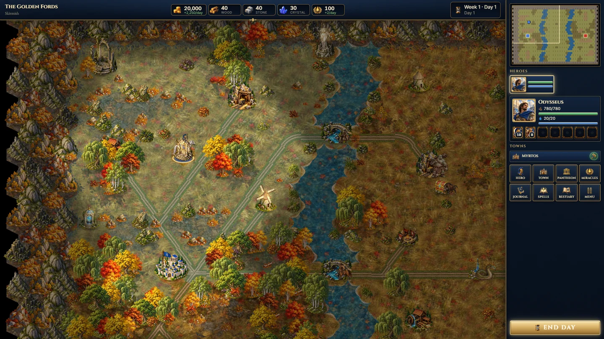
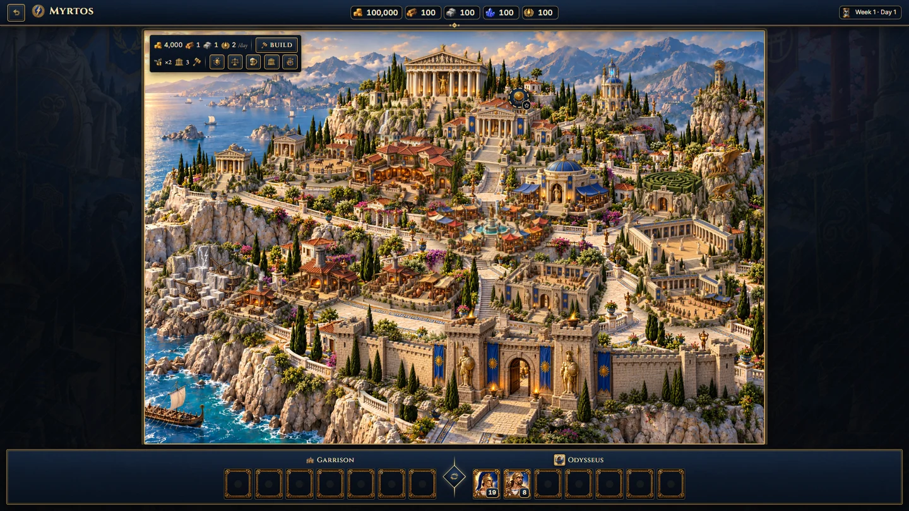
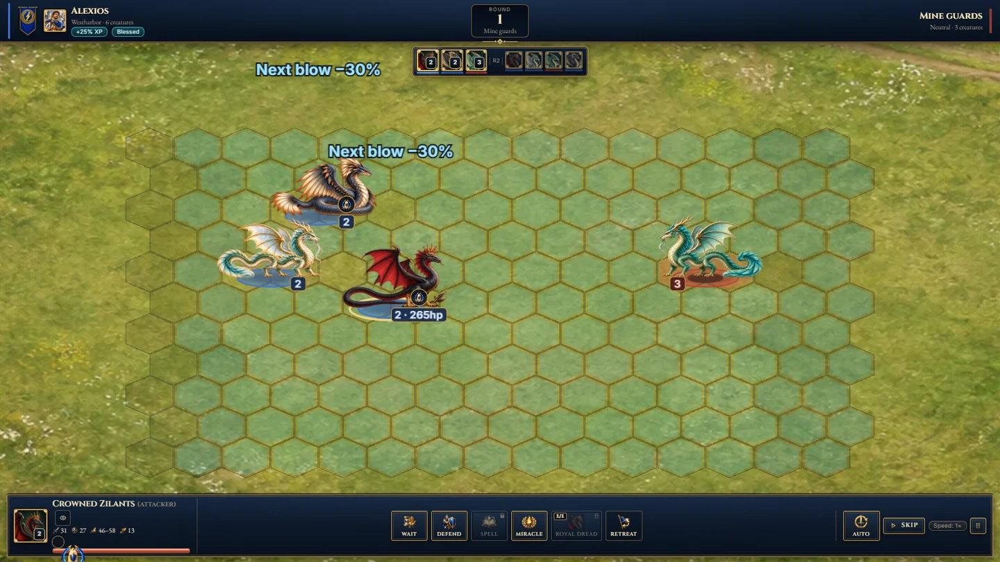
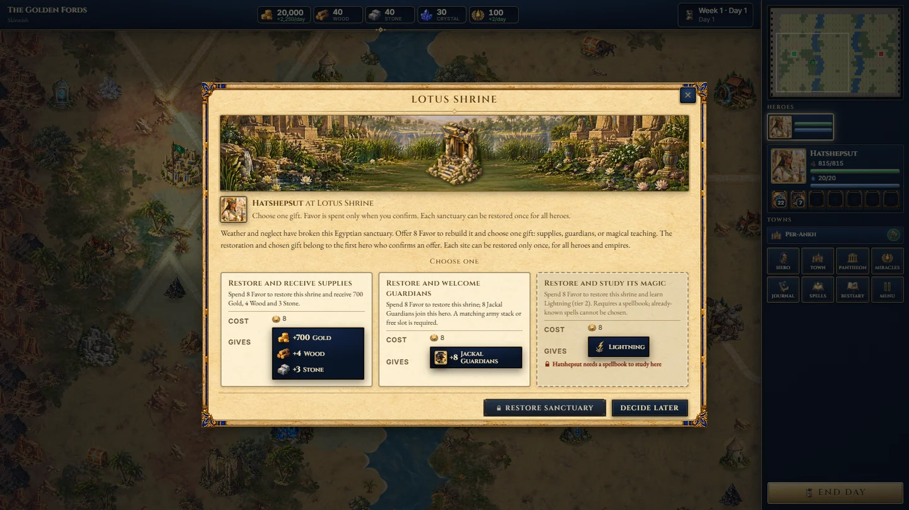
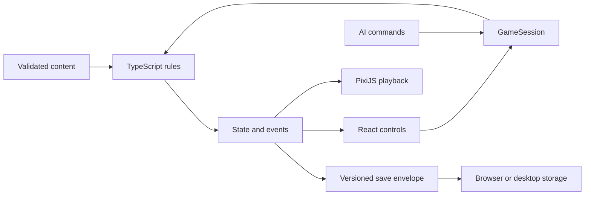

<p align="center"></p>

<h1 align="center">Six pantheons. One world. Your legend.</h1>

<p align="center">An offline, turn-based strategy game of exploration, city building and mythological warfare.<br>Built with TypeScript · React · PixiJS · Electron</p>

<p align="center">
<a href="https://drive.google.com/file/d/1BdPPimif77vCDrNtWFaPW5CY9SzySu6X/view?usp=sharing"><strong>Download for Windows</strong></a> ·
<a href="#develop-locally">Run from source</a> · <a href="#inside-the-code">Architecture</a> ·
<a href="CONTRIBUTING.md">Contribute</a> · <a href="https://github.com/teddy4445/pantheon_realms_website">Website repository</a>
</p>


> **Version 1.0.0 · Windows x64 · Offline play.** Current content: six playable pantheons, nine campaigns with 51 chapters, and 130 creature forms. Balance remains under active development; these are catalog counts, not a promise that every unit or spell is available in every mission. [Verified content snapshot](docs/development/content-snapshot.json).

## Choose your gods. Command legends.

Lead a hero beyond the safety of your town, gather resources and allies, restore forgotten sanctuaries, and turn a growing settlement into a capital. Recruit and upgrade creature stacks, develop your hero, choose divine patrons and fight tactical battles on a hex grid.

| Explore | Build | Command |
| :--- | :--- | :--- |
| Rich maps with forests, mountains, coastlines, animated resource sites and visitable landmarks. | Six distinct painted cities, each with four stages of development and individual building upgrades. | Land battles, town sieges and naval encounters with spells, divine interventions and animated creatures. |
| Find guarded treasures, sacred trees, ruins and neutral allies. | Restore small shrines and great temples with Favor for supplies, guardians or magical teaching. | Shape your army around faction troops and neutral creatures, including Yinglong, Cuélebre and Zilant dragons. |

**Greek · Norse · Egyptian · Japanese · Celtic · Mesoamerican**

Each pantheon has seven faction creature families with base and upgraded forms. The wider catalog includes neutral and naval creatures, for 65 families and 130 forms in total. An in-game encyclopedia helps you explore creatures and abilities.

### See it in the game

The images below are actual gameplay captures. The cover above is promotional artwork. Click a screenshot for the larger image; [image provenance](docs/images/provenance.json) records their sources.

<table>
<tr>
<td width="50%"><a href="docs/images/adventure.webp"></a><br><strong>A world worth exploring</strong><br>Animated sites, distinctive landmarks and varied scenery.</td>
<td width="50%"><a href="docs/images/city.webp"></a><br><strong>From village to capital</strong><br>Layered buildings and development backgrounds for all six pantheons.</td>
</tr>
<tr>
<td><a href="docs/images/dragons.webp"></a><br><strong>Legends on the battlefield</strong><br>Distinct dragon families, upgraded forms and painted combat effects.</td>
<td><a href="docs/images/temple.webp"></a><br><strong>Restore the sacred</strong><br>Spend Favor and choose one gift from a ruined sanctuary.</td>
</tr>
</table>

### Ways to play

- **Campaign chronicles:** nine campaigns, selectable difficulty, persistent progression and chapter replay. Objectives, journals, deadlines and enemy pressure vary by mission.
- **Random skirmishes:** maps for 2–6 empires, from small to huge, with AI opponents or local hot-seat players.
- **Single battles:** assemble armies and experiment with battlefield setups without starting a campaign.
- **Map editor:** author custom maps using the same logical map and site definitions as the game.
- **Offline desktop and browser builds:** both use the same rules engine. Local hot-seat does not require an online service.

<details>
<summary><strong>The campaign shelf — nine chronicles, 51 chapters</strong></summary>

| Chronicle | Chapters |
| :--- | ---: |
| The Three Beacons | 2 |
| When the Worlds Met | 7 |
| The Silent Oracle | 6 |
| The Winter Oath | 6 |
| The Twelfth Hour | 6 |
| The Lantern Road | 6 |
| The Silver Branch | 6 |
| The New Fire | 5 |
| The Ashes of the Accord | 7 |

Counts reflect the current playable catalog, rather than older outlines in the design archive.
</details>

### Latest additions

- **More expressive magic:** 42 additional attack spells and 12 additional attack miracles, with painted animation strips and effects designed around their individual themes.
- **Living maps:** gentle resource-site animation, varied shores, improved flags, 48 extra scenery pieces and town silhouettes that reflect development.
- **Restoration temples:** small and large sites for every pantheon, each with ruined and rebuilt artwork.
- **Mythological dragons:** three neutral families, each with an upgraded form, portraits and combat animations.
- **Performance work:** viewport culling, bounded image decoding and smaller packaged image derivatives. The latest Windows installer is approximately 850 MB. [Performance notes](docs/development/PERFORMANCE.md).

## Install and play

**[Download Pantheon Realms 1.0.0 for Windows x64](https://drive.google.com/file/d/1BdPPimif77vCDrNtWFaPW5CY9SzySu6X/view?usp=sharing)**

1. Open the Google Drive link and select **Download**.
2. Run `Pantheon-Realms-Setup-1.0.0-x64.exe` to install for your Windows user. Administrator privileges are not required.
3. Launch Pantheon Realms from the desktop or Start menu. Once installed, gameplay works offline.

The current installer is unsigned, so Windows may display an unknown-publisher warning. Saves and preferences live in `%APPDATA%\Pantheon Realms\` and remain there after uninstalling. Browser saves use browser storage and are separate from desktop saves.

<details>
<summary>Release file details</summary>

- Version: **1.0.0**
- Build date: **2026-10-23**
- File: `Pantheon-Realms-Setup-1.0.0-x64.exe`
- Size: **849,739,984 bytes** (approximately 850 MB / 810 MiB)
- SHA-256 of the locally verified release artifact:

```text
fecdf16052b35671fa324413e6205271c9956b1e742f62831f4f455c1f2c3ddc
```

Verify a downloaded copy in PowerShell:

```powershell
Get-FileHash -Algorithm SHA256 -LiteralPath .\Pantheon-Realms-Setup-1.0.0-x64.exe
```
</details>

## Develop locally

Use **Node.js 24** and npm (the release was built with Node 24). This is an npm-workspaces monorepo; run commands from its root. Runtime artwork and sound are bundled in `assets-runtime/`, so keep those files in your checkout. No API key or online backend is needed to build or play.

```bash
git clone https://github.com/teddy4445/pantheon_realms.git
cd pantheon_realms
npm ci
npm run dev
```

Open **http://localhost:5173**. If that port is occupied, stop the existing development server first; Vite intentionally uses a strict port.

| Command | Purpose |
| :--- | :--- |
| `npm run dev` | Start the browser development server. |
| `npm run build` | Build the renderer into `apps/client/dist/`. |
| `npm run preview` | Serve the production browser build locally. |
| `npm run desktop` | Build and launch Electron with the same renderer. |
| `npm run desktop:dist` | Build the Windows installer into `apps/desktop/release/`. Run on Windows for the supported packaging path. |
| `npm run check` | Check import boundaries, TypeScript and the unit test suite. |
| `npm test -- --maxWorkers=2` | Run unit tests with bounded parallelism. |
| `npm run test:e2e` | Run the default Playwright browser suite. |
| `npm run balance` | Produce headless AI balance measurements. |
| `npm run campaign-sim` | Exercise campaign progression with the simulator. |

Before browser tests, install the browser binary once:

```bash
npx playwright install chromium
```

Asset-authoring tools may also need Python and the dependencies described in [ASSET_PIPELINE.md](ASSET_PIPELINE.md). They are not required for an ordinary checkout/build using the supplied runtime assets. Additional focused Playwright configurations cover individual art packs and systems; see the [testing guide](docs/development/TESTING.md).

## Inside the code

**The rules decide; the interface presents.** A player action becomes a typed command. The engine validates it, commits an accepted change and emits events. React, PixiJS, audio and AI consume the resulting state through their respective boundaries.



| Directory | Responsibility | Guide |
| :--- | :--- | :--- |
| `packages/rules` | DOM-free state, commands, validation and gameplay systems | [Rules](packages/rules/README.md) |
| `packages/content` | Pantheons, creatures, magic, campaigns and catalog validation | [Content](packages/content/README.md) |
| `packages/mapgen` | Seeded maps, terrain, routes, sites and editor conversion | [Map generation](packages/mapgen/README.md) |
| `packages/campaign` | Mission setup, progression and hero carryover | [Campaigns](packages/campaign/README.md) |
| `packages/ai` | Legal observations, strategic and tactical planners | [AI](packages/ai/README.md) |
| `packages/session` | Authoritative session host, checkpoints and save envelopes | [Session](packages/session/README.md) |
| `packages/platform` | Storage/window contracts and browser/desktop adapters | [Platform](packages/platform/README.md) |
| `packages/presentation` | PixiJS scenes, sprite playback, scenery, effects and textures | [Presentation](packages/presentation/README.md) |
| `packages/audio` | Local audio loading, mixing, crossfades and voice limits | [Audio](packages/audio/README.md) |
| `packages/ui` | React screens, dialogs, preferences and asset lookup | [Interface](packages/ui/README.md) |
| `packages/testing` | Headless driver for integration scenarios | [Testing utilities](packages/testing/README.md) |
| `apps/client` | Vite entry for the web and desktop renderer | [Client](apps/client/README.md) |
| `apps/desktop` | Electron main/preload, validated IPC and installer packaging | [Desktop](apps/desktop/README.md) |

`assets-source/` holds authoring inputs and provenance; `assets-runtime/` contains files the game consumes. `tools/` contains importers, validators and measurement scripts. `tests/e2e/` exercises the assembled application. `docs/` includes current contributor guides alongside dated production and design archives.

### Why it is built this way

- **One simulation across platforms.** The DOM-free TypeScript core runs in browser, desktop and headless tests. A UI animation cannot decide damage or grant resources.
- **Serializable, deterministic state.** Stable IDs, explicit commands and saved random streams make failures reproducible and campaign saves inspectable. Cosmetic randomness stays separate from gameplay.
- **Content expressed as data.** Pantheons share rules rather than branching the engine by faction. New creatures and spells usually extend definitions and assets; genuinely new mechanics need a shared rule and tests.
- **A warm, painted 2D world.** Layered city art and sprite strips provide detail without a 3D pipeline. Particle overlays and interpolation add motion while keeping asset cost manageable.
- **Load heavy visuals when needed.** The menu uses a Pixi-free presentation entry point. One long-lived renderer hosts scene controllers, with cached terrain, viewport culling and bounded decode concurrency.
- **Offline by design.** Storage and desktop capabilities sit behind small adapters. Game logic does not depend on a server or Electron APIs.

Read the [architecture walkthrough](docs/development/ARCHITECTURE_WALKTHROUGH.md) for concrete code paths, or the [full architecture reference](ARCHITECTURE.md) for detailed contracts. The [source atlas](docs/development/SOURCE_INDEX.md) links every TypeScript source module and lists declared exports; package entry points remain the supported import surface.

## Make it your own

Start with the [contributor guide](CONTRIBUTING.md), then choose a focused change:

- Add a creature, spell, campaign encounter or site: [extending the game](docs/development/EXTENDING.md).
- Improve art or animations: [asset pipeline](ASSET_PIPELINE.md) and [performance guide](docs/development/PERFORMANCE.md).
- Reproduce a bug or verify a change: [testing guide](docs/development/TESTING.md).
- Work on the landing page: **[pantheon_realms_website](https://github.com/teddy4445/pantheon_realms_website)**, a separate, buildless website repository.

The historical [design proposals](DESIGN_PROPOSALS.md) and [implementation plan](IMPLEMENTATION_PLAN.md) explain earlier decisions; the validated catalog and running code are authoritative for current behavior. [Development status](DEVELOPMENT_STATUS.md) records dated work and limitations. Human balance testing and accessibility feedback are especially useful contributions.

## License and credits

Created by **Teddy Lazebnik**. Project code is released under the existing **[Apache License 2.0](LICENSE)**. See [asset credits and provenance](ASSET_CREDITS.md) for generated artwork, bundled fonts and recorded music/sound. Third-party assets retain their own terms; the code license does not replace those terms.

<p align="center"><br><em>Build a realm. Leave a legend.</em></p>
